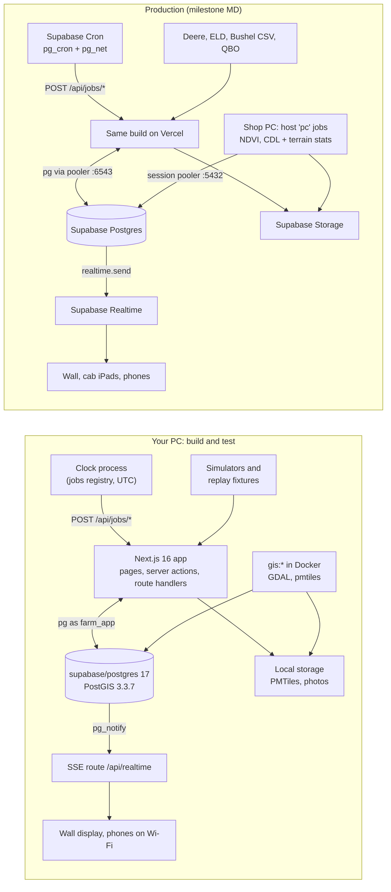

# Farm Ops Build Plan

Oct 28, 2026 · for Derrick Hopson · companion to farm-ops-software-spec.md

This plan builds what the spec describes: the integration layer, the war-room map and the other modules (spec: *Architecture*, *War-room map*, *Other modules*). It follows the spec's four phases and works in thin vertical slices, and every slice ends in a demo you run on your own PC. Until the app is solid, everything runs on your Windows PC with Docker Desktop:
- Next.js on Node
- Supabase's own open-source Postgres image in Docker
- a folder on disk instead of Supabase Storage
- a local clock process instead of scheduled functions
- **vendor API stand-ins**: a local server that answers like Deere, Samsara/Motive, QuickBooks and the NWS (same paths, sign-in, paging, webhooks and errors), driven by one simulated farm, so the real connector code runs against them (§5)
- recorded fixtures and file exports in place of Bushel, Traction and the drone software, which have no public API

**Who does what:** Claude writes and tests the code in cloud sessions and pushes it to a branch of this repo. You pull it onto the PC, run the slice's Friday demo, make the farm-side calls and decisions (§8), and say what to change.

You don't need a Vercel, Supabase or Tailscale account or any vendor credentials. Once the data caches are filled, you don't need the internet either. Every hosted service sits behind a small adapter with a local version and a production version, and the production limits (request size, time budget, pooler, UTC cron, CDN caching) are enforced on the PC from day one. Going live is therefore one planned two-week milestone (MD): config changes, four small adapters and a checklist, not a rewrite.

---

## 1. Local stack vs. production

| Dependency | On your PC | In production | How it swaps |
|---|---|---|---|
| **Hosting (Vercel)** | `next dev` while building. `pnpm pilot` (`next build && serwist build && next start` on the LAN) for the wall display and phones; `pnpm pilot:https` adds TLS for phones (§2) | Vercel **Pro**. Hobby is non-commercial only and limits cron to once a day. Node 24.x, function region next to the database, Skew Protection on | Config (env vars) |
| **Scheduled functions** | `tools/clock` (croner, `timezone: 'UTC'`) reads `src/jobs/registry.ts` and POSTs to `/api/jobs/<name>` with a bearer secret. `CLOCK=pgcron` rehearses the production path: pg_cron and pg_net inside the local container call `host.docker.internal:3000` | Supabase Cron (pg_cron + pg_net) POSTs to the same URLs. The SQL is generated from the same registry (`pnpm jobs:emit-cron`). Jobs marked `host: 'pc'` run on the shop PC instead (§5) | Config + generated SQL |
| **Postgres + PostGIS** | Docker `supabase/postgres:17.11.0.008`: Supabase's own build, amd64 and arm64, PostGIS 3.3.7, pg_cron, pg_net, pgmq, btree_gist, Vault. Bound to `127.0.0.1:15432` | Supabase Postgres 17. The app connects as the `farm_app` role through the transaction pooler (6543) with `pg` `Pool({max: DB_POOL_MAX})` plus `attachDatabasePool`. Migrations, loaders and backups use the **session pooler** (`aws-…pooler.supabase.com:5432`, IPv4 on every plan); the direct host is IPv6-only | Config (two URLs) + `pnpm db:parity` |
| **Migrations** | `drizzle-kit migrate` | Same command, same SQL files, run by a GitHub Action before promotion | None |
| **Auth (Supabase Auth)** | `LocalAuth`: a device or manager session in a signed httpOnly cookie (jose); `Secure` follows `PUBLIC_URL`, never `NODE_ENV`. On shared devices (wall, cab iPads) the operator picks their name and enters a PIN, checked against `farm.app_users.pin_hash` | Supabase Auth via `@supabase/ssr` in `proxy.ts` (`getClaims()`): one Auth user per device (enrolled once from an admin magic link, so the kiosk never types an OTP) and per manager (email OTP, custom SMTP). **The operator PIN layer is the same code in both** | Adapter (`AUTH_PROVIDER`); it returns only `{deviceId, appUserId, partyId, role}` |
| **Realtime (Supabase Realtime)** | `app.publish()` → `pg_notify` → one LISTEN connection → `/api/realtime` server-sent events, one EventSource per tab | `app.publish()` → `realtime.send()` → private Broadcast channels, with an RLS policy on `realtime.messages`. The browser gets its token through `getRealtimeAuth()` (`createBrowserClient` + `realtime.setAuth`) | The database side detects which one exists. The client adapter is chosen by `NEXT_PUBLIC_REALTIME`. Both carry a per-topic `seq` and an `onResync` refetch |
| **Storage (Supabase Storage)** | `.data/storage/<bucket>/<key>`, served by `/api/storage/...` with HTTP Range and HMAC-signed GET and PUT URLs | Buckets `tiles` (public, public-domain data only; PMTiles over Range) and `uploads` (private). Uploads use `createSignedUploadUrl` | Adapter + `pnpm storage:sync`. Uploads are always two-step (grant, then direct PUT), never through a function |
| **Basemap** | Protomaps PMTiles extract of SE Michigan plus its fonts and sprites, downloaded by bootstrap and served locally | Same files in the `tiles` bucket | Config: `BASEMAP_STYLE=protomaps-local` (default) or `openfreemap` (online, a different tile schema, so it's a second style with its own layer anchors, not just a URL) |
| **App vector layers** (fields, soils, parcels, pins, jobs) | `/api/tiles/[layer]/[z]/[x]/[y]?v=<version>` → `ST_AsMVT` | Same route. Public-data layers send `public, s-maxage=31536000, immutable`; private layers (fields, parcels with owner names, pins, jobs) send `private` and check the session | None. `gis.map_layers.cache_policy` decides |
| **Raster layers** (hillshade, slope, CDL, NAIP close-ups, NDVI) | PMTiles built on the PC with content-addressed names (`hillshade.<sha8>.pmtiles`) | Uploaded to `tiles`; the old object is deleted only after `gis.map_layers` points at the new one | Config + `storage:sync` |
| **Heavy GIS processing** | `pnpm gis:*` in Docker (GDAL, pmtiles) on the PC | Still on the PC; the outputs are pushed. **It never runs on Vercel.** Recurring PC work (NDVI, CDL and terrain stats for new boundaries) runs as `host: 'pc'` jobs on the shop PC, and the board marks it stale when the PC is off | None |
| **Notifications** (`notify`) | In-app banner over realtime, plus mail written to `.data/mail` and viewable at `/dev/mail` | SMTP (also Supabase Auth's custom SMTP) plus Web Push (VAPID) to installed PWAs; SMS optional (D20). Every alert gets an acknowledgement record | Adapter |
| **Secrets** | `.env` (database password and port, read by Docker Compose) and `.env.local` (everything else), validated by zod at boot | Vercel env vars; Supabase Vault for the cron secret | Config |
| **Deere, ELD, drones, Bushel, QuickBooks/Traction, bin cables, bids** | `CONNECTOR_<X>=sim` (default locally): the **live** client pointed at the vendor stand-in (`tools/vendor-sim`, `http://127.0.0.1:4010/<vendor>`). Also `replay` (recorded or doc-derived fixtures), `sandbox` where the vendor has one, or `off`. `WRITEBACK_<X>=off` | `live` or `off`. **With `APP_ENV=production`, `config.ts` refuses `sim` and `replay`.** Write-backs are turned on one connector at a time | Config (base URL + credentials) |
| **Vendor webhooks** | The stand-in POSTs vendor-shaped, vendor-signed webhook bodies (including Deere's verification event) to `localhost:3000/api/webhooks/<source>`. Real vendors can't reach localhost, so `sandbox` mode relies on polling | `/api/webhooks/<source>` on the production domain only (never a preview URL) | Config (register the URL) |
| **NWS, NOAA, USDA, USGS public data** | Live with no keys; raw downloads cached in `data/raw` | Same | None |

### Rules that keep the move bounded (enforced by lint, tests and review)

- Only `src/platform/**` may import `@supabase/*`, touch the filesystem for storage, or read auth-provider user ids. Biome's `noRestrictedImports` rule enforces this. Nothing under `src/jobs/**` may import `tools/gis/**`, `child_process` or anything GDAL-backed.
- The browser never talks to the database. Reads and writes go through server components, server actions and route handlers, using Drizzle. App tables live in schemas `farm`, `gis`, `ingest` and `app`, and Supabase's Data API exposes none of them. The app runs as the `farm_app` role in both places, so a missing grant fails on the PC.
- **The driver is `pg` (node-postgres). postgres.js is banned:** Supabase documents that its default pipelining can hang queries or return mismatched rows through the transaction pooler. Named prepared statements (`.prepare('name')`) are banned too. The pool and the LISTEN client are `globalThis` singletons so hot reloads don't leak connections. Jobs use their own small pool, so a sync never starves page requests.
- `proxy.ts` never runs on `/api/tiles`, `/api/jobs`, `/api/webhooks`, `/api/oauth` or `/api/realtime`. A contract test checks these never answer 3xx.
- **Production limits apply locally:**
  - Route handlers and `/api/storage` reject request bodies over 4 MB (Vercel's limit is 4.5 MB; server actions default to 1 MB).
  - A dev guard fails any non-streamed API response over 4 MB. Big data is chunked (track replay per machine-hour, exports paged) or streamed.
  - Offline outboxes post only to versioned route handlers (`/api/v1/...`), never to server actions, whose ids change on every deploy.
- These are deliberately not used:
  - PostgREST or supabase-js queries
  - Edge Functions
  - Postgres Changes and Database Webhooks
  - Vercel's Edge runtime, KV, Blob and Edge Config
  - long-lived workers such as pg-boss (Vercel can't host them)

  Nothing should stop `next start` from running the same build.
- Every scheduled job is an idempotent HTTP call:
  1. Check the secret.
  2. Claim a lease with one `UPDATE … RETURNING`.
  3. Return `202`.
  4. Do the work in Next's `after()` within a 45-second budget, then advance the cursor.

  pg_net's default `timeout_milliseconds` is 2000, and the early 202 sidesteps it; the cron SQL still sets 5000. Jobs keep no session state, so they work through the pooler.
- **Schedules are UTC.** Supabase runs pg_cron in UTC and croner is pinned to UTC. `every` accepts only `'1–59 seconds'` (pg_cron's only interval form); anything a minute or longer is a cron string. One validator serves the clock and `jobs:emit-cron`. Jobs tied to local time run hourly and check `America/Detroit` plus a once-per-local-day guard in `ingest.sync_state`.
- Heavy work (GIS loads, backfills) is CLI-only.
- All configuration goes through `src/config.ts`, which loads env files with `@next/env`'s `loadEnvConfig` so CLI tools see the same values as Next. Nothing else reads `process.env`. At runtime, nothing writes to local disk except through the storage adapter.
- `db:reset`, `db:seed` and `sim:*` refuse any `DATABASE_URL` that isn't localhost or the test host.
- **Realtime is batched.** Each sync run sends one `fleet.tick` message, not one per vehicle. Payloads stay under about 8 KB (the `pg_notify` limit); anything bigger sends `invalidate` and the clients refetch.
  - Supabase bills every delivery to every subscriber, and Pro includes 5M messages a month.
  - Batched: 2 ticks a minute × 10 screens × 14 h × 30 days ≈ 0.5M.
  - One message per vehicle with 20 vehicles would be about 10M.

  Broadcast doesn't replay missed messages, so clients refetch their snapshot on every (re)subscribe and whenever `seq` skips.
- Timestamps are stored as `timestamptz` in UTC and shown in `America/Detroit`.

### The seams, in code

```sql
-- one migration, correct in both places
create or replace function app.publish(p_topic text, p_event text, p_payload jsonb)
returns void language plpgsql as $$
declare v_seq bigint;
begin
  insert into app.topic_seq as t (topic, seq) values (p_topic, 1)
  on conflict (topic) do update set seq = t.seq + 1
  returning t.seq into v_seq;
  p_payload := p_payload || jsonb_build_object('seq', v_seq);
  if to_regprocedure('realtime.send(jsonb,text,text,boolean)') is not null then
    execute 'select realtime.send($1,$2,$3,true)' using p_payload, p_event, p_topic;  -- Supabase
  else
    perform pg_notify('app_events',
      json_build_object('topic',p_topic,'event',p_event,'payload',p_payload)::text); -- your PC
  end if;
end $$;
```

```ts
// src/jobs/registry.ts: one source for the local clock, the shop-PC worker and the Supabase Cron SQL.
// All cron strings are UTC. `every` must be '1-59 seconds'.
export const jobs = {
  'fleet.trucks':  { every: '30 seconds',   run: syncTruckPositions },   // 5 s in local demo mode
  'fleet.deere':   { cron: '*/2 * * * *',   run: syncDeereLocations },   // cadence set at 1f from the call budget
  'deere.ops':     { cron: '*/15 * * * *',  run: syncDeereOperations },
  'deere.fields':  { cron: '17 * * * *',    run: syncDeereFields },
  'weather.nws':   { cron: '*/30 * * * *',  run: syncNwsForecasts },
  'weather.mrms':  { cron: '25 * * * *',    run: syncMrmsRain },          // 2b
  'outbox.drain':  { cron: '* * * * *',     run: drainOutbox },           // 2b
  'gis.derived':   { cron: '40 8 * * *',    run: refreshDerivedStats, host: 'pc' },
  'gis.ndvi':      { cron: '10 11 * * 1',   run: syncNdvi,            host: 'pc' },  // 3c
} satisfies JobRegistry;
```

---

## 2. Setup on your Windows PC

Docker Desktop is already installed. Docker Desktop needs Windows 10 22H2 or Windows 11 with the WSL 2 backend.

### Prerequisites (one time)

| Item | What to do |
|---|---|
| Shell | PowerShell. Run `Set-ExecutionPolicy -Scope CurrentUser RemoteSigned` once (the default policy blocks `npm.ps1`/`pnpm.ps1`). Windows PowerShell 5.1 has no `&&`, so the commands below are one per line |
| Git + GitHub sign-in (private repo, D2) | `winget install Git.Git GitHub.cli`, then `gh auth login` |
| Node **24** (Maintenance LTS until Apr 2028; Vercel offers 22 and 24). Node 26 became LTS today, so a plain "LTS" install gets the wrong one | The Node 24 MSI (`node-v24.x.x-x64.msi`) from `nodejs.org/dist/latest-v24.x/` |
| pnpm 12 | `npm i -g pnpm@12`. pnpm then switches itself to the exact version pinned in `packageManager` |
| Docker Desktop | Already installed. Check *Settings → General → Use the WSL 2 based engine* is on and that Docker Desktop is running before `bootstrap` |
| Browsers | Chrome; `pnpm exec playwright install chromium` before e2e tests |
| Disk | About 15 GB, plus Docker's WSL disk image, which grows and doesn't shrink on its own. Full raw lidar for both counties adds about 18 GB |
| Where to clone | `C:\dev\farm-manager` (a Dev Drive is ideal). **Never under OneDrive** (Desktop and Documents are often synced), because synced folders lock `node_modules` and `.next` |

The repo pins Node with `.node-version` (24) and `engines.node: "24.x"`, and `engine-strict=true` in `.npmrc` makes a wrong Node fail at install.

### Commands

```powershell
# PowerShell, one command per line
git clone https://github.com/hopdad/farm-manager.git C:\dev\farm-manager
cd C:\dev\farm-manager
pnpm install
pnpm run bootstrap   # one time, safe to re-run (`setup` is a built-in pnpm command, so the script isn't named that)
pnpm dev             # app + clock + vendor stand-ins → http://localhost:3000/board
```

To get a new slice later: `git pull`, `pnpm install`, `pnpm run bootstrap` (it only does what's missing, including new migrations), `pnpm dev`.

`scripts/bootstrap.ts` is Node/tsx, not a shell script. Every child process is spawned as `process.execPath` plus the package's JS entry point. It never calls `.cmd` shims, which Node refuses to spawn without a shell on Windows. Docker is a real executable and is called directly. Bootstrap does the following:
1. **Checks** for:
   - Node 24; if it's wrong, bootstrap prints the exact install or link command for your OS.
   - Docker running (skipped with `--db=external` or `--no-docker`).
   - Ports 3000 and `DB_PORT` free, or held by this project's own container.
   - A repo folder that isn't under OneDrive.
2. **Writes env files.** `.env` holds `DB_PASSWORD` (32 hex characters) and `DB_PORT`; Docker Compose reads it automatically. `.env.local` holds app secrets, URLs and `DEV_ORIGINS`.
   - It never regenerates a secret that already exists.
   - It stops with a clear message if the database volume exists with a different password (fix it with `pnpm db:nuke`).
   - `DEV_ORIGINS` (passed to Next's `allowedDevOrigins`) lists every private IPv4 address plus `<hostname>.local`. Docker and WSL add virtual adapters, so bootstrap prints each candidate phone URL with its adapter name. `pnpm dev` warns if the addresses change.
3. **Starts the database:** `docker compose up -d db`, then waits on `pg_isready` with progress messages. The first boot runs Supabase's init scripts and takes 1–3 minutes.
4. **Migrates** `postgres` (the dev database, named as on hosted Supabase) and `farm_test_template` (cloned per test file). `db:configure local` creates pg_cron and pg_net in `postgres` only; pg_cron can live only in that database.
5. **Seeds** `demo`: about 40 fields, crew, 2 combines, 2 grain carts, a sprayer, a planter, 4 semis, a drone, 3 fictional elevators, sensitive sites and 5 seasons of synthetic history.
6. **Fetches the basemap:**
   - Resolves the newest daily build from the Protomaps builds listing. Daily builds are kept one week; if the newest can't be reached, it uses the latest patch-version build, which is kept indefinitely.
   - Runs `pmtiles extract https://build.protomaps.com/<build>.pmtiles … --bbox=-84.45,41.65,-83.10,42.15 --maxzoom=15` in `protomaps/go-pmtiles:v1.31.2`.
   - Downloads the fonts and sprites the pinned `@protomaps/basemaps` style uses (from a pinned commit of protomaps/basemaps-assets) into `.data/storage/tiles/assets/`.
   - **If any of this fails, bootstrap exits non-zero** ("offline basemap missing, run `pnpm gis:basemap`") instead of silently going online.
7. **Prints** the URLs, demo PINs, a phone check (`http://<pc-ip>:3000/api/health`) and the firewall step below.

```yaml
# docker-compose.yml: the whole local infrastructure
services:
  db:
    image: supabase/postgres:17.11.0.008          # re-pin to the hosted project's version at MD
    ports: ["127.0.0.1:${DB_PORT:-15432}:5432"]   # loopback only; below Windows' reserved port ranges, clear of the Supabase CLI's 5432x ports
    environment: { POSTGRES_PASSWORD: "${DB_PASSWORD:?run pnpm run bootstrap first}" }
    extra_hosts: ["host.docker.internal:host-gateway"]   # pg_net → Next on the host (CLOCK=pgcron)
    volumes: ["pgdata:/var/lib/postgresql/data"]         # named volume avoids Windows bind-mount problems
    healthcheck: { test: ["CMD", "pg_isready", "-U", "postgres", "-h", "localhost"], interval: 3s, timeout: 5s, retries: 30, start_period: 180s }
volumes: { pgdata: {}, gis_work: {} }
# compose.prodlike.yml (perf tests only): cpus: 2, mem_limit: 1g, sized to the Supabase compute you pick at MD
```

The image's default command loads Supabase's own `postgresql.conf`, which preloads pg_cron and pg_net, so no command override is needed. The image accepts connections from any address, which is why the port is published on loopback only.

### Daily commands

| Command | Does |
|---|---|
| `pnpm dev` | `tools/dev.ts`: the vendor stand-ins (`tools/vendor-sim` on `127.0.0.1:4010`), `next dev -H 0.0.0.0`, then the clock once `/api/health` answers. `pnpm dev --scenario=spray-windy --speed=30` runs a farm day in about 30 minutes; `--no-clock` starts the app alone |
| `pnpm clock` | The clock on its own. A pause/resume toggle also sits on `/admin/connectors` |
| `pnpm pilot` / `pilot:https` | Production build + clock for the wall display and phones on shop Wi-Fi. `pilot:https` puts a small Node TLS proxy (`tools/https`, mkcert certificate) in front of `next start` |
| `pnpm db:reset` | Drops schemas `farm`, `gis`, `ingest`, `app` and `drizzle`, then migrates and seeds demo. It never drops the `postgres` database, whose Supabase init objects can't be rebuilt by the `postgres` role. Run `pnpm data:export` first once real data exists |
| `pnpm db:nuke` | `docker compose down -v` + up: a truly clean start that re-runs the image's init |
| `pnpm test` / `test:db` / `test:e2e` | §7 |
| `pnpm db:down` | Stop the container; data stays in the named volume |

- **Phones:** open `http://<pc-ip>:3000/m` on the same Wi-Fi.
  - **Windows:** set the shop Wi-Fi profile to *Private* and allow Node.js on private networks when prompted. Or, once as admin: `New-NetFirewallRule -DisplayName 'farm-ops dev' -Direction Inbound -Protocol TCP -LocalPort 3000,3443 -Profile Private -Action Allow`.
- **HTTPS for phones (from slice 2c; service workers and GPS need it).** Default is mkcert (D12), which needs no account:
  1. `winget install FiloSottile.mkcert`, then `mkcert -install`.
  2. `mkcert <pc-ip> <pc-name>.local localhost`.
  3. Install `rootCA.pem` on the test phones. On iOS, also turn it on under Settings → General → About → Certificate Trust Settings.

  The HTTPS host is added to `experimental.serverActions.allowedOrigins`. Tailscale Serve is an alternative, but it needs a Tailscale account.
- **Wall kiosk:** use a separate profile so the flags aren't swallowed by a Chrome that's already running: `& "C:\Program Files\Google\Chrome\Application\chrome.exe" --kiosk --user-data-dir=$env:LOCALAPPDATA\farm-kiosk http://localhost:3000/board`.

  The full kiosk flags and runbook are in 1g.
- **Windows hygiene:**
  - `.gitattributes` sets `* text=auto eol=lf`.
  - Scripts don't use inline `FOO=bar` env assignments.
  - GIS work files live in the `gis_work` Docker volume, not on an NTFS bind mount (slow through WSL). Only final PMTiles and CSVs are copied to `.data`.
- **Fallback if the M0 spike fails:**
  1. Use `imresamu/postgis:17-3.5-alpine3.23`, a current multi-arch community image.
  2. Run `pnpm db:parity-init` (the `extensions` schema, `search_path`, and the `anon`, `authenticated`, `service_role` and `farm_app` roles).
  3. Make `pnpm db:lint` reject PostGIS functions newer than 3.3.

  That image has no pg_cron or pg_net, so `CLOCK=pgcron` is unavailable and the croner clock is the only option.
- **No Docker at all:** install Postgres 17 + PostGIS natively (EDB installer + Stack Builder), then run `pnpm run bootstrap --db=external --no-docker` and `pnpm db:parity-init`.
  - `--no-docker` downloads the go-pmtiles release binary into `.tools/`.
  - The raster GIS steps then need native GDAL.
  - pg_cron doesn't support native Windows, so `CLOCK=pgcron` is unavailable there too.

---

## 3. Architecture and repo layout

Same shape as the spec's diagram (*Architecture*): one database keyed on fields, machines and jobs, with every screen reading from it. Only the hosting around it changes.



### Stack choices (versions checked on npm and Docker Hub on Oct 28, 2026; pin exact versions at scaffold time)

| Area | Choice | Note |
|---|---|---|
| Runtime | Node 24.22.x (Maintenance LTS), pnpm 12.x pinned in `packageManager` | Vercel lists Node 24.x (default) and 22.x, and pnpm 6–12. Allow build scripts only for the packages that need them (`allowBuilds` in `pnpm-workspace.yaml`, e.g. esbuild); pnpm 12 fails installs on unreviewed ones. Move to Node 26 once Vercel lists it |
| Framework | next 16.4.x, react 19.x | Turbopack is the default. `proxy.ts` replaces middleware and always runs on Node |
| Language | TypeScript 6.0.x | 7.0 (the native compiler) is out; adopt it once Next documents support |
| Map | maplibre-gl 6.16, deck.gl + @deck.gl/maplibre 9.4.1 (`MapLibreOverlay`, interleaved), react-map-gl 8.1 (`react-map-gl/maplibre`), pmtiles 4.5, @protomaps/basemaps 5.7 | MapLibre 6 is ESM-only and needs WebGL2. Set the worker with `setWorkerUrl(new URL('maplibre-gl/dist/maplibre-gl-worker.mjs', import.meta.url).toString())` in a client component. deck.gl's peer range covers MapLibre 4.5.1 through 6. Use one interleaved overlay per map. Fonts via `next/font/local` only |
| DB access | drizzle-orm 0.45.4 + drizzle-kit 0.31.11 on pg 8.23 | Drizzle's built-in `geometry` type covers points only; polygons use a `customType`. Skip Drizzle 1.0 while it's still a release candidate |
| IDs | uuid (v5) | Rows from outside sources get deterministic ids from `source:source_id` (§4) |
| UI state and data | zod 4, @tanstack/react-query 5, zustand 5, @dnd-kit/core 6.3 | |
| Auth | jose 6 locally. @supabase/ssr 0.12 + supabase-js 2 are **added at MD only** | No Auth.js or Better Auth: production auth is Supabase Auth, so the local stand-in only issues a cookie |
| Clock | croner 10.x (`timezone: 'UTC'`) | 11.0 shipped two days ago; wait for it to settle |
| Geometry | @turf/turf 7.4 (simulated passes), geotiff (CDL pixel counts, MRMS rasters) | geotiff is pure JS, so raster reads that must run on Vercel use it, never GDAL |
| PWA (from 2c) | @serwist/next 9.5 in configurator mode + `@serwist/cli`, `serwist`, `esbuild` | Configurator mode builds the service worker after `next build` (`build` = `next build && serwist build`), which also works with Turbopack |
| Vercel helper | @vercel/functions 3.10 (`attachDatabasePool`) | Harmless locally |
| Quality | Biome 2.6, Vitest 5.0 (needs Node ≥22.12), Playwright 1.64, tsx 4.23 | `tools/dev.ts` replaces concurrently |
| GIS containers | `ghcr.io/osgeo/gdal:ubuntu-small-3.13.3`, `protomaps/go-pmtiles:v1.31.2` | Both publish amd64 and arm64 |
| Supabase CLI | `supabase` 2.122, **added as a dev dependency at MD Week 1** | Its postinstall downloads a binary, so it needs `allowBuilds`. Nothing before MD uses it |

### Repo layout: one Next.js package, not a monorepo

```
farm-ops/
  src/
    app/
      board/                       war room (4K, touch-first, kiosk)
      m/                           phone and cab-iPad views
      fields/[id]/  login/  dev/mail/
      admin/connectors/            sync health: mode, last OK, errors, call counts, clock pause
      api/health/
      api/jobs/[name]/             scheduled work (both environments)
      api/realtime/                SSE (local adapter; 404 in production)
      api/tiles/[layer]/[z]/[x]/[y]/      ST_AsMVT
      api/storage/[bucket]/[...key]/      local storage (Range, signed GET/PUT)
      api/v1/                      stable endpoints for offline outboxes (pins, job status)
      api/webhooks/[source]/  api/oauth/[source]/
    proxy.ts                       session refresh (Next 16); excludes the api routes above
    config.ts                      zod-validated env; the only process.env reader
    platform/                      auth/ realtime/ storage/ mail/ notify/, each {local, supabase}; the only @supabase importer
    db/                            Drizzle schema, client, geo helpers, queries
    domain/                        pure TS: go/no-go, acres, geofence visits, load counts, invoices, costs, job state machine
    connectors/<source>/           port.ts live.ts replay.ts mapper.ts schemas.ts fixtures/{recorded,doc-derived}/ (sim mode = live.ts against the stand-in)
    sim/                           deterministic world + scenarios; sim/vendors/<vendor>/ = the stand-in's routes for that vendor
    jobs/                          registry.ts + one file per job
    ui/                            map/ board/ panels/ touch/
  db/migrations/                   drizzle-kit SQL (generated + custom), identical for both targets
  db/supabase/                     production-only SQL: realtime.messages policies, cron schedules (MD)
  tools/dev.ts  tools/clock/  tools/vendor-sim/  tools/https/  tools/gis/  tools/seed/
  e2e/                             Playwright specs + touch helpers
  docs/adr/  docs/runbooks/
  data/seed/                       committed, small, synthetic or public-domain
  data/aoi.geojson                 area of interest (committed only as the demo AOI; yours stays local)
  data/raw/        (gitignored)    immutable downloads + manifest.json
  .data/           (gitignored)    local buckets, mail, GIS outputs
```

Real farm data (boundaries, landlords, customers) lives only in the database and gitignored folders. It is never committed.

### Scripts

| Script | Does |
|---|---|
| `bootstrap [--db=external] [--no-docker] [--dry-run]`, `dev`, `clock`, `pilot`, `pilot:https` | §2 |
| `db:up` / `db:down` / `db:reset` / `db:nuke` / `db:studio` | Container control, Drizzle Studio |
| `db:generate` / `db:migrate` | drizzle-kit. `db:migrate` uses `DATABASE_URL_MIGRATE` |
| `db:seed <set>` / `seed:build` | Load a seed set / regenerate the committed seed |
| `db:lint` | Migrates a brand-new non-`postgres` database twice (the second run must be a no-op) and checks for PostGIS functions newer than 3.3 |
| `db:parity <a> <b>` / `db:parity-init` | Compare Postgres and extension versions between two URLs / prepare a non-Supabase Postgres (fallbacks in §2) |
| `db:configure <local\|prod>` | `app.settings` and the `farm_app` login role (password set here, never in migrations). Locally it also creates pg_cron and pg_net in `postgres`. For prod it also applies the realtime policies, Vault secrets and cron jobs |
| `import:boundaries <file>` / `import:seasons <csv>` / `import:tile <file>` / `gis:parcels <file>` | Ops Center shapefile or GeoJSON, crop-year history, tile as-builts, parcel files |
| `deere:backfill --seasons=2022-2026` | Pulls past operations by crop season and derives `field_seasons` rows. **Deferred (D22):** built after MD, before M4's season flip-through; until then a placeholder that says so |
| `gis:basemap\|soils\|csb\|cdl\|dem\|naip\|ndvi`, `gis:refresh-derived`, `gis:device-pack`, `ingest:all [--offline] [--target]`, `gis:pack` | Public data (§5) |
| `connectors:record <source>` | Saves scrubbed live responses as replay fixtures |
| `jobs:emit-cron` | Registry → `db/supabase/cron.sql` (skips `host: 'pc'` jobs) |
| `data:export` / `data:import [--target]` | App-level JSON export and upsert of hand-entered data (rows from the sim or demo seed are skipped) |
| `storage:sync --to=<fs\|supabase>` | Copies buckets between adapters (resumable uploads; never overwrites a `tiles` key) |
| `sim:scenario <name> --speed N --assert` | Runs a whole scenario headless |
| `gate:phase3` | Phase 3 gate check (3d) |
| `lint`, `typecheck`, `test`, `test:db`, `test:e2e`, `test:live`, `dq` | §7 |
| `e2e:prod-smoke`, `backup:prod` | From MD on |

---

## 4. Data model

**Conventions**
- Primary keys are uuid. Times are `timestamptz`; money and acres are `numeric`.
- Geometry is stored in **EPSG:4326**. Metric work (passes, buffers, terrain) uses **EPSG:3078** (Michigan GeoRef) or `::geography`, because Lenawee straddles UTM zones 16 and 17. Every geometry column has a GiST index.
- Anything that comes from outside carries `source` + `source_id`, unique together, so syncs are idempotent upserts. **Its primary key is a deterministic uuid v5 of `source:source_id`**, so a re-sync (on a reset PC or in production) recreates the same ids, and hand-entered rows that point at them survive `data:export`/`data:import`. Rows with `source` of `demo` or `sim` are never exported.
- The migration creates `farm_app`, a NOLOGIN group role (idempotent, since roles are cluster-wide). It has USAGE on the four app schemas, SELECT/INSERT/UPDATE/DELETE on their tables (with default privileges), and EXECUTE on `app.*`.

### Core tables (Phases 1–2)

| Table | Key columns | Geometry | Arrives |
|---|---|---|---|
| `farm.parties` | kind (person/org), org_id → parties, display_name, roles[] (owner, crew, landlord, customer, elevator, vendor, neighbor), phone, email, address, introduced_by, notes, source | none | M0 |
| `farm.app_users` | party_id, role (owner, manager, operator, driver, viewer), **`auth_user_id uuid unique null`** (linked at first verified sign-in in production, so no primary key changes), pin_hash, failed_pins, locked_until (both environments), active | none | 1a |
| `farm.devices` | kind (wall, cab_ipad, truck_ipad, phone), name, auth_user_id unique null (production device login), last_seen_at | none | 1a |
| `farm.farms` | name, client_party_id (null = yours), deere_farm_id | none | M0 |
| `farm.fields` | farm_id, name, county_fips, tenure (owned, cash_rent, share, custom), landlord_party_id, deere_field_id, active, notes | none (identity only) | M0 |
| `farm.field_boundaries` | field_id, acres (trigger: `ST_Area(geom::geography)/4046.86`), valid tstzrange, source, source_ref, derived_stale; `EXCLUDE USING gist (field_id WITH =, valid WITH &&)`. Boundaries with source `deere` are read-only in the app | MultiPolygon | M0 |
| `farm.field_lineage` | parent_field_id, child_field_id, effective_on, kind (split, merge), so 5-season history survives boundary edits | none | 1c |
| `farm.field_seasons` | field_id, crop_year, crop, variety, planted_on, harvested_on, yield_bu_ac, source (demo, import, deere); unique (field_id, crop_year) | none | 1a |
| `farm.machines` | kind (combine, tractor, sprayer, planter, grain_cart, semi, trailer, drone, pickup), unit_no, make, model, year, vin_serial, status (active, down, retired), down_reason, engine_hours, odometer_mi | none | M0 |
| `farm.machine_state` | machine_id PK, ts, speed_mph, heading, activity (working, transport, idle, queued), current_field_id, fuel_pct, position_source (eld, deere_working, cab_device, manual) | Point | M0 |
| `farm.positions` | machine_id, ts, speed_mph, heading, engine_on, source; PK (machine_id, ts); BRIN on ts; raw rows kept 90 days (D9) | Point | M0 |
| `farm.machine_hours` / `farm.machine_faults` | machine_id, ts, engine_hours, odometer_mi, source / machine_id, code, severity, description, first_seen_at, cleared_at, source | none | 1f |
| `farm.tracks_daily` | machine_id, local_date, miles, engine_hours; kept forever, feeds replay | LineStringM (M = epoch seconds) | 1g |
| `farm.geofences` / `farm.geofence_visits` | kind (elevator, field_entrance, shop, bin_site, fuel), party_id / machine_id, geofence_id, entered_at, exited_at | Polygon | 1a |
| `farm.tile_lines` | field_id, size_in, depth_ft, installed_on, source (installer drawing, Deere tile plow log, manual) | MultiLineString | 1d |
| `farm.weather_forecasts` | grid_id, **issued_at**, valid_at, temp_f, dewpoint_f, wind_mph, gust_mph, wind_dir, pop_pct, qpf_in, sky_pct, mixing_height_ft | none | 1b |
| `farm.weather_observations` | station_id, observed_at, wind_mph, gust_mph, wind_dir, temp_f, rh_pct | Point | 1b |
| `farm.soil_temp_readings` | field_id null, depth_in, temp_f, observed_at, source (manual, station, probe), entered_by | Point | 1b |
| `farm.spray_assessments` | field_id, for_hour, verdict (go, caution, no_go), reasons, inputs, rules_version, forecast_issued_at (an audit trail for every call) | none | 1b |
| `farm.operations` | kind, field_id, crop_year, started_at, ended_at, area_reported_ac, area_clipped_ac, products jsonb, machine_ids, operator_party_id, weather jsonb (observed, with its source), status (provisional, final), source, source_id, source_org | MultiPolygon (coverage, simplified) | 1f |
| `farm.products` | kind (seed, chemical, fertilizer, fuel), name, epa_reg_no, restricted_use, unit, label_rules jsonb | none | 2a |
| `farm.jobs` | kind (plant, spray, harvest, haul, tillage, fertilize, scout, tile, repair, other), business_line (grain, spraying, trucking, store), customer_party_id, field_id, status (requested, planned, assigned, pushed, in_progress, done, invoiced, cancelled), window tstzrange, planned_acres (defaults to boundary acres), planned_qty, planned_unit (loads, bu, hours), priority, sort_key, version, deere_work_plan_id | none | 2a |
| `farm.job_assignments` / `farm.job_products` | job_id, party_id, machine_id, role, planned_for / product_id, rate, unit, supplied_by (us, customer) | none | 2a |
| `farm.data_rights_agreements` | party_id, signed_on, document_key, permitted_uses[] (billing, agronomy, prospecting, landlord_sharing) | none | 2a |
| `farm.job_operations` | job_id, operation_id, acres_attributed (links billing to actuals) | none | 2b |
| `farm.field_rain` | field_id, period_end, hours, qpe_in, source, product_version; unique (field_id, period_end, hours) | none | 2b |
| `farm.sensitive_sites` / `farm.site_checks` | kind (organic, apiary, residence, school, water), name, buffer_ft, contact_party_id, source (drawn, csv, registry) / field_id, crop_year, checked_on, registry (FieldWatch, BeeCheck), checked_by | Geometry / none | 2b |
| `farm.pins` | kind (wet_hole, rock, tile_blowout, washout, hazard, note), field_id, note, photo_keys[], created_by, resolved_at, client_id (offline dedupe), source (app, deere_flag), read_only | Geometry | 1f (Deere flags), 2c |
| `app.usage_events` | app_user_id, device_id, route, at (for the Phase 2 gate report) | none | 2a |

**Phase 3 (M3):**
- `rate_cards` with a unit (acre, bu, load, mile, hour, flat).
- `product_prices` (product, crop_year, unit_cost, source), `cost_rates` (machine hourly, labor hourly), and `job_costs` (job_id, kind, qty, rate, amount, source).
- `invoices` and `invoice_lines`. Each line snapshots its inputs: operation ids, ticket or load ids, the quantity rule and the rate version. An invoice becomes **immutable once approved** (enforced by trigger).
- `application_records`: one per final application operation, insert-only, with deletes blocked by a trigger.
- `credentials`: applicator certificate and categories, CDL, DOT medical, Part 107/137/44807, each with expires_on.
- `vehicle_inspections` (annual inspections, DVIRs) and `hos_logs` (driver party_id, status, started_at, ended_at, source).
- `contracts`, `tickets`, `cash_bids`, `crop_plans` (breakeven).
- `bins` and `bin_ledger`. A bin's position is the sum of its ledger, never a stored balance.
- `bin_readings`, `loads`, `service_plans`, `service_events`, `time_entries`, `alerts` (with acknowledgements).

**Phase 4 (M4):** `leases`, `lease_fields`, `lease_payments` (due_on, amount, paid_on), `touches`, `ledger_entries` (business_line × field × machine × job), `inventory_txns`, `drone_flights`.

### Reference data and sync plumbing

| Table | Key columns |
|---|---|
| `gis.soil_mapunits` / `gis.soil_polygons` | mukey, musym, muname, drainage_class, hydgrp, farmland_class, nccpi / mukey, areasymbol (MI091, MI115), geom |
| `gis.field_soils` | boundary_id, mukey, acres, pct. Rebuilt in SQL whenever a boundary version changes, so it runs anywhere |
| `gis.csb_polygons` | csb_id, crop_seq jsonb, release, geom (land scouting + demo fields) |
| `gis.field_cdl` / `gis.parcel_cdl` | boundary_id or parcel_id, year, crop_code, crop_name, pct |
| `gis.parcels` / `gis.parcel_imports` | county_fips, parcel_no, owner_name, owner_mailing, acres, import_id, geom / source, received_on, license_note |
| `gis.terrain_stats` | boundary_id or parcel_id, min_ft, max_ft, slope_p50, slope_p90, depression_ac |
| `gis.map_layers` | key, kind (pmtiles, mvt, xyz), url_or_key, version, cache_policy (public, private), minzoom, maxzoom, attribution, legend, source_vintage, built_at, default_visible |
| `gis.field_ndvi` | field_id, scene_date, scene_id, mean, p10, p90, valid_pct (M3) |
| `ingest.external_refs` | source, kind, external_id, source_org → entity_id; unique. Sim and live sources, and the same field seen from two orgs, map onto one row |
| `ingest.sync_state` | source, stream, mode, cursor jsonb, lease_until, next_run_at, last_ok_at, last_error, extra jsonb (webhook subscription ids, once-per-day guards) |
| `ingest.job_runs` | job, host, started_at, finished_at, ok, items, error |
| `ingest.raw_events` | source, stream, external_id, payload jsonb, sha256, fetched_at, status (pending, processed, dead), attempts, processed_at; unique (source, stream, external_id, sha256). Serves as the webhook inbox and raw landing; 90-day retention except billing inputs |
| `ingest.oauth_tokens` | source, org_external_id, ciphertext (AES-256-GCM, key in env), expires_at, refresh_expires_at, scopes |
| `ingest.outbox` (M2) | kind (deere.work_plan, accounting.invoice), entity_id, payload, idempotency_key unique, status, attempts, next_attempt_at, response, external_id |
| `app.settings` / `app.topic_seq` | key, value / topic, seq |

**Key SQL objects (same in both environments):**
- `app.publish` (§1).
- `app.mvt(layer, z, x, y)` using `ST_TileEnvelope` + `ST_AsMVT` (both available in PostGIS 3.3).
- `app.claim_due(lease_seconds)`, a single `UPDATE … RETURNING`.
- The current-boundary view.
- Publish triggers on jobs, assignments and pins. Fleet updates are published in batches by the job, not by triggers.

### Keeping migrations identical on your PC and on Supabase

1. drizzle-kit writes plain SQL to `db/migrations`. Custom migrations (`drizzle-kit generate --custom`) hold the schemas, roles, functions, triggers, EXCLUDE constraints, GiST/BRIN indexes and MVT functions. One folder and one command serve both targets.
2. Migration 1 starts with `create schema if not exists extensions;`. The image's init scripts create that schema only in the `postgres` database, so `farm_test` would lack it; on Supabase the statement is a no-op. Then `create extension if not exists postgis with schema extensions;`, and the same for `btree_gist`. Never install extensions into `public`. **pg_cron and pg_net are never in migrations:** `db:configure` creates them in `postgres` only.
3. Use only functions that exist in PostGIS 3.3. Running the same image locally makes this automatic, and `db:lint` guards any fallback setup.
4. Migrations run as `postgres` locally, as they do on hosted Supabase. That role is NOSUPERUSER there (the M0 spike confirms it locally), and Supabase's supautils lets it create postgis and btree_gist. No superuser-only statements.
5. Supabase-only objects live in `db/supabase/` and `pnpm db:configure prod`, never in migrations: `realtime.messages` policies, `cron.schedule`, Vault secrets and buckets.
6. Expand, then contract: never drop or rename a column in the same release that stops using it.
7. On every push, CI applies all migrations from zero to the pinned image, twice, in a brand-new non-`postgres` database.

---

## 5. Connectors, simulator and public data

### Common shape

```ts
type Mode = 'sim' | 'replay' | 'sandbox' | 'live' | 'off';  // sim = the live client against the local vendor stand-in
interface PositionSource     { poll(cursor: string | null): Promise<{ items: NormalizedPosition[]; cursor: string }> }
interface VehicleStatsSource { statsSince(cursor: string | null): Promise<{ items: NormalizedVehicleStat[]; cursor: string }> }  // hours, odometer, fuel, faults
interface FieldSource        { listFields(): Promise<NormalizedField[]> }
interface FlagSource         { flagsSince(cursor: string | null): Promise<{ items: NormalizedFlag[]; cursor: string }> }
interface OperationSource    { operationsSince(cursor: string | null): Promise<{ items: NormalizedOperation[]; cursor: string }> }
interface WorkPlanSink       { push(job: JobWithAssignments): Promise<{ externalId: string }> }   // M2
interface ForecastSource     { hourly(grid: GridRef): Promise<HourlyForecast[]>; observations(grid: GridRef, since: Date): Promise<Observation[]> }
interface SoilTempSource     { latest(near: LngLat): Promise<SoilTempReading | null> }           // manual first (1b)
interface TicketSource       { ticketsSince(cursor: string | null): Promise<{ items: NormalizedTicket[]; cursor: string }> }
interface BidSource          { bidsFor(date: string): Promise<NormalizedBid[]> }                  // manual / CSV first (3b)
interface BinSensorSource    { readingsSince(cursor: string | null): Promise<{ items: NormalizedBinReading[]; cursor: string }> }
interface HosSource          { logsSince(cursor: string | null): Promise<{ items: NormalizedHosLog[]; cursor: string }> }  // 3d
interface InvoiceSink        { push(inv: InvoiceWithLines): Promise<{ externalId: string }> }    // M3
```

- **One sync step for every source:**
  1. Claim the lease.
  2. `poll(cursor)`.
  3. In one transaction, land the raw payloads in `ingest.raw_events` and advance the cursor.
  4. Process pending raw events one at a time. Map each with a pure function, upsert it through `external_refs` with deterministic ids, and mark it processed. A failure counts an attempt, and after five attempts the event goes to `dead` and shows on `/admin/connectors`.

  A crash at any point re-runs safely, and one huge payload can't stall the cursor. The simulator emits full-size payloads (a full-day sprayer log), and tests assert each item maps in under 10 s on the `prodlike` database.
- **Webhooks only nudge.** The handler does four things:
  1. Answers the verification handshake.
  2. Inserts into `raw_events`.
  3. Sets `sync_state.next_run_at = now()`.
  4. Returns 200.

  It never processes the event inline.
- **Sim mode runs the live client against the vendor stand-in** (below). The HTTP client, OAuth refresh, paging, retries and the mapper are all the code under test even in sim mode, and the same zod schemas validate stand-in and real responses. Going live changes a base URL and credentials, not code.
- **`replay`** re-runs fixtures offline. These are either recorded live responses (`pnpm connectors:record`, secrets scrubbed) or **doc-derived fixtures** hand-written from the vendors' public API references (1a), so replay works before any vendor account exists.
- **Write-backs** go through `ingest.outbox` and are gated by `WRITEBACK_<SOURCE>=off` by default. The PC can never push to your real Deere org or your real books.
- **OAuth tokens** are refreshed inside a transaction holding `pg_advisory_xact_lock(hashtext(source || org))`. It re-reads the row after taking the lock and refreshes only if the token is still near expiry. QuickBooks rotates refresh tokens, and two refreshers would invalidate them. After MD the PC uses separate dev apps, sandbox or replay, and never production tokens.
- **Contract tests:** one suite per interface runs against `sim` (the stand-in, started in-process on a random port) and `replay` in CI. It runs against `sandbox` or `live` only by hand (`pnpm test:live`).

### Per source

| Source | Simulator | Live path | Blocker | Cadence | Until live |
|---|---|---|---|---|---|
| **Deere Operations Center** | Combines, sprayers and planters run back-and-forth passes at implement width (turf, EPSG:3078), clipped to the boundary. Deere positions exist only during working passes (like the real feed). A finished field emits an operation with coverage, acres and products. The sim emits flags, accepts Work Plans and walks them through their statuses | OAuth2, then each org (yours and each customer's) approves the connection through Deere Connections. Start in sandbox, which Deere describes as calling the real production data of connected orgs. Build machine data on the Equipment API. **Deere's docs describe breadcrumb positions as recorded only while equipment is working**, so transport and idle positions come from the ELD or a cab device's GPS, and Deere-only machines show "last working position". Flags come in read-only as pins. Webhook subscriptions start with a `subscriptionVerification` event. Take endpoint paths from developer.deere.com at build time; none are hard-coded here | App registration and API grants. **Production approval is the Phase 1 gate**, and it may need a public HTTPS app (Week 0) | Locations: set at 1f from a call budget (machines × polls a day vs Deere's limits). Operations every 15 min, plus webhooks in production. Fields hourly | Doc-derived fixtures → replay; Ops Center boundary shapefile export → `import:boundaries` |
| **Trucks: Samsara or Motive** (D3) | Semis drive the 1-mile section-line road grid between field entrances and elevator geofences, queue, unload and return, emitting GPS, engine hours, fuel and faults | Samsara: cursor feeds `/fleet/vehicles/locations/feed` and `/fleet/vehicles/stats/feed` (engine hours, fuel, faults); HOS logs in 3d. Motive: vehicle locations API plus webhooks (paths to confirm). **Geofence arrivals are computed in PostGIS from positions**, so switching vendors doesn't touch that logic | Vendor pick and ELD install (Phase 1 gate). API access may need a particular plan | 30 s | sim; doc-derived fixtures |
| **Drones (Hylio)** | A flight path plus as-applied polygon, gallons and acres per simulated flight | File import (CSV, KML, shapefile, GeoJSON) until Hylio's export format is known. No telemetry API is confirmed, so the board shows a manual status (at shop, at field X, down) until D18 | Aircraft decision (D18) | After each flight | Manual status; manual application entry (3a) |
| **Bushel** (tickets, contracts) | One ticket per simulated elevator visit (net bu, moisture, test weight, dock) | No public farmer API found; Bushel works with partners. Plan on CSV import from the farmer app or portal, plus manual entry | Elevator cooperation | On delivery | CSV / manual |
| **Cash bids** | Daily bid curve per elevator | Manual entry and CSV first; a live feed (elevator bid pages, a Bushel partner feed, or a licensed DTN/Barchart feed) is decision D15 | Decision | Daily | Manual |
| **QuickBooks Online / Traction Ag** (D14) | The sink logs invoices | QBO Accounting API, starting in Intuit's free sandbox company. Traction: no public API found, so CSV export | Your choice | On invoice | CSV |
| **Bin cables** | Daily temperature cycle with a scripted hot spot | Vendor-specific | Hardware choice | 5–15 min | sim / manual |
| **NWS forecast + observations** | Scenario fixtures (windy morning, dawn inversion, overnight rain) for CI and offline use | `api.weather.gov/points/{lat},{lon}`, then follow `forecastGridData`. Observations: `/gridpoints/{wfo}/{x},{y}/stations`, then `/stations/{id}/observations`. **A User-Agent header is required.** Cache per 2.5 km grid cell (most fields share a few) | None | 30 min | sim |
| **NOAA MRMS** (rain last night) | Fixture raster | **Primary (runs on Vercel):** the NOAA `obs/mrms_qpe` ImageServer's 24-hour layer, `exportImage` as GeoTIFF over your area (about 150 × 60 px at 1 km), decoded with `geotiff`, mean per field. Confirm its operations in 2b. **Fallback:** the public `noaa-mrms-pds` bucket, `CONUS/MultiSensor_QPE_24H_Pass2_00.00/YYYYMMDD/MRMS_MultiSensor_QPE_24H_Pass2_00.00_YYYYMMDD-HHMMSS.grib2.gz` (hourly, about 1 h latency; GDAL via `/vsigzip/`), as a `host: 'pc'` job | None | Hourly; morning mode shows the 24 h ending at the latest hour | none |
| **Soil temperature** | Seasonal curve | Manual probe readings from a phone first (1b), then the D5 source (2b) | Decision | Hourly | Manual |

### Simulator (`src/sim`)
- **Deterministic.** World state is a function of (scenario, seed, sim time, Work Plans the stand-in has received). Nothing ticks in the background: a feed request returns samples from its cursor up to sim-now, so tests can jump or freeze time (`SIM_FROZEN_AT`, or the stand-in's control API).
- **World.** About 40 fields around Adrian, Blissfield, Deerfield, Petersburg and Dundee:
  - In M0 they're generated as quarter- and half-quarter-section rectangles on the 1-mile grid, with no download.
  - In 1e they're replaced with real Crop Sequence Boundaries shapes.

  The world also has fictional customers, landlords, elevators, sensitive sites and parcels, plus the shop, bins and crew. A second simulated customer org shares some fields, to test field matching.
- **Scenarios:** `harvest-day`, `winter-idle`, `planting-day`, `spray-windy`, `breakdown`, `bad-morning` (vendor faults and a 6 a.m. outage).
- **Closed loop (M2):** the outbox POSTs a Work Plan to the stand-in's Deere work-plan endpoint, the simulated machine runs it, and the operation comes back through the normal pull and links to its job.

### Vendor API stand-ins (`tools/vendor-sim`)

One small Node server (port 4010, loopback only, started by `pnpm dev`) answers like each vendor, under a path prefix per vendor (`/deere`, `/samsara`, `/motive`, `/qbo`, `/nws`). Every response is computed from the shared simulated farm above, so the map, billing and grain screens agree with each other. It runs as a Node process rather than a Docker container because it shares `src/sim` with the tests and needs no image rebuilds.

| Behaviour | What the stand-in does |
|---|---|
| Paths and shapes | The vendor's documented paths, query parameters, paging (Samsara `after`/`endCursor` feeds, Deere `nextPage` links, QBO `startposition`) and JSON shapes, validated by the same zod schemas as real responses. Paths that aren't confirmed from the vendor's docs are marked `// doc-derived, confirm` and listed on `/admin/connectors` |
| Sign-in | OAuth 2 authorization-code flow with a "Sign in to Deere (simulated)" consent page, token endpoint, short-lived access tokens and **rotating** refresh tokens (QBO-style), so the app's locked refresh path is exercised every few minutes. Samsara/Motive use bearer API tokens |
| Webhooks | Vendor-shaped, vendor-signed POSTs to `localhost:3000/api/webhooks/<source>`, including Deere's `subscriptionVerification` event |
| Write-backs | Accepts Work Plans and QBO invoices, stores them in `.data/vendor-sim/state.json`, and feeds them back into the world (the planned job gets run; the invoice gets a payment) |
| Files instead of APIs | Bushel ticket CSV, Traction CSV and drone flight-log exports are generated as downloads from the same world, for the file importers |
| Fault injection | Control API `/_control/faults` (and per-scenario schedules): added latency, timeouts, 429 with `Retry-After`, 500s, expired or revoked tokens, duplicate and out-of-order pages, replayed or reordered webhooks, and a full outage window ("internet down at 6 a.m."). The `breakdown` and `bad-morning` scenarios turn these on |
| Control | `/_control/clock` (pause, resume, speed, jump), `/_control/scenario`, `/_control/reset`; `/admin/connectors` drives these. Rejects anything not from loopback |
| Keeping it honest | When a real sandbox or account exists, `pnpm connectors:record` captures real responses and a conformance test replays the same requests against the stand-in and diffs the shapes. A mismatch fails the test until the stand-in is fixed |

### Public data: keyless, loaded once, cached for offline use

**Area of interest (AOI):** owned, rented, customer and prospect ground plus a 1-mile buffer, kept in `data/aoi.geojson`. Loaders that download by area (3DEP, NAIP close-ups) use it. County-wide loads (soils, CDL, parcels) don't.

| Layer (spec) | Source | Loader | Lands in | Slice |
|---|---|---|---|---|
| Basemap | Protomaps daily build, `pmtiles extract --bbox`, plus pinned fonts and sprites (§2 step 6) | bootstrap / `gis:basemap` | `tiles/basemap.<sha8>.pmtiles` + `tiles/assets/` | M0 |
| Soils (SSURGO) | NRCS Soil Data Access `POST https://SDMDataAccess.sc.egov.usda.gov/Tabular/post.rest` (SQL), chunked by areasymbol (MI091, MI115) and mukey batches. Queries have row and size limits, and an empty reply can mean you hit one. **NCCPI comes from SDA's `cointerp`** (the NCCPI v3 rule; confirm the exact rule name), aggregated by component percent. Fallback: Web Soil Survey county download + `ogr2ogr` | `gis:soils` | `gis.soil_*`, `gis.field_soils`, soils MVT | 1c |
| Elevation, slope, flow (3DEP) | USGS 3DEP 1 m via TNMAccess. **Lenawee project `MI_31Co_Lenawee_2017` (47 tiles, ~12.3 GB) mixes UTM 16 and UTM 17 tiles**; Monroe `MI_31Co_Monroe_2016` (23 tiles, ~5.9 GB) is all UTM 17. Download only tiles touching the AOI; parcels outside it get stats after `pnpm gis:dem --add <parcel>` | `gis:dem`: **`gdalwarp -t_srs EPSG:3078` on every tile first**, then `gdalbuildvrt` → `gdaldem hillshade`/`slope` + contours. For display: warp to EPSG:3857 → `gdal_translate -of MBTILES` → `gdaladdo` → `pmtiles convert`. Depressions and flow paths with WhiteboxTools; if it has no build for your OS or architecture, use GRASS `r.watershed` in a container | Raster PMTiles; `gis.terrain_stats` | 1e |
| Crop history (CDL) | CropScape `GetCDLFile?year=YYYY&fips=26091` (and 26115) for 2008 through the latest year. It returns a URL to a county GeoTIFF. CropScape has had uptime and certificate problems, so cache everything | `gis:cdl`: transform boundaries to EPSG:5070 and count 30 m pixels | `gis.field_cdl`, `gis.parcel_cdl`, CDL PMTiles | 1e |
| Field shapes with 8-year rotations | NASS Crop Sequence Boundaries (public domain; national geodatabase, format and size to confirm) | `gis:csb` | `gis.csb_polygons`; real demo shapes | 1e |
| Aerial photos (NAIP) | Online: USGS `USGSImageryOnly` tiles. Close-ups: `imagery.nationalmap.gov/arcgis/rest/services/USGSNAIPImagery/ImageServer/exportImage` (0.6 m mosaic) for the AOI; `USGSNAIPImageryIndex/MapServer` gives tile footprints and the latest Michigan year. Avoid the AWS NAIP buckets, which are requester-pays | `gis:naip` | Online layer + AOI PMTiles | 1d |
| Parcels and owners | Lenawee County GIS says it maintains a countywide parcel layer. Monroe is unconfirmed. Vendors: ReportAll, Regrid, Landrecords (D7). A synthetic parcel fixture covers the demo area until a real file arrives | `gis:parcels <file>` (shapefile, GeoPackage, GeoJSON or ArcGIS FeatureServer paging) | `gis.parcels` + private MVT | 1d |
| Tile as-builts | Installer drawings (scan and trace) and Deere tile plow logs | `import:tile <file>` + draw tool | `farm.tile_lines` | 1d |
| Rain and forecast | NWS, MRMS (above) | jobs | `farm.weather_forecasts`, `farm.weather_observations`, `farm.field_rain` | 1b / 2b |
| Crop health (Sentinel-2) | Earth Search STAC `https://earth-search.aws.element84.com/v1`, collection `sentinel-2-c1-l2a` (anonymous COGs). Read the assets **`red` (B04), `nir` (B08) and `scl`** (cloud mask) per field; check the keys against the collection's `item_assets` | `gis:ndvi` as the weekly `host: 'pc'` job in season | `gis.field_ndvi` + NDVI overlays | 3c |

**Offline rules**
- Every download goes to `data/raw/<source>/<date>/`, with an entry in `data/raw/manifest.json` (URL, date, sha256, bytes, licence note).
- Loaders are idempotent. `pnpm ingest:all --offline` must rebuild every derived table from raw data alone, with matching checksums, and a test checks this.
- `pnpm gis:pack` zips the cache to move it to the shop PC.
- At MD, the same command runs with `--target=prod` to load Supabase.
- **Derived stats for new boundaries:** a new boundary version gets `field_soils` immediately (SQL), and is flagged `derived_stale` for CDL and terrain stats. The `gis.derived` job (`host: 'pc'`) computes those. Until it does, the panel shows parcel-level stats marked "pending".

---

## 6. Milestones

**Pace:** Claude writes the code, so the dates below are targets that can move earlier. What sets the pace is your time to pull each slice, run its demo on the PC, and answer the decisions in §8. Plan on about 2–4 h a week of your time for that, more around the farm-side tasks (Ops Center clients, county calls, vendor quotes). The ≈ hours column is build effort, kept for sizing. If M1 slips, cut in this order: flow paths, the CSB demo swap, the replay slider.

Every slice ends with a **Friday demo you run on your PC** and green CI.

| Milestone | Dates | ≈ Hours | Spec phase / gate |
|---|---|---|---|
| Week 0: start the slow clocks | Oct 29 – Nov 6 (alongside M0) | 4 | Lead time for the Phase 1 gate |
| **M0 Foundation** | Oct 29 – Nov 15 | 30 | none |
| **M1 See it** | Nov 16 – Feb 14, then the rest of 1g Mar 15 – Mar 21 (holiday buffer Dec 21 – Jan 3) | 250 | Phase 1; gate checked in 1g (Mar 21), before any production use |
| **M2 Plan it** | 2a and 2b Feb 15 – Mar 14, 2c Mar 22 – Apr 4 | 140 | Phase 2 |
| **MD Deploy-ready** | Apr 5 – Apr 18, burn-in to May 2 | 50 | Ends the PC-only period |
| Planting and spraying support | Apr 19 – Jun 6 | fixes only | **Phase 2 gate:** crew uses the board every day |
| **M3 Bill it** | Jun 7 – Sep 5 | 170 | Phase 3 |
| Harvest support | Sep 6 – Nov 2027 | freeze | **Phase 3 gate:** one clean season of job and cost data (`pnpm gate:phase3`) |
| **M4 Decide with it** | Dec 2027 – Mar 2028 | 300 | Phase 4 |

**Build order from 1f on (D22, Oct 31, 2026: the war board moves up).** M1 and M2 interleave; the dates below replace the slice dates in their headings where they differ:
1. **1f** live connectors + sync health, with **1f.2** (every telematics vendor at once): Feb 1 – Feb 14.
2. **2a** job board + drag-to-assign (drag a job onto a field, then onto a person or machine): Feb 15 – Feb 28.
3. **2b** Work Plan loop, morning meeting mode, go/no-go v1: Mar 1 – Mar 14.
4. **The rest of 1g:** kiosk hardening; empty, stale and error states; performance at 50 machines and 500 fields; the replay slider; raw-GPS retention; the Phase 1 gate check: Mar 15 – Mar 21.
5. **2c** pins + cab devices: Mar 22 – Apr 4.
6. **MD** deploy-ready → production: Apr 5 – Apr 18 (unchanged).

The gates stay where they were in substance: Work Plans push to the Deere simulator or sandbox only until Deere grants Work Plans for production (`WRITEBACK_DEERE` stays off), and the Phase 1 gate is still checked (in 1g) and is an MD entry item before anything is used for real. 2a and 2b don't need it; they run on sim and sandbox, as they would have anyway.

**Deferred, not dropped: the Deere season backfill** (`deere:backfill`, your 2022-2026 seasons read from Operations Center). It moves out of 1f and sits **after MD and before M4**, whose season flip-through (4c) needs past seasons. Until then seasons come from `import:seasons` and the demo seed; the season rule (decision 1f-1) and the `pnpm deere:backfill` placeholder stay. Detail: `docs/contracts-1f.md` §13.

### Week 0: start the slow clocks (calls and forms, not code)
- [ ] **Deere:**
  - Read developer.deere.com/precision/get-started first. Note the sandbox time limit (search snippets say six months; one summary says 18) and when its clock starts. If it's six months from registration, register in early January instead of now, and send your questions through Deere's developer support meanwhile.
  - Register a developer app. Request Operations Center, Equipment, Flags and Work Plans access, plus webhooks.
  - Ask Deere:
    - whether `http://localhost` redirect URIs are allowed;
    - whether your own org can connect in sandbox;
    - what call limits apply;
    - **what production approval requires**: a public HTTPS redirect URI, website, privacy policy and terms, a demo, and whether a single-farm internal app qualifies.

    If a public callback or domain is required, settle the domain part of D13 now and stand up a stable HTTPS callback (a static page on the domain) by January.
- [ ] Get Samsara and Motive quotes, and ask whether API access is included. **Decide by Nov 15 (D3)** so installs land in January.
- [ ] Call Lenawee and Monroe county equalization/GIS about parcel layers with owner names, and get one vendor price (D7).
- [ ] Ask your elevators what Bushel exports you can get. Ask Hylio for a sample flight-log export.
- [x] PC: Windows with Docker Desktop already installed (D1).

### M0 Foundation: walking skeleton (Oct 29 – Nov 15) · gate: none
**Goal:** a moving war-room map on your PC, with every seam in place.
- [x] **Day-1 spike: passed** in the cloud build machine on Oct 28 (Linux, Docker 29). `bootstrap` re-runs the same checks on your PC as `pnpm db:check`. Bring up `supabase/postgres:17.11.0.008` (password from `.env`, port on loopback), then confirm:
  - As `postgres` in `postgres`: `create extension postgis with schema extensions`, `btree_gist`, `pg_cron` and `pg_net` all work.
  - As `postgres`, in a new database it created (`farm_test_template`): `create schema extensions` + postgis + btree_gist work. supautils lists them as privileged extensions.
  - `realtime.send` is absent.
  - `postgres` is NOSUPERUSER CREATEDB CREATEROLE BYPASSRLS, and `search_path` is `"$user",public,extensions`.

  Result: all four hold; PostGIS is 3.3.7 with GEOS 3.14 and PROJ 9.7; EPSG 3078, 5070 and 3857 are present. Recorded in `docs/adr/0001-db-image.md`. If `db:check` fails on the PC, use the fallback in §2.
- [x] **Scaffold:** Next 16 + TypeScript, Biome seam rules, Vitest, Playwright, `.gitattributes`, `.node-version`, `config.ts` (loads env with `@next/env`), `bootstrap.ts`, `tools/dev.ts`.
- [x] **GitHub Actions:**
  - Linux runs lint, typecheck, unit tests and DB tests against the pinned image on every push, plus e2e on PRs.
  - Windows runs lint, typecheck, unit tests and `bootstrap --dry-run` on `main` and nightly only. Private repos get 2,000 free minutes a month, and Windows minutes count double.
- [x] **Migration 1:**
  - The `extensions` schema, extensions, the app schemas and the `farm_app` role.
  - `app.publish`, `app.topic_seq`, `app.claim_due`.
  - parties, farms, fields, `field_boundaries` (EXCLUDE + acreage trigger), machines, machine_state, positions, and the `ingest` plumbing.

  The local app connects as a `farm_app` login role.
- [x] Demo seed: grid-generated fields, fictional parties, fleet and elevators, 5 seasons of synthetic history.
- [x] Sim v0 (combines in passes, carts, semis on section roads to elevators) and **vendor stand-in v0**: the Samsara-shaped vehicle locations feed (bearer token, cursor paging) and the Deere-shaped OAuth flow and machine locations, with the fault-injection and clock control APIs. The `fleet.*` jobs run in sim mode through the live clients. The clock, with the shared schedule validator. `/api/jobs/[name]` (lease, then 202, then `after()`), outside the proxy matcher.
- [x] **Realtime:**
  - The SSE route sends `text/event-stream`, `Cache-Control: no-cache, no-transform` and `X-Accel-Buffering: no`, with a 15 s heartbeat.
  - One shared EventSource per tab; the client adapter has `seq` and `onResync`.
  - A batched `fleet.tick`.
- [x] Map shell: `WarRoomMap` (react-map-gl + `MapLibreOverlay` interleaved), local PMTiles basemap with local fonts and sprites, field fills from `/api/tiles/fields`, and a fleet `IconLayer` that glides between ticks. Routes: `/board` (touch pan, pinch and rotate) and `/m`.

**Done when:**
1. On your PC, follow §2 (`pnpm install`, `pnpm run bootstrap`, `pnpm dev`) and open `/board`.
2. The offline basemap with labels and about 40 demo fields around Adrian and Blissfield appear, with 2 combines, 2 carts and 4 semis moving in `harvest-day`.
3. Pause the simulation on `/admin/connectors` and they freeze; resume it and they move again. Turn on the stand-in's "trucks API down" fault and the trucks go stale with a badge on the board; turn it off and they catch up.
4. A phone on the same Wi-Fi at `http://<pc-ip>:3000/m` shows the same trucks within 2 s, under both `pnpm dev` and `pnpm pilot`.
5. Unplug the router's internet (WAN) cable while the PC and phone stay on the LAN (on the phone, keep Wi-Fi and turn off mobile data), and everything keeps running.
6. CI is green.

### M1 Phase 1, "See it" (Nov 16 – Feb 14; the rest of 1g Mar 15 – Mar 21, after 2b: D22) · gate: Phase 1 gate checked in 1g; nothing in M1 waits on it
**Goal:** the spec's Phase 1 on your PC with your real fields, read-only. Deere and trucks are live once their gates open; until then they run in sim or replay.

**1a Tap a field, fleet panel, sign-in (Nov 16 – Nov 29)**
- [x] field_seasons, geofences (elevators, shop, field entrances), app_users, devices. Geofence enter/exit detection inside the positions job.
- [x] Tap a field to see the boundary, acres, owner or landlord, 5 seasons, open jobs (placeholder) and notes. Phones get a bottom sheet; the wall gets 72 px targets.
- [x] Fleet panel: moving, idle, down, stale (more than 10 min old), with a position-source badge. Mark a machine down, with a reason, from a phone.
- [x] `LocalAuth`: device and manager sessions, plus operator PIN on shared devices with lockout. Roles. Kiosk device session (D8). `pnpm pilot` + kiosk instructions.
- [x] Doc-derived replay fixtures for Deere (fields, boundaries, operations with coverage, machine locations, flags) and the ELD from the public API references, validated by the same zod schemas.

*Done when:*
- On a touchscreen laptop or TV, tapping a field opens the panel in under 200 ms.
- Marking a combine "down" on your phone updates the wall within 2 s, in `pnpm pilot` too (sign-in works over `http://<lan-ip>`).
- `CONNECTOR_DEERE=replay` runs on the doc-derived fixtures.

*As built (Oct 29, 2026; `e2e/m1-demo.spec.ts`, `e2e/field-panel.spec.ts`, `e2e/fleet-panel*.spec.ts`, `e2e/auth.spec.ts`):* a field tap opens its panel in about 40-70 ms on the composed board (software WebGL); a phone signed in over `http://<lan-ip>` under `pnpm pilot` marks a combine down and the wall follows in about 0.1 s; replay runs on Deere and Samsara fixtures written from the vendors' published OpenAPI documents (developer.deere.com itself was unreachable from the build machine), and CI runs the fleet specs in replay mode. Deviations: marking machines down and logging soil temperatures need **driver** (the contract's `ROLE_FOR`), not operator; Motive has no replay fixtures until D3; geofence visits break after a 30-minute gap. Defaults: `docs/decisions.md`.

**1b Weather strip + spray go/no-go v0 (Nov 30 – Dec 13)**
- [x] `weather.nws` job: per-field grid lookup (cached), hourly forecast stored with `issued_at`, nearby station observations, sim fallback.
- [x] Strip: today and 3-day rain, wind, gusts and temperature, plus soil temperature from manual probe readings entered on a phone (shown with their age) until D5 is built in 2b.
- [x] Go/no-go v0, pulled forward from Phase 2 because it uses the same data. Inputs: sustained wind, gusts, rain-free hours, and an inversion heuristic (low wind and clear sky near dawn or dusk). Thresholds come from D4. It's marked advisory, and the reasons are stored.

*Done when:* the strip shows real NWS data for your gridpoints. With `CONNECTOR_WEATHER=sim` and the internet unplugged it still renders, and moving the sim's wind slider flips field colors with reasons.

*As built:* the sim and offline parts are automated (`e2e/weather.spec.ts`, `e2e/m1-demo.spec.ts`). **Real NWS data is still to be seen on your PC:** api.weather.gov answered 403 at the build machine's proxy, so the live client follows the NWS OpenAPI document and its unconfirmed points are listed on `/admin/connectors`; README "Live weather" switches it on. The thresholds are the D4 defaults, marked advisory. Field colours use the current hour; the inversion check uses the real sun.

**1c Your real fields, people, history and soils (Dec 14 – Dec 20)**
- [x] `import:boundaries` (Ops Center shapefile export or GeoJSON) creates boundary versions. **Boundaries for Deere fields are read-only in Phase 1** (Operations Center stays the system of record, D6). An attempted edit becomes a "change this in Ops Center" note. Drawing, editing, splitting and merging (with lineage) are allowed only for fields with no `deere_field_id` (prospects, customers not in Ops Center).
- [x] `import:seasons <csv>` with a template (field, crop_year, crop, variety, planted_on, harvested_on, yield_bu_ac) from your records or crop-insurance APH, so real fields show 5 seasons before Deere is connected.
- [x] Landlords, customers and crew through admin forms and CSV import.
- [x] `gis:soils`: county-wide load, then a per-boundary clip. Soils layer. Field soils tab: series, drainage and percentage, plus weighted NCCPI.
- [x] `data:export` / `data:import`, built now because real data starts now.

*Done when:*
- Your own fields replace the demo.
- Tapping one shows its real soils, landlord and 5 seasons of crop and yield.
- `data:export` → `db:reset` → re-sync from replay → `data:import` round-trips your data unchanged, including references to synced rows.

*As built:* `e2e/m1-demo.spec.ts` imports a test farm with the two CLIs and taps a field (soils, landlord, 5 seasons); the round trip is a DB test (`tools/import/data-transfer.db.test.ts`) and was run by hand on the dev database (identical exports). A row whose person isn't in the target database (a test sign-in) comes back without that link instead of failing the import. **Real SSURGO is still to be loaded on your PC** (Soil Data Access was unreachable here): `pnpm gis:soils`; until then a clearly labelled synthetic soils layer covers the demo farm. Not built: `--target=prod` (MD), and **the Web Soil Survey + ogr2ogr fallback, a 1c item still open** (it matters if Soil Data Access also fails on your PC: then the board keeps the synthetic soils layer until it is built). `--hide-demo` switches every demo field off (the shared demo farm is not per-farm).

*Holiday buffer, Dec 21 – Jan 3:* catch up and fix.

**1d Imagery, parcels, tile maps, layer rail (Jan 4 – Jan 17)**
- [x] Storage adapter (Range, signed GET/PUT, 4 MB body limit, no overwrites in `tiles`) and the `gis.map_layers` registry with legends, versions and cache policy.
- [x] NAIP online layer plus AOI close-up PMTiles. Parcels import (D7) and private MVT with owner names. `tile_lines` import and draw tool.
- [x] Layer toggles down one side: soils, elevation and drainage, imagery, tile maps, parcels, live fleet, custom-work customers.

*Done when:* with the internet unplugged, the basemap, fields, soils, parcels (Lenawee if received, otherwise the synthetic fixture), tile lines, AOI imagery and simulated fleet all still work. Online-only imagery shows "offline".

*As built:* automated with every non-local host blocked (`e2e/m1-demo.spec.ts`, `e2e/layers.spec.ts`, `e2e/imagery.spec.ts`), except **AOI imagery**, which needs one `pnpm gis:naip` on your PC (imagery.nationalmap.gov was unreachable here; the pipeline was exercised end to end on a synthetic tile with `--fixture`). Parcel owner names reach managers and the owner only, in the tiles and the Parcels tab. The Michigan NAIP year is unconfirmed (`--vintage`).

**1e Lidar and crop history (Jan 18 – Jan 31)**
- [ ] `gis:dem` with the warp-first step, over the AOI. Hillshade, slope and contours. Depressions and flow paths: WhiteboxTools, falling back to GRASS `r.watershed`. If both fight you, flow paths move to 4b prospect scoring and the reason goes in an ADR.
- [ ] `gis:cdl` (2008 through latest) and `gis:csb`. Rotation tab for fields and parcels. Terrain stats. The `gis.derived` refresh for stale boundaries.
- [ ] Swap the demo fields to CSB shapes. Commit pre-clipped soils and CDL for them, so a fresh bootstrap shows real-looking layers without any GIS steps.

*Done when:*
- Hillshade toggles over a known wet field.
- Tapping any field or parcel inside the AOI shows its crop history back to 2008 and its slope stats.
- `ingest:all --offline` rebuilds identical checksums.

**1f Live connectors + sync health (Feb 1 – Feb 14)**
- [x] **Deere (sandbox, if registered):**
  - OAuth plus the Connections redirect, and encrypted tokens with locked refresh.
  - Fields and boundaries, operations with coverage, machine locations and hours, flags (read-only into pins).
  - `connectors:record` and contract tests.
  - ~~`deere:backfill --seasons=2022-2026`~~ **deferred (D22)** to after MD, before M4's season flip-through; the season rule (1f-1) and a placeholder CLI stay.

  If Deere won't take a localhost redirect, use the public callback from Week 0. **Submit the production-access request by Feb 1**, not at the gate check.
- [x] Set the location cadence from the measured call budget. Deere-only machines show their last working position.
- [x] ELD live client for the vendor chosen in D3 if the account exists (positions plus the stats feed: engine hours, fuel, faults); otherwise sim plus doc-derived fixtures. Faults badge in the fleet panel; a critical fault suggests "down".
- [x] `/admin/connectors`: mode, last OK, last error, dead-lettered events and call counts per source, plus a source badge on each machine.
- [x] **1f.2 (added Oct 30, when D3 changed):** every telematics vendor at once (Samsara, Motive, Geotab, CNH, the AEMP feed, Terminal; Ford and Ram pickups through the carmaker-cloud links), each on its own setting, against the vendors' published documents until real accounts exist (`docs/contracts-1f.md` part B). M2 2a starts after it (D22).

*Done when:* one of these holds:
- `CONNECTOR_DEERE=sandbox` shows your real Deere fields, machines, flags and this season's field operations (backfilled past seasons are deferred, D22).
- Without a Deere app, the same flow runs from fixtures in `replay`, with the OAuth step skipped.

Trucks are live if the ELDs are in, otherwise simulated.

*As built (Oct 31, 2026; branch `claude/m1-1f`, seven builders merged):* the replay flow holds
and is automated (`e2e/m1f-replay.spec.ts`, in CI's replay step with every connector that has a
replay mode): the 40 demo fields matched to Deere's with their Deere boundaries current (the
seeded ones kept as history) and the Deere-only field with tenure "not set", flags as read-only
pins (rail toggle, popup), Deere machines from the Equipment API with engine hours, a field's
History tab with this season's operations (coverage, or the measured area when Deere refuses
it), the Samsara fault badges, and `/admin/connectors` with replay call counts, the orgs and the
doc-derived list. The same flow runs in sim against the vendor stand-ins with the whole mixed
fleet (`e2e/m1f-mixed-fleet.spec.ts`): every vendor's machines with their vendor + mode badges
(Samsara, Motive, MyGeotab, Terminal, CNH FieldOps, Kubota through AEMP, Samsara's asset gateway,
the Ford and Ram pickups with "not reported"), a critical code raised from `/admin/connectors`
offering drivers "mark down?", and every connection's capability matrix with the AEMP and
Terminal providers. Call counting per source, stream and mode, the Deere budget split (`fleet.deere`
paced, `deere.ops` capped), org isolation and the approval links, dead-letter requeue and discard,
`connectors:record --scrub` with its conformance test and the `test:live` suites are built.
Deere-only machines that stopped working show their last working position on the panel, the map
and the board card. One migration (`0007`) holds everything; fleet-faults' pending table became
`machine_faults.module`. **Still on your PC:** a Deere app (sandbox), its first recording and the
live suites; the other vendors' accounts (README "Connectors"); the production-access request by
Feb 1. The Deere season backfill stays deferred (D22). Defaults picked at the merge:
`docs/decisions.md` "Slice 1f merge".

**1g Replay + Phase 1 hardening (Mar 15 – Mar 21, after 2b: D22)**
- [ ] `tracks_daily` rollup and the raw-retention job (D9). A time slider (deck.gl `TripsLayer`) replays a day, loaded per machine-hour.
- [ ] Empty, stale and error states. Performance: 50 machines and 500 fields at 4K must hold 45 fps or better against the `prodlike` database, on the real display if it's bought (D10). If it misses, pre-bake soils and CSB to PMTiles.
- [ ] **Kiosk runbook** and script:
  - Flags: `--kiosk --disable-pinch --overscroll-history-navigation=0 --noerrdialogs --disable-session-crashed-bubble`.
  - Start on boot; reload when realtime has been stale for more than 5 minutes.
  - Display sleep and OS update windows.
- [ ] **Phase 1 gate check:** has Deere production access been approved? Are the ELDs installed? Flip each to `live` where it's open (config only). **If the gate isn't met,** 2c continues on sim and sandbox, the gate stays open, and it becomes an MD entry item. (2a and 2b ran before this check, on sim and sandbox: D22.)

*Done when (the Phase 1 demo):* for a week you open the board each morning and see:
- real fields with soils, lidar, crop history and 5 seasons (imported, until the deferred Deere backfill);
- parcels and tile lines;
- the fleet (live, replay or sim);
- the weather strip.

It's read-only, and Operations Center stays the system of record.

### M2 Phase 2, "Plan it" (Feb 15 – Apr 4, with the rest of 1g between 2b and 2c: D22) · gate: Deere Work Plans grant for live push (sim/sandbox until then); Phase 1 gate before production use
**Goal:** the job board, drag-to-assign, Work Plans, morning meeting mode, go/no-go per field, and pins on phones.

**2a Job board + drag-to-assign (Feb 15 – Feb 28)**
- [ ] products, jobs (with planned quantities), job_assignments, job_products; publish triggers; optimistic `version`.
- [ ] Cards by crew, colored by status. Create a job from a tapped field or from a text or phone request.
- [ ] Drag a card onto a field (`queryRenderedFeatures` at the drop point), then onto a person or machine chip (dnd-kit pointer and touch sensors). Drags start only from cards and chips, so they don't fight map panning.
- [ ] `data_rights_agreements` (D17). Customer-org OAuth connections, and any prospecting use of customer data, are blocked until an agreement is on file.
- [ ] `app.usage_events` and an `/admin` gate report (daily active crew, morning-mode runs per day).
- [ ] Stretch: customer request web form (token link, no login).

*Done when:* with the wall and a phone side by side, drag a spray job onto a field, then onto Sprayer 2 and an operator. The other screen updates in under 2 s.

**2b Work Plan loop, morning meeting, go/no-go v1 (Mar 1 – Mar 14)**
- [ ] **Work Plans and actuals:**
  - `ingest.outbox` + `deere.work_plan` handler (sim, then sandbox) with status synced back.
  - `job_operations` matching on field + window + kind, with manual override.
  - Each operation stores observed weather: the nearest station's observations for its time window, plus an optional wind and temperature reading the operator enters, with the source recorded.
- [ ] **Morning meeting mode,** one tap:
  - weather strip (with soil temperature);
  - jobs by crew;
  - fleet, including machines down and drone status;
  - grain snapshot (manual totals until M3);
  - yesterday's planned vs actual acres and loads per business line, with loads counted from elevator geofence visits until 3b.
- [ ] **Go/no-go v1:**
  - Sensitive-site buffers (`ST_DWithin` on geography).
  - Product label rules.
  - `weather.mrms` rain last night into `field_rain`.
  - Sensitive sites by drawing and CSV import. Optionally, Microsoft's free building footprints loaded as residences.
  - A per-field FieldWatch/BeeCheck check recorded in `site_checks` until programmatic access is known. `dq` flags spray jobs on fields with no check this season.
- [ ] Soil temperature from the D5 source.
- [ ] If a customer org has connected (with an agreement), field matching: an incoming boundary overlapping an existing field by 0.8 or more (intersection over the smaller area) maps to the same field. Ambiguous cases go to a review queue.
- [ ] **Farm-side tasks (not code), by Mar 31:** every custom customer set up in Operations Center as Client → Farm → Fields with boundaries. A `dq` check confirms that each Deere client maps to a party and that no operation from the last 7 days lacks a field.
- [ ] **Checkpoint for D11:** deploy before planting, or run LAN-only?

*Done when (6 a.m. scenario):*
1. Tap **Morning** and the screens walk through a 10-minute standup, with planned vs actual acres and loads.
2. A pushed plan appears in the Deere sandbox (or the sim log).
3. The simulated sprayer runs it, and the as-applied record returns linked to the job with its observed weather. The job shows Done.
4. Switch to `spray-windy`, and a field next to a seeded apiary turns No-Go with its reasons.

**2c Pins + cab devices (Mar 22 – Apr 4)**
- [ ] Draw tools for wet holes, rock piles, tile blowouts and washouts. Deere flags show alongside as read-only pins.
- [ ] **Photos:**
  1. Downscale on the device (2048 px JPEG).
  2. Ask for an upload grant at sync time, not capture time (Supabase's signed upload URLs last 2 hours).
  3. PUT directly to storage.
  4. Post the key to `/api/v1/pins`, deduped by `client_id`.
- [ ] **Phone/iPad PWA (Serwist):**
  - Cache the app shell, including `/board` with its last-known state.
  - Keep an IndexedDB outbox for pins and today's job status, posting only to `/api/v1/*`.
  - **Offline maps:** `gis:device-pack` builds a small AOI PMTiles extract (field buffers, z ≤ 15). The PWA downloads it once into OPFS and reads it through a pmtiles `Source` backed by that file. The Cache API can't store HTTP 206 range responses, so runtime tile caching isn't used.
  - iPads and phones must be installed to the home screen; otherwise Safari may evict their storage.
  - HTTPS on phones through `pnpm pilot:https` (D12).

*Done when:*
- Drop a pin with a photo on a phone in airplane mode, reconnect, and it shows on the wall within 2 s.
- With the network off, the phone's basemap still renders around your fields.

### MD Deploy-ready → production (Apr 5 – Apr 18; burn-in to May 2)
**Entry checklist ("solid"):**
- [ ] Two weeks of daily use with no data-loss bugs.
- [ ] All end-to-end tests green.
- [ ] Migrations apply from zero.
- [ ] `data:export`/`import` round-trip verified.
- [ ] No `TODO(prod)` left in `src/platform`.
- [ ] Phase 1 gate met (Deere production approved; ELDs live for 2 weeks or more), or your recorded decision to deploy without it, with the affected connectors set to `off`.

**Week 1, still with no hosted accounts**
- [ ] Add the Supabase CLI and `@supabase/ssr` (allow the CLI's build script).
- [ ] Write `platform/{auth,realtime,storage,mail,notify}/supabase.ts` against the existing adapter contract suites.
- [ ] Rehearse on `supabase start` (the Supabase CLI in Docker, no account) with `storage.file_size_limit` raised in `supabase/config.toml` to fit the largest PMTiles. Run:
  - the contract suites and full end-to-end suite with `CONTRACT_TARGET=supabase-local`;
  - a `CLOCK=pgcron` run;
  - a resumable upload over 50 MB;
  - a 14-hour kiosk soak with a forced token expiry;
  - realtime fault injection (drop the connection and converge within 2 s).

**Week 2, production**
- [ ] **Supabase:**
  - Create a Pro project in us-east-2 (D13). Re-pin the local image to the project's version, and confirm `pnpm db:parity` shows zero drift.
  - Enable postgis (in `extensions`), btree_gist, pg_cron and pg_net. Run `DATABASE_URL_MIGRATE=<session pooler> pnpm db:migrate`.
  - Run `pnpm db:configure prod`: the `farm_app` login role, `realtime.messages` policies for `authenticated`, Vault secrets, and `cron.schedule` from `jobs:emit-cron`.
- [ ] **Storage:** raise the global file-size limit (Free caps it at 50 MB; Pro allows up to 500 GB). Create `tiles` (public; public-domain layers only) and `uploads` (private). Run `storage:sync` with resumable uploads; keys are content-addressed.
- [ ] **Auth:**
  - Set up custom SMTP; the built-in sender only mails your Supabase team.
  - Disable sign-ups and set the Site and redirect URLs.
  - Enroll each device (wall, cab iPads) with an admin-generated magic link. Invite managers (email OTP). Operator PINs carry over unchanged. `auth_user_id` links on each person's first verified sign-in.
- [ ] **Vercel:**
  - Pro project from Git. Turn off *Auto-assign Custom Production Domains*. A GitHub Action on `main` runs `db:migrate` (session pooler), then `vercel promote`.
  - Previews are disabled at first (or point at a separate Supabase project, D13). `config.ts` refuses to start a preview whose database host matches production.
  - Skew Protection on, with Next `deploymentId` set.
  - `engines.node: 24.x`, `packageManager` + `ENABLE_EXPERIMENTAL_COREPACK=1`. Confirm in the build log that the pinned pnpm is used.
  - Function region next to the database (e.g. Cleveland `cle1` with `us-east-2`; confirm both lists).
  - Env vars: `APP_ENV=production`, providers set to `supabase`, pooler `DATABASE_URL` (6543, `farm_app`), `DB_POOL_MAX`, `NEXT_PUBLIC_REALTIME=supabase`, connector modes and credentials.
  - `maxDuration = 60` on `/api/jobs/*`.
- [ ] **Data:** `data:import --target=prod` (hand-entered data only; synced rows reappear with the same ids), then `ingest:all --offline --target=prod`, then `storage:sync`.
- [ ] **Shop-PC worker:** the clock with `CLOCK_HOSTS=pc --target=prod` as a Windows Task Scheduler task. `/admin/connectors` and the board show its jobs as stale when the PC is off.
- [ ] **Connectors:** Deere production redirect URI and webhooks (production domain only; subscription ids recorded), ELD webhooks, QBO redirect. Separate dev and prod OAuth apps. Turn `WRITEBACK_*=on` one connector at a time.
- [ ] **Verify:**
  - `pnpm e2e:prod-smoke`: read-only flows, realtime round trip under 2 s, every job on cadence in `ingest.job_runs`, private tiles never served from cache to a signed-out request.
  - Rollback rehearsed: Vercel instant rollback, with expand-then-contract migrations.
  - Weekly `pnpm backup:prod` to the shop PC over the session pooler.

*Done when:*
- The wall (Chrome kiosk), a cab iPad and a phone on cellular show the same truck within 2 s.
- Turning off your PC stops only the `host: 'pc'` jobs (CDL and terrain stats for new boundaries; NDVI from 3c), and the board marks them stale.
- A forced bad deploy rolls back in under 2 minutes.
- Local mode keeps working for development, and CI stays on the PC stack.

*Fallback:* if the "solid" list isn't met by the Mar 21 checkpoint, run planting LAN-only (`pnpm pilot`, with phones on shop Wi-Fi) and deploy in June. Under D10, the host is a driver PC strong enough for Docker + Next, or the dev PC.

### Planting and spraying support (Apr 19 – Jun 6)
- Fixes only. Flip Work Plans to live when Deere grants access.
- Spring applicator records and invoices are kept the current way (Operations Center plus QBO or paper) until 3a backfills them.
- **Phase 2 gate:** the crew uses the board every day through planting, as shown by the usage report.

### M3 Phase 3, "Bill it" (Jun 7 – Sep 5) · gate in: Phase 2 gate; D14, D15, D16
Built on the PC and shipped through the same pipeline.

**3a Invoices, applicator records, licences, costs (Jun 7 – Jun 27)**
- [ ] **Invoicing:**
  - Rate cards with units.
  - Invoice = quantity × rate + product you supplied, with inputs snapshotted. For field work the quantity is acres (rule from D16).
  - Trucking and hauling lines (per load, bu, mile or hour) wait for 3b loads.
  - Approve → outbox → QBO sandbox (or CSV for Traction). Payment status syncs back. Approved invoices are immutable.
- [ ] **Costs:** product prices, machine and labor cost rates, and `job_costs` generated from as-applied products, machine hours and labor hours on every job.
- [ ] **Application records:** one per final application, insert-only, exportable as CSV or PDF for MDARD. Confirm the Reg 636 fields with MDARD first.
  - Backfill records and draft invoices from the final spring 2027 operations.
  - Manual application entry for drone jobs if the drone flew commercially.
- [ ] **Credentials and alerts:** credentials with expiry reminders through `notify`. Customer request form, if it wasn't done in 2a.

*Done when:*
- A simulated custom season's invoices reconcile to the cent with as-applied acres × rate + product.
- Every final spring 2027 application has a record.
- Deleting an application record fails.
- A licence within 30 days of expiry shows on the board and alerts your phone.

**3b Grain position + loads (Jun 28 – Jul 25)**
- [ ] Contracts; tickets (Bushel CSV, manual or sim); cash bids through `BidSource` (manual or CSV; live feed per D15); breakeven per crop; bins and the bin ledger.
- [ ] Loads from geofence visits joined to tickets, with time in line and haul cycle times. Trucking invoices from loads.

*Done when:*
- The grain panel shows bushels grown, in bins, contracted and priced vs breakeven, and today's bid.
- Daily load counts match ticket counts.
- A simulated hauling job invoices per load.

**3c Bin monitoring + NDVI (Jul 26 – Aug 15)**
- [ ] `bin_readings` through the vendor connector (sim first), with alert rules through `notify`.
- [ ] `gis:ndvi` per field as the weekly `host: 'pc'` job.

*Done when:* a simulated hot spot raises an in-app alert on every screen (plus Web Push to installed PWAs over HTTPS), and a field's NDVI trend shows drown-outs.

**3d Maintenance, crew time, inspections, gate check (Aug 16 – Sep 5)**
- [ ] Service intervals driven by `machine_hours` (Deere and ELD); repair cost per machine.
- [ ] `hos_logs` from the ELD; `time_entries` from operations and hours of service.
- [ ] `vehicle_inspections`, with DVIRs from the ELD.
- [ ] `pnpm gate:phase3`, run at the end of harvest. It passes when every final operation links to a job, every job has cost lines, and `dq` is clean.

*Done when:*
- A combine crossing its 250-hour interval shows "service due".
- Hours by job and person are visible.
- A truck with an expired annual inspection is flagged.
- `gate:phase3` runs against the simulated season.

### M4 Phase 4, "Decide with it" (Dec 2027 – Mar 2028) · gate in: Phase 3 gate
- [ ] **4a** Field P&L and business-line P&L (grain, spraying, trucking, store) from `job_costs`, rent and a ledger import. The default import is a CSV export from QBO or Traction; the QBO API import is optional.
- [ ] **4b** Leases with renewal reminders and rent due dates (`lease_payments`). Contact book (introduced by, last and next touch). Prospect parcels scored with CSB, CDL and lidar (plus flow paths if deferred from 1e).
- [ ] **4c** Drone log import (D18), season flip-through per field including Deere yield and as-applied map layers, multi-year history, and inventory on hand vs planned. Needs the deferred Deere season backfill (D22; `docs/contracts-1f.md` §13) built first, after MD.

*Done when:*
- Every 2027 field has a P&L, and each business line has its own ledger.
- Leases expiring within 120 days and rent due within 30 days are listed on the board.
- One field flips through 5 seasons.
- Drone acres show up on invoices.
- 2028 seed and chemical on hand vs plan is visible.

---

## 7. Testing strategy

| Layer | Tool | What it covers | Runs |
|---|---|---|---|
| Unit | Vitest 5 | `domain/`: go/no-go, acres, geofence visits, load counting, invoice and cost math, job state machine. Connector mappers vs fixtures (golden files). Sim determinism (same seed and time give the same hash). Schedule validator (rejects `every` outside 1–59 s). Config refuses `sim` in production. CLI scripts pick up `.env.local` | Every save + CI |
| Database integration | Vitest + real `supabase/postgres` (`farm_test_<file>` cloned from a migrated `farm_test_template`), app queries running as `farm_app` | **Migrations and schema:** migrations from zero, twice, in a non-`postgres` database; the emitted `cron.schedule` calls create `cron.job` rows; overlapping boundaries rejected; acreage trigger; `field_soils` clipping; `ST_AsMVT` output; `ST_DWithin` buffers.<br>**Realtime:** trigger → `app.publish` → a test LISTEN receives it within 1 s, with `seq` incrementing.<br>**Sync safety:** lease claims under concurrency; running a job twice creates no duplicates; deterministic ids survive reset and re-sync; 10 parallel token refreshes cause exactly one exchange; raw-event dead-lettering; outbox retry; immutability triggers (M3) | CI (GitHub Actions service container; the image's default command works there) |
| Connector contracts | Vitest + zod | One suite per interface against `sim` and `replay` (recorded and doc-derived); `sandbox`/`live` only through `pnpm test:live` | CI + manual |
| Adapter contracts | Vitest | Auth (device session + operator PIN), realtime (resync after a dropped connection), storage (signed PUT, 4 MB limit, no `tiles` overwrite), mail and notify. Local versions always; Supabase versions against `supabase start` from MD on. Proxy-excluded routes never return 3xx | CI |
| Ingest / offline | Vitest + small committed raw fixtures (one SDA chunk with NCCPI, a CDL clip, a 1 km² DEM tile, one MRMS file, one Sentinel-2 window) | Loader output; `ingest:all --offline` checksums | CI; full counties by hand |
| Scenarios | `pnpm sim:scenario <name> --speed 60 --assert` | Whole-day outcomes: acres, loads, tickets, go/no-go flips | Nightly CI |
| End-to-end | Playwright 1.64 | **Projects:** `wall` (Chromium, 4K or 1080p at DPR 2, `hasTouch`), `ipad` (WebKit), `phone` (Pixel + iPhone).<br>**Flows:** sign in (including over `http://<lan-ip>` against a production build), tap a field, layer toggles, drag-to-assign, morning mode, and realtime across **two browser contexts** under `next start`. A `setOffline(true)` check covers the pin outbox and the OPFS basemap. The board must load with every non-local host blocked. `/sw.js` must be served after `pnpm build` | Every PR, sim mode |
| Touch specifics | Playwright | Taps use `page.touchscreen.tap`. Pinch and pan use dispatched touch events from Playwright's touch guide; these are `isTrusted=false`, so the app must not filter on that. Drag-to-assign uses **trusted** touch through a Chromium CDP session (`Input.dispatchTouchEvent`). Assertions go through a test-only `window.__map` (center, zoom, `queryRenderedFeatures`, deck layer data) rather than pixel diffs. `SIM_FROZEN_AT` + local PMTiles keep the few screenshot tests stable | Every PR |
| Performance | Playwright + manual | 50 machines, 500 fields and the replay slider at wall size, sampled with requestAnimationFrame; 45 fps or better. The database runs under `compose.prodlike.yml`, with `DB_POOL_MAX` at its production value. Repeated on the real display PC | Per slice + on hardware |
| Data quality | `pnpm dq` (SQL assertions) | Orphans, invalid geometry, overlapping current boundaries, operations more than 5% outside their boundary, operations with no field, Deere clients with no party, spray jobs with no site check, future timestamps, application operations with no record, jobs with no cost lines (M3) | Nightly locally; against production after MD |
| Production smoke | `pnpm e2e:prod-smoke` | Read-only flows, realtime, job freshness, private-tile caching | After each deploy |
| You | The Friday demo script for the slice | On the PC and a phone | Weekly |

**CI notes**
- Ubuntu runs everything. Headless MapLibre 6 needs WebGL2: if Chromium's software GL refuses, add `--use-angle=swiftshader` / `--enable-unsafe-swiftshader` (confirm on the first run).
- The Windows runner does lint, typecheck, unit tests and `bootstrap --dry-run`, on `main` and nightly only, to stay inside the free minutes. It can't run the Linux database container, so your PC provides the Windows database coverage.

---

## 8. Risks, open questions and decisions for Derrick

### Risks

| Risk | Impact | Mitigation |
|---|---|---|
| Deere access is slow or limited: production approval (possibly needing a public app), the Work Plans grant, a sandbox time limit, call limits | High: Phase 1 gate | Read the get-started terms before registering; public callback early if needed; production request by Feb 1; doc-derived fixtures + replay; boundary export; Operations Center stays the system of record and the fallback view |
| Deere positions exist only while machines work | Medium | ELD or cab-device GPS for transport and idle; "last working position" badge; sim mirrors the gaps |
| ELD vendor or installs slip past January | Medium | Truck sim through Phase 1; geofencing in PostGIS doesn't depend on the vendor; MD can go without it on your recorded decision |
| Your time vs the season (harvest now, planting about late April) | High | Each slice is usable on its own; holiday buffer; written hour assumptions and a cut order; LAN-only planting fallback; anything outside the current phase goes to a backlog |
| Drift between local and production | Low (same image) | `db:parity`, migrations tested in a fresh database in CI, seam lint rules, production limits enforced locally, adapter contracts rehearsed on `supabase start` |
| Auth model changes at deploy | Low | Device sessions + operator PINs work the same in both; only the session layer swaps; kiosk soak test |
| Pooler problems (pipelining, prepared statements, LISTEN, pool starvation) | Low | `pg` driver, lint bans, no session state, configurable pool, separate job pool; SSE is local-only |
| Job timeouts (pg_net 2 s default, Vercel 60 s set) | Low | 202 + `after()`, 45-second budget, per-item processing with dead-letter; heavy work never runs on Vercel |
| Private data cached by the CDN | Medium | Per-layer cache policy; private tiles send `private`; prod smoke test |
| Shop PC off after deploy | Low | Only `host: 'pc'` jobs stop, and they show stale; MRMS runs on Vercel via the ImageServer |
| Realtime quota or big file uploads at deploy | Low | Batched ticks (~0.5M of the 5M/month on Pro); two-step uploads; resumable PMTiles uploads with content-addressed keys |
| Touch display or GPU too weak at 4K (WebGL2 required) | Medium | Performance test in 1g before buying; cap device pixel ratio; keep deck layers lean |
| Map gestures conflict with drag-to-assign | Medium | Drags start only on cards and chips; long-press to move pins; kiosk disables browser pinch and swipe-back |
| Phones need HTTPS for the PWA and GPS before deploy | Medium | mkcert root on the test phones + `pilot:https` (D12) |
| Windows setup friction (execution policy, firewall, reserved ports, WSL disk) | Medium | §2 prerequisites, bootstrap checks with exact fix commands, loopback port outside reserved ranges |
| Lidar is heavy, and Lenawee straddles UTM 16/17 | Medium | Download only the AOI; warp before mosaicking; GIS work in a Docker volume; one-time builds; `gis:pack` |
| Public endpoints change or go down (SDA limits, CropScape uptime, NWS, NOAA ImageServer, Protomaps build retention) | Medium | Raw cache + manifest; offline rebuild; MRMS S3 fallback; the database is the runtime source |
| Parcel data cost or licence (especially Monroe) | Medium | Lenawee first; buy a vendor file if needed; synthetic fixture for demos; the layer isn't required for the Phase 1 gate |
| No public APIs for Bushel, Traction or Hylio | Manual steps | CSV and file importers behind the same interfaces; manual drone status |
| Real farm or customer data ends up in git | Medium | `data/raw`, `.data/` and your AOI gitignored; seed is synthetic or public; private repo; data-rights agreement before connecting customer orgs |
| Internet drops at 6 a.m. after deploy | Medium | Starlink or cellular backup (spec *Hardware*); PWA caches the app shell, `/board`'s last state and an AOI basemap; the board shows a stale banner |
| Docker Desktop on the PC (WSL 2, virtualization) | Low | Native Postgres fallback (§2). Docker Desktop's licence is free for small businesses; confirm the current terms |

### Open questions to settle during the build
- **Week 0 / 1f (Deere):**
  - How long does the sandbox last, and when does its clock start?
  - What does production approval require?
  - Are localhost redirects allowed?
  - Can your own org connect in sandbox?
  - What are the call limits?
  - Which Equipment, Flags and Work Plans endpoints and scopes will the app be granted?
  - How do breadcrumbs, webhook verification and token rotation behave?
- **1b:** Which `forecastGridData` layers do your gridpoints have (`windGust`, `mixingHeight`, `transportWindSpeed`)? Which observation stations are nearest your fields?
- **1c:** What is the exact NCCPI rule name in SDA `cointerp`?
- **1d:** What is the latest NAIP year for Michigan (from the NAIP index service)? Does Monroe have a parcel layer with owner names?
- **1e:** What format and size is the current CSB release, and which is the latest CDL year? Does WhiteboxTools run on your OS and architecture?
- **1f:** What are Samsara's and Motive's rate limits and the API plan tier needed? What are Motive's endpoint paths?
- **2b:** Does the NOAA `obs/mrms_qpe` ImageServer allow `exportImage` (or `getSamples`) without a key? Can Michigan sensitive-site registries (FieldWatch, MDARD) be accessed programmatically?
- **3a:** Which record elements does MDARD Reg 636 require? What does a Hylio log export look like? What does a Bushel CSV export contain? Does the bin-monitor vendor have an API?
- **MD:**
  - Does the Vercel/Supabase region pairing hold?
  - Which Supabase compute size matches the `prodlike` limits?
  - Does Vercel list Node 26 by then?

### Decisions only you can make

| # | Decision | Needed by | Default if you don't decide |
|---|---|---|---|
| D1 | ~~Which PC; is Docker Desktop OK?~~ **Decided:** Windows PC, Docker Desktop already installed | Done | — |
| D2 | Keep the GitHub repo private | Now | Private |
| D3 | Samsara or Motive, and the install date | **Nov 15** | Whichever quote includes API access and installs by mid-January; build against Samsara's feeds in the meantime |
| D4 | Spray go/no-go thresholds (wind, gusts, inversion, rain-free hours, buffers) | Dec 1 (v0), Mar 1 (v1) | You set them from labels and your licence; the software only enforces them |
| D5 | Soil temperature source (NWS has none; Open-Meteo's free tier is non-commercial) | Dec 1 (built in 2b) | Manual probe readings now; ask MSU Enviroweather about the nearest station; otherwise a probe with an API |
| D6 | Boundary master: Deere or this database | Dec 14 | Deere is the master for every field it has; the app edits only non-Deere fields and versions every change |
| D7 | Parcels: request from the counties or buy | Dec 15 | Ask both counties; buy one county if there's no answer in 3 weeks |
| D8 | Who tests this winter; roles; which devices are shared (PIN) vs personal | Jan 4 | You plus one crew lead; the wall and cab iPads are shared devices |
| D9 | How long to keep raw GPS | Mar 15 (retention is built in 1g, now after 2b: D22) | 90 days raw, daily tracks forever |
| D10 | When to buy the war-room display and driver PC, and whether it hosts the LAN-only fallback | After the 1g performance test (Mar 21) | Test on a 4K TV or touch laptop until then; the dev PC hosts any LAN-only period |
| D11 | Deploy before planting, or run LAN-only through planting | **Mar 21** | Deploy if the "solid" list passes |
| D12 | HTTPS for test phones before deploy | Mar 22 | mkcert (no account); Tailscale Serve only if you already use Tailscale |
| D13 | Domain name, hosting regions, SMTP provider, preview environment | Apr 5, or **Week 0** if Deere needs a public callback | us-east-2 + nearby Vercel region; any transactional SMTP; previews off |
| D14 | QuickBooks Online or Traction Ag | Apr 30 | QBO (free sandbox, documented invoice API) |
| D15 | Elevators and Bushel exports; bin-cable vendor; live bid source | May | CSV import; a vendor that has an API; bids entered by hand |
| D16 | Which acres you bill: machine-reported, boundary-clipped, or agreed/FSA (can differ per customer) | Jun 7 | Boundary-clipped worked acres, with machine-reported acres shown alongside |
| D17 | Data-rights agreement wording (attorney) | **Mar 1, 2027** (before spring custom work) | Draft once, reuse for every customer |
| D18 | Drone platform and log format | Before buying the aircraft | File import only; manual status on the board |
| D19 | Should app pins push to Deere as flags (so they show in the cab)? | Mar 22 | No; Deere flags show read-only in the app |
| D20 | Alert channel and quiet hours (in-app + push, email, SMS) | Jun 7 | In-app + Web Push to installed PWAs; email for licence and lease reminders |

---

## Checked for this plan (Oct 28, 2026)

- **npm registry:**
  - App libraries: next 16.4.3; maplibre-gl 6.16.0; deck.gl and @deck.gl/maplibre 9.4.1 (peer maplibre-gl 4.5.1 to 6); react-map-gl 8.1.3; drizzle-orm 0.45.4 (1.0 is still pre-release); pg 8.23.1.
  - Tooling: Vitest 5.0.5 (Node ^22.12 or ^24); TypeScript 7.0.2 is the latest release; croner 11.0.0 published Oct 26.
  - Packages: @serwist/next 9.5.13; supabase CLI 2.122.0; pmtiles 4.5.0.
  - **pnpm:** `latest` is 12.16.1 (12.0.0 shipped Aug 26).
- **Node release schedule:** Node 24 has been Maintenance LTS since Oct 20 and ends Apr 30, 2028. Node 26.13.0 became LTS on Oct 28; the latest Node 24 is 24.22.2.
- **Docker Hub:**
  - `supabase/postgres:17.11.0.008` has amd64 and arm64 images (published Oct 27).
  - `imresamu/postgis:17-3.5-alpine3.23` was refreshed Oct 26 (multi-arch). The plain `17-3.5` tag dates from Sep 2025.
  - `postgis/postgis:17-3.x` is amd64-only. `protomaps/go-pmtiles:v1.31.2` and `ghcr.io/osgeo/gdal:ubuntu-small-3.13.3` are multi-arch.
- **supabase/postgres repo:**
  - Image contents: PG17 ships PostGIS 3.3.7 and pgmq 1.5.1. pg_cron and pg_net are preloaded by the image's default config, and `listen_addresses = '*'`.
  - Init scripts: they create the `extensions` schema only in the `postgres` database, and demote `postgres` to `NOSUPERUSER CREATEDB CREATEROLE REPLICATION BYPASSRLS` with `search_path "$user",public,extensions`.
  - supautils: `privileged_extensions` includes postgis, btree_gist, pg_cron and pg_net.
- **Supabase CLI:** the default local pooler port is 54329 (which is why the database moved off it). The CLI's local storage `file_size_limit` defaults to 50 MiB (per the critic's reading of the CLI docs).
- **Supabase docs (from the earlier pass and the critics' citations):**
  - postgres.js pipelining warning and transaction-pooler limits.
  - `realtime.send(payload, event, topic, private)`.
  - Realtime billing per recipient; Pro includes 5M messages and 500 connections.
  - pg_net `timeout_milliseconds` defaults to 2000.
  - Cron supports `'30 seconds'`, and pg_cron accepts only `[1-59] seconds` intervals.
  - Storage global file limit: 50 MB on Free, up to 500 GB on Pro. Signed upload URLs last 2 hours.
  - The built-in SMTP only mails team members.
  - The direct connection is IPv6 unless you buy the IPv4 add-on; the shared pooler is IPv4.
  - `getClaims()` in `proxy.ts`.
- **Vercel docs (via Context7):**
  - pnpm 6, 7, 8, 9, 10, 11 and 12 are supported.
  - CDN caching depends on the response (`private`, `set-cookie`, `Vary`) and on the request's `Authorization` and `Range` headers. Request cookies don't stop it, hence the per-layer cache policy.
  - From the earlier pass:
    - Hobby cron runs once a day and Pro once a minute.
    - Hobby is non-commercial only.
    - Function bodies are capped at 4.5 MB.
    - Functions get 300 s by default and up to 800 s on Pro.
    - `attachDatabasePool` supports `pg`.
    - Node 24.x is the default.
- **Serwist docs (via Context7):** configurator mode needs `@serwist/cli serwist esbuild` and a `next build && serwist build` build script, and it works with Turbopack.
- **Next.js docs:** `proxy.ts` (Node runtime only), `allowedDevOrigins`, `after()` running up to `maxDuration`, the 1 MB server-action body default, and action ids rotating between deployments. MapLibre 6 docs: WebGL2 required and the Turbopack worker pattern. PGlite's PostGIS extension is still marked experimental, so it isn't used. Drizzle: the built-in `geometry` type covers points only.
- **Protomaps docs:**
  - Daily builds are kept for one week, plus the latest build for each patch version. The listing is at `maps.protomaps.com/builds`.
  - `pmtiles extract … --bbox`.
  - Fonts and sprites live in protomaps/basemaps-assets.
- **NOAA `noaa-mrms-pds` listing:** the 24 h Pass1 and Pass2 prefixes, and the hourly `.grib2.gz` key pattern used above (the 00Z file landed at 00:58Z).
- **USGS prd-tnm S3 listing:** Lenawee 2017 tiles x24–27 are UTM 17 and x71–75 are UTM 16; Monroe 2016 tiles x27–32 are UTM 17.
- **From the critics' sources, not re-fetched here:**
  - Deere: sandbox time limit, breadcrumbs recorded only while working, webhook `subscriptionVerification`, production approval wording.
  - Earth Search asset keys `red`/`nir`/`scl`.
  - NRCS's NCCPI user guide (NCCPI in Soil Data Access).
  - USGS NAIP ImageServer and index URLs.
  - Intuit refresh-token rotation.
  - Docker Compose `.env` interpolation.
  - The Windows PowerShell 5.1 and execution-policy behaviour; Node's CVE-2024-27980 `.cmd` spawn change.
- **Could not be reached from this session; marked "confirm" above:**
  - vercel.com and serwist.pages.dev directly (Context7 used instead);
  - developer.deere.com;
  - mapservices.weather.noaa.gov (the MRMS ImageServer);
  - earth-search.aws.element84.com;
  - api.weather.gov (the User-Agent rule comes from NWS documentation);
  - Samsara and Motive limits;
  - the CSB release format ([NASS CSB metadata](https://data.nass.usda.gov/Research_and_Science/Crop-Sequence-Boundaries/metadata_Crop-Sequence-Boundaries-2025.htm); a GeoParquet mirror exists at [Source Cooperative](https://source.coop/fiboa/us-usda-cropland));
  - MDARD record fields;
  - Docker Desktop licence terms.
