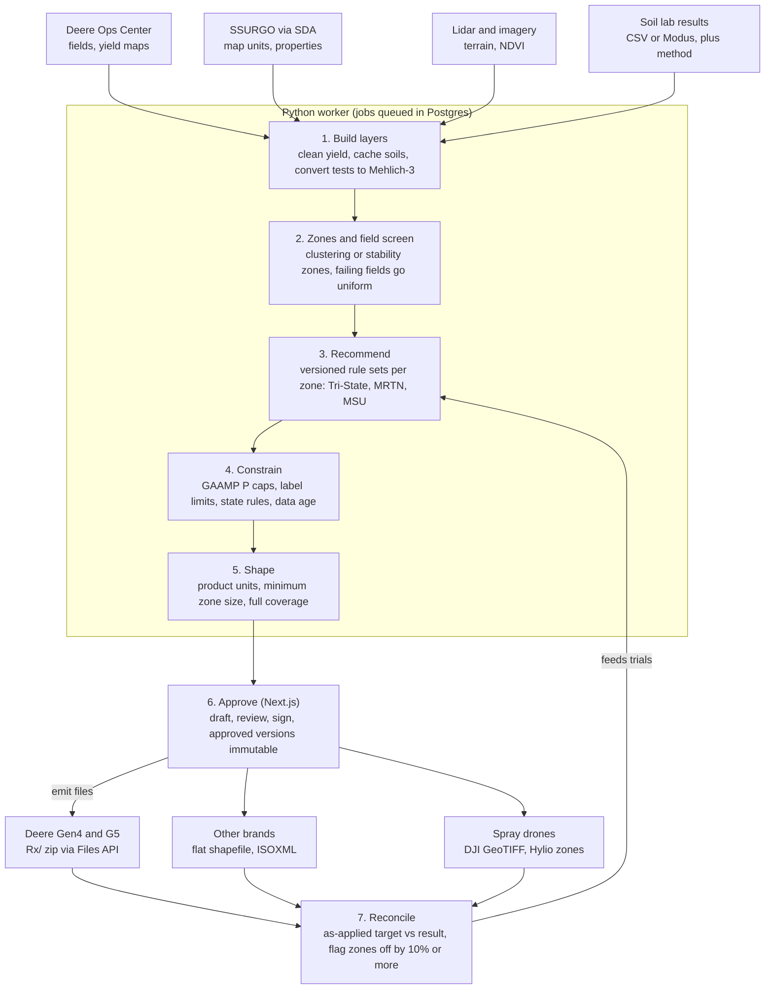

# Soil types and automatic prescriptions

Oct 29, 2026 · @Derrick Hopson

## Verdict: automate the math, gate the judgment

Yes, the tool can write prescriptions automatically wherever the rate is a published equation applied to measured data. Where the rate depends on crop response or legal judgment, it should draft and a person should approve.

| Tier | Prescriptions | Why |
| --- | --- | --- |
| Publish automatically (your own fields) | P and K (Tri-State 2020); lime under a chosen target-pH rule; field-level corn N (Michigan MRTN); wheat N and seeding rate; GAAMP fertilizer P caps; zero-rate setback zones | Published equations and hard thresholds, all unit-testable |
| Draft, a person approves | Zone-level corn N; corn and soybean seeding offsets; the lime rule-set choice; manure rates, until checked against the Manure GAAMP; anything filed for a cost-share program; anything for a custom-work customer | The rate depends on crop response, or the field isn't yours |
| Decision support, certified applicator signs | Residual herbicide rates; drone pesticide missions; foliar manganese | The label is law, and for-hire application needs certification |
| Don't automate | Soil-applied Mn or Zn without a 0.1 N HCl test; sulfur or gypsum for yield; variable-rate fungicide | No calibrated soil test, or too little evidence |

The ground justifies the effort. Wet lake-plain clays (Pewamo, Lenawee, Hoytville, Ziegenfuss) are cut by sandy beach ridges (Selfridge, Tedrow, Oakville, Ottokee). Every one of eight sampled 160-acre blocks crossed 3 to 12 soil map units.

The economics are thin. Variable rate typically returns $0–20 an acre, and Operations Center already builds zone seeding prescriptions for free. GeoPard and FieldView scripting cost $200–$649 a year, and Deere's top API fee tier covers prescription writing, though its public template lists that tier as free below 10 connected organizations.

So build a guarded rule engine, not an agronomist in a box. It needs versioned rules, data-quality gates, label and GAAMP limits, machine-geometry checks, human sign-off and an as-applied check. Its most reliable money is upstream: screening which fields deserve variable rate, and designing strip trials that fix your uniform rates.

## Soils: two systems on one water table

Two soil systems share south Monroe and east Lenawee, and nearly all of it sits on a seasonal water table. That variety justifies variable rate, but soil maps alone can't place the zones.

**Wet clay flats and depressions** formed in till or lake sediment: Pewamo, Lenawee, Hoytville and Ziegenfuss, with somewhat poorly drained Blount, Del Rey and Nappanee on slight rises. Toledo, Latty and Paulding sit in the clayiest lake beds. **Sandy beach ridges and sand sheets** carry Selfridge, Metamora, Tedrow, Thetford, Ottokee and Oakville, with wet sandy swales of Granby and Gilford.

Hoytville is the largest series on the Erie-Huron Lake Plain, at about 806,000 acres or 10% of named-series acreage ([SoilWeb-data series](https://raw.githubusercontent.com/ncss-tech/SoilWeb-data/main/files/series-mlra-overlap.csv.gz)). The largest south Monroe map units are Pewamo clay loam (46,730 ac) and two Selfridge units (45,780 ac combined). Lenawee's largest is one Ziegenfuss clay loam unit of about 72,800 acres ([SoilWeb-data map units](https://raw.githubusercontent.com/ncss-tech/SoilWeb-data/main/files/mukey-mlra-overlap.csv.gz)).

County-wide cropland shares weren't retrieved. One Soil Data Access query (muacres × comppct_r, grouped by component, for MI115 and MI091) answers it; run it on day one.

### Water first, then texture

Nearly every cropland series has a seasonal water table within 2 feet, and many pond in winter and spring. Hoytville's perched water table sits from 30 cm above to 30 cm below the surface in January–April ([OSD Hoytville](https://soilseries.sc.egov.usda.gov/OSD_Docs/H/HOYTVILLE.html)), and Lenawee is often ponded November to May ([OSD Lenawee](https://soilseries.sc.egov.usda.gov/OSD_Docs/L/LENAWEE.html)). Oakville is the opposite: excessively drained and droughty ([OSD Oakville](https://soilseries.sc.egov.usda.gov/OSD_Docs/O/OAKVILLE.html)).

Organic matter follows drainage. Michigan corn-field samples averaged 3.7% OM on poorly drained clay loams, 1.1% on well-drained sands, 5.9% on poorly drained sandy loams and 56% on muck ([MSU RR297, 1976](https://archive.lib.msu.edu/DMC/extension_publications/RR297/RR297.pdf)). CEC follows texture: about 3–5 meq/100 g on sands against 20–50 on clays and clay loams ([OSU ANR-81](https://ohioline.osu.edu/factsheet/anr-81)).

Subsoil acidity splits the clays. Blount and Del Rey typically have strongly acid subsoils, while Hoytville, Pewamo and Lenawee run neutral to alkaline ([OSD Blount](https://soilseries.sc.egov.usda.gov/OSD_Docs/B/BLOUNT.html); [OSD Del Rey](https://soilseries.sc.egov.usda.gov/OSD_Docs/D/DEL_REY.html)). That matters for lime: the 1995 Tri-State rule targets pH 6.5 where subsoil pH is below 6 and 6.0 where it is above, while MSU targets 6.5, or 6.7 over an acid subsoil ([OSU AGF-505](https://ohioline.osu.edu/factsheet/AGF-505-07)).

| Soil group (examples) | Position | Drainage | Surface OM | Rate levers it pulls |
| --- | --- | --- | --- | --- |
| Dark lake-plain clays (Pewamo, Lenawee, Hoytville, Toledo, Ziegenfuss) | Flats, toeslopes, depressions | Poorly to very poorly drained; ponds | About 3.7% | High K build-up multiplier; top herbicide OM tier; Mn deficiency above pH 6.2–6.5; stand loss from ponding |
| Somewhat poorly drained Alfisols (Blount, Del Rey, Nappanee) | Slight rises | Perched water over dense till | About 2.5–3.5% | Acid subsoil, where present, raises the lime target (to 6.5 under Tri-State 1995, 6.7 under MSU) |
| Sand over till (Selfridge, Metamora, Rimer) | Low rises, nearshore ridges | Somewhat poorly drained | Mostly below 4%; Rimer below 2% | Sandy K class; S and N-loss risk; low herbicide tier |
| Beach-ridge and dune sands (Tedrow, Ottokee, Oakville, Thetford) | Ridges and dunes | Somewhat poorly to excessively drained | About 1.1–1.3% on dry ridges | Sandy K class; herbicide prohibitions on low-OM sand; lime minimums; split N; S risk |
| Wet sandy swales (Granby, Gilford) | Depressions between ridges | Very poorly drained | 4–8% | Mn risk; wet-spot seeding |

*OM ranges from [MSU RR297](https://archive.lib.msu.edu/DMC/extension_publications/RR297/RR297.pdf); drainage from the series descriptions linked above.*

### Variation inside a field

Eight roughly 160-acre sample blocks each crossed 3 to 12 SSURGO map units. One near Blissfield held 12, from Berrien sandy loam to Colwood–Wauseon; north of Lambertville, Oakville dunes alternate with Granby swales ([SDA, Blissfield block](https://sdmdataaccess.sc.egov.usda.gov/Spatial/SDMWGS84Geographic.wfs?SERVICE=WFS&VERSION=1.1.0&REQUEST=GetFeature&TYPENAME=MapunitPolyExtended&PROPERTYNAME=areasymbol,musym,mukey,muname&BBOX=-83.8849,41.8164,-83.8751,41.8236); [SDA, Bedford block](https://sdmdataaccess.sc.egov.usda.gov/Spatial/SDMWGS84Geographic.wfs?SERVICE=WFS&VERSION=1.1.0&REQUEST=GetFeature&TYPENAME=MapunitPolyExtended&PROPERTYNAME=areasymbol,musym,mukey,muname&BBOX=-83.6249,41.7864,-83.6151,41.7936)). Rises carry Blount, Selfridge, Tedrow and Oakville; toeslopes and flats carry Pewamo, Granby, Lenawee and Hoytville ([SoilWeb-data hillslope position](https://raw.githubusercontent.com/ncss-tech/SoilWeb-data/main/files/hillpos_wide.csv.gz)).

SSURGO can't place those positions precisely. One Pewamo delineation near Ida covers 540 acres ([SDA, Ida](https://SDMDataAccess.sc.egov.usda.gov/Spatial/SDMWGS84Geographic.wfs?SERVICE=WFS&VERSION=1.1.0&REQUEST=GetFeature&TYPENAME=MapunitPoly&BBOX=-83.585,41.905,-83.580,41.909)), and complexes like Selfridge–Pewamo are only about half their named soil ([SoilWeb-data carbon stocks](https://raw.githubusercontent.com/ncss-tech/SoilWeb-data/main/files/ssurgo-component-cstock.csv.gz)). Lenawee's survey dates from 1961 and uses legacy names like Brady and Macomb, so key everything to the map-unit key (mukey), never the series name ([UNT catalog](https://mocat.library.unt.edu/catalog/801-17826)).

One trap: the ArcGIS service named SSURGO_Soils_MonroeCounty is Monroe County, New York ([layer](https://maps.monroecounty.gov/server/rest/services/Hosted/SSURGO_Soils_MonroeCounty/FeatureServer/2)).

### Problems that change rates

- **Manganese:** soybean and wheat on lakebed and depressional soils run short above pH 6.2 (Tri-State) or 6.5 (MSU) ([Tri-State 1995](https://www.extension.purdue.edu/extmedia/ay/ay-9-32.pdf); [MSU E2904](https://archive.lib.msu.edu/DMC/extension_publications/e2904/e2904.pdf)). Ohio soybean responded in only 6 of 109 trials, but by 29–41% in Fulton County, just south of Lenawee ([OSU AGF-519](https://ohioline.osu.edu/factsheet/agf-519)). MSU advises against liming above 6.5 and documented Mn-deficient soybeans on a field over-limed to 7.0 ([Staton, MSU Extension](https://farms.com/news/identifying-manganese-deficiency-in-soybeans-109429.aspx)).
- **Nitrogen loss:** fall N losses run 10–20% on fine soils but 30% to more than 50% on coarse soils, so the sand ridges want split or sidedress N ([MSU E2904](https://archive.lib.msu.edu/DMC/extension_publications/e2904/e2904.pdf)).
- **Fertility drift:** in an Ohio 10-year example, uniform rates raised low-yield areas 5 ppm P and 10 ppm K while high-yield areas lost 6 and 11 ppm ([OSU AGF-513-12](https://agcrops.osu.edu/sites/agcrops/files/imce/fertility/Soil_Sampling_to_Develop_Nutrient_Recommendations_AGF-513-12.pdf)).
- **State line:** Michigan K recommendations run 20 lb K2O/acre below Ohio and Indiana for identical inputs, so every field needs a state flag ([OSU condensed K](https://agcrops.osu.edu/node/3480)).
- **Old groups:** Michigan's soil management groups (Hoytville 1c, Pewamo 1.5c, Selfridge 4/2b) no longer drive rates; texture now enters only through CEC ([MSU E-1262](https://sanweb.lib.msu.edu/DMC/extension_publications/e1262/e1262_82.pdf); [Tri-State 2020 sample](https://extensionpubs.osu.edu/content/sample/e974.pdf)).

## Data: free layers map the soils, only lab samples set rates

Everything the tool needs for soil and terrain priors is free and scriptable. None of it sets a fertilizer rate; soil tests do.

| Layer | Access | Resolution | Cost | Role in the engine |
| --- | --- | --- | --- | --- |
| Soil map units and properties | SSURGO via Soil Data Access (SQL POST, WFS) | Polygons, 1:12,000–1:63,360 | Free | Prior for texture class, drainage, OM/CEC, NCCPI; never the OM input for a herbicide rate |
| Gridded soil properties | SOLUS100 GeoTIFF or Earth Engine | 100 m | Free | Covariate and uncertainty flag |
| Elevation and terrain | 2017 QL2 lidar: 1 m DEM, seamless 1 m tiles, point cloud | 1 m | Free | Wetness, depressions, landscape position; places soils inside polygons |
| Imagery | Sentinel-2, Landsat, NAIP | 10 m, 30 m, 0.6 m | Free | Multi-year productivity and bare-soil OM/texture |
| Soil tests | Lab CSV, shapefile or Modus | 1–2.5 ac grid, or zones | About $12.75–14.89/ac per sampling at a 2.5-ac grid ($8.55/ac to sample plus a $10.50–15.86 test) | The only basis for P, K, lime and herbicide OM classes |
| Yield history | Deere Field Operations API | 1-second points | Free to the data owner | Stability zones, validation, trial analysis |

### SSURGO through Soil Data Access

Soil Data Access takes SQL by POST, needs no API key, returns JSON and caps each response at 100,000 rows ([SDA help](https://sdmdataaccess.nrcs.usda.gov/WebServiceHelp.aspx)). An oversized or timed-out query returns an empty body, not an HTTP error, so treat a blank response as a failure ([ncss-tech/pysda](https://github.com/ncss-tech/pysda)).

The pattern is two steps: intersect the field polygon to get map-unit keys, then aggregate component and horizon properties weighted by the component percentages present ([soilDB SDA vignette](https://erised.las.iastate.edu/CRAN/web/packages/soilDB/vignettes/sda.html)). The MapunitPolyExtended WFS layer returns polygons with drainage class, hydrologic group, available water storage and minimum water-table depth in one call; a live test near Ida worked ([SDA, Ida](https://SDMDataAccess.sc.egov.usda.gov/Spatial/SDMWGS84Geographic.wfs?SERVICE=WFS&VERSION=1.1.0&REQUEST=GetFeature&TYPENAME=MapunitPolyExtended&BBOX=-83.585,41.905,-83.580,41.909)).

SSURGO refreshes every October 1, and the FY2026 data went live October 1, 2026 ([NRCS refresh](https://www.nrcs.usda.gov/conservation-basics/soil/annual-soils-refresh)). Both county surveys were re-saved August 27, 2026 ([Lenawee](https://SDMDataAccess.sc.egov.usda.gov/Spatial/SDMWGS84Geographic.wfs?SERVICE=WFS&VERSION=1.1.0&REQUEST=GetFeature&TYPENAME=SurveyAreaPoly&BBOX=-83.80,41.86,-83.70,41.92); [Monroe](https://sdmdataaccess.sc.egov.usda.gov/Spatial/SDMWGS84Geographic.wfs?service=WFS&request=GetFeature&typename=SurveyAreaPoly&propertyname=areasymbol,saverest&bbox=-83.4,41.9,-83.39,41.91)), so re-pull whenever the survey save date changes.

The productivity prior is NCCPI v3 in gSSURGO's Valu1 table, scored 0.01–0.99 for corn, soybean and small grains, beside root-zone water storage and a droughty flag ([Valu1 columns](https://www.nrcs.usda.gov/sites/default/files/2022-08/gSSURGO%20Value%20Added%20Look%20Up%20Valu1%20Table%20Column%20Descriptions.pdf)). SSURGO carries no Michigan productivity index ([soilDB interpretation list](https://raw.githubusercontent.com/ncss-tech/soilDB/master/R/get_SDA_interpretation.R)).

### Where SSURGO falls short

It was mapped at 1:12,000 to 1:63,360 ([NRCS SSURGO](https://www.nrcs.usda.gov/resources/data-and-reports/soil-survey-geographic-database-ssurgo)), and a map unit can hold roughly 15–25% dissimilar inclusions ([Soil Survey Manual, ch. 4](https://www.nrcs.usda.gov/sites/default/files/2022-09/SSM-ch4.pdf)). In Montana, SSURGO-only maps didn't predict measured yields ([Stermitz et al.](https://consensus.app/papers/details/b7ca224267bc5541afe70628e5ca3ab8/?utm_source=claude_desktop)). In Indiana it overstated organic matter in 8 of 10 fields, and Purdue advises against it for variable-rate residual herbicide ([Vagedes et al. 2024](https://link.springer.com/article/10.1007/s11119-024-10130-3)).

Newer grids don't fix this. SOLUS100 maps 20 properties at 100 m with per-pixel uncertainty ([NRCS SOLUS](https://www.nrcs.usda.gov/resources/data-and-reports/soil-landscapes-of-the-united-states-solus)), but its cross-validated R² runs 0.5–0.7 and glaciated areas were harder to model ([Nauman et al. 2024](https://consensus.app/papers/details/e6c51e8356a7567787f66c439edffff0/?utm_source=claude_desktop)). SSURGO beat SoilGrids 2.0, POLARIS and the 100 m US grids for 75% of property-depth combinations ([Bohn et al. 2024](https://consensus.app/papers/details/67cab31cf7f858e0ad3c21490442bfa9/?utm_source=claude_desktop)).

### Terrain places the soils

Both counties were flown as QL2 lidar from March 24 to May 7, 2017, with vertical error of 3.9 cm RMSE in Lenawee and 7.4 cm in Monroe ([NOAA InPort 55315](https://www.fisheries.noaa.gov/inport/item/55315)). 1 m DEM tiles come through The National Map API ([TNM 1 m](https://tnmaccess.nationalmap.gov/api/v1/products?datasets=Digital%20Elevation%20Model%20%28DEM%29%201%20meter&bbox=-83.80,41.85,-83.55,41.95&max=10)), and new seamless 1 m tiles were published September 16, 2026 ([TNM S1M](https://tnmaccess.nationalmap.gov/api/v1/products?datasets=Seamless%201-m%20DEM%20%28S1M%29&bbox=-83.80,41.85,-83.55,41.95&max=10)). Point clouds sit on AWS in Entwine format, which PDAL can crop to a field ([USGS EPT index](https://raw.githubusercontent.com/hobu/usgs-lidar/master/boundaries/resources.geojson)); all of it is free with no use restrictions ([USGS 3DEP](https://www.usgs.gov/3d-elevation-program/about-3dep-products-services)).

Terrain earns its place. Lidar derivatives explained Ontario corn yield with a geographically weighted R² of 0.80 ([Eyre et al. 2021](https://consensus.app/papers/details/fa6625fba4465fc69c8f118033d947ef/?utm_source=claude_desktop)). In Maryland, topography alone explained 38% of yield variance, 73% with hydrology and 87% with imagery ([Chang et al. 2025](https://consensus.app/papers/details/a64b5ff628a5570782f7853ae375f6d1/?utm_source=claude_desktop)). Across 338 Midwest fields, high-wetness depressions were the unstable areas: poor in wet years, better in dry ones ([Maestrini & Basso 2018](https://www.nature.com/articles/s41598-018-32779-3)).

On relief this low, flow accumulation, depression depth and wetness index should matter more than slope. WhiteboxTools computes all of them ([WhiteboxTools](https://raw.githubusercontent.com/jblindsay/whitebox-tools/master/whitebox_tools.py)).

### Imagery

Sentinel-2 Collection-1 L2A is free at 10 m through Earth Search; multiply stored values by 0.0001 and add −0.1 to get reflectance ([Earth Search](https://earth-search.aws.element84.com/v1/collections/sentinel-2-c1-l2a)). Landsat Collection 2 reaches back to 1982 ([Planetary Computer](https://planetarycomputer.microsoft.com/api/stac/v1/collections/landsat-c2-l2)), and NAIP covers the Ida area every even year from 2012 to 2022, at 0.6 m since 2016 ([NAIP search](https://planetarycomputer.microsoft.com/api/stac/v1/search?collections=naip&bbox=-83.60,41.89,-83.57,41.92&limit=50)).

Long-term mean NDVI tracked long-term productivity zones at r = 0.86–0.94 on a 448 ha maize field ([Harbar et al. 2026](https://consensus.app/papers/details/92b24c79de60552bb54bf7f7e98d9d65/?utm_source=claude_desktop)). Multi-date bare-soil composites predict soil organic carbon at R² of about 0.52–0.62 ([Shi et al. 2022](https://consensus.app/papers/details/ae9d61e3b8a757dd8524f94ef2010f90/?utm_source=claude_desktop)). Prefer older scenes from before conservation tillage, when more soil was bare ([Sorenson et al. 2021](https://consensus.app/papers/details/d2adb7fc922b5e7b9b316e449d6d253a/?utm_source=claude_desktop)).

### Soil tests set the rates

A&L Great Lakes in Fort Wayne charges $10.50 per standard sample with recommendations (OM, P, K, Mg, Ca, pH, buffer pH, CEC) ([A&L](https://www.algreatlakes.com/pages/soil-analysis)). MSU's lab charges $12 ([Bay County MSUE](https://baycountymi.gov/health_community/msu_extension/agriculture_and_natural_resources/diagnostic_services.php)), and Ohio's 2026 survey puts grid sampling at $8.55 an acre and soil testing at $15.86 a sample ([Ohio custom rates 2026](https://farmoffice.osu.edu/sites/aglaw/files/site-library/farmmgtpdf/Ohio%20Farm%20Custom%20Rate%20Summary%202026%20August%204.pdf)).

Grid size governs accuracy. Across nine Georgia fields, a 1-acre grid put the right lime rate in the right place on 89% of the area, a 2.5-acre grid on 76% and a 10-acre grid on 52%. For P and K, the 2.5-acre grid reached only 63% and 60% ([CSA News 2024](https://www.sciencesocieties.org/publications/crops-soils/2024/march-april/soil-sampling-grid-size-considerations-for-site-specific)).

Every value must carry its extractant and its measurement method, ICP or colorimetric, because the Bray-to-Mehlich-3 factor depends on both (table below). Mehlich-3 K = 1.14 × ammonium acetate K ([OSU ANR-75](https://ohioline.osu.edu/factsheet/anr-75)); the calibration paper limits the K conversion to 250 mg/kg, the safer cutoff to code ([Culman et al. 2020](https://soilfertility.osu.edu/sites/soilf/files/imce/Publications/Culman%20et%20al.%20-%202020%20-%20Calibration%20of%20Mehlich-3%20with%20Bray%20P1%20and%20ammonium.pdf)). A&L's standard report labels P as Bray-1 ([A&L example report](https://cdn.shopify.com/s/files/1/0979/5626/files/Example_Report_-_Soil_-_Std.pdf?15209415394832935199)), while the Tri-State 2020 thresholds are Mehlich-3.

| From | To | Multiply by |
| --- | --- | --- |
| Bray P1, colorimetric | Mehlich-3 P, ICP | 1.35 |
| Bray P1, ICP | Mehlich-3 P, ICP | 1.20 |
| Bray P1, ICP | Mehlich-3 P, colorimetric | 1.05 |
| Bray P1, colorimetric | Mehlich-3 P, colorimetric | 1.03 |
| Ammonium acetate K | Mehlich-3 K | 1.14 |

*From [OSU ANR-75](https://ohioline.osu.edu/factsheet/anr-75), fitted on soils under 50 ppm Bray P and 200 ppm ammonium acetate K. Don't convert above 300 ppm Bray P, or above 250 ppm K ([Culman et al. 2020](https://soilfertility.osu.edu/sites/soilf/files/imce/Publications/Culman%20et%20al.%20-%202020%20-%20Calibration%20of%20Mehlich-3%20with%20Bray%20P1%20and%20ammonium.pdf)).*

That fitted range matters twice. The GAAMP P tiers (Bray 75 and 150 ppm) sit outside it, so judge them on the lab's native extractant. And Tri-State 2020 puts Mehlich-3 P about 35% above Bray, the colorimetric-to-ICP factor, which suggests its thresholds assume ICP; a colorimetric Mehlich-3 result would then read about 24% low (confirm with OSU).

No lab publishes a results API, so ingest CSV, shapefile or AgGateway's Modus format, which A&L adopted early ([CropLife](https://www.croplife.com/?p=103023)). EC and gamma sensing are zoning inputs, not lab substitutes: sensor fusion predicted OM, pH and lime need, but not extractable P and K ([Ji et al. 2019](https://consensus.app/papers/details/180ac7d52f9a537abaf98cb6dc711b48/?utm_source=claude_desktop)).

### Yield history from Deere

List harvest operations by crop season through the Field Operations API, then request each shapefile asynchronously. The API answers 202, or 307 if the file is already ready. Poll from 5 seconds, doubling each time; processing can take up to 30 minutes before the 307 redirect to a presigned URL. Send that URL no Authorization header, treat a 406 as no shapefile available, and don't wait for a webhook, since this endpoint has none ([deere-sdk 3.1.2, unofficial](https://registry.npmjs.org/deere-sdk/-/deere-sdk-3.1.2.tgz)). Deere's OAuth sample requests the ag1–ag3, files and offline_access scopes and checks each organization's approval ([Deere OAuth sample](https://raw.githubusercontent.com/JohnDeere/MyJohnDeereAPI-OAuth2-Python-Example/master/john-deere-api.py)).

Raw yield needs cleaning: 10–50% of points carry significant errors ([Sudduth & Drummond 2007](https://consensus.app/papers/details/a782c496dfe353c09c6e42d5ade31118/?utm_source=claude_desktop)), and an uncleaned map can shift an N recommendation by more than 15 lb/acre ([UNL EC2005](https://extensionpubs.unl.edu/publication/ec2005/na/pdf/view)). Cleaning automates well. USDA's automated Yield Editor matched an expert's hand cleaning on 50 maps ([Sudduth et al. 2012](https://consensus.app/papers/details/877c4c63eaee5e12adcfef6b46d1be4e/?utm_source=claude_desktop)), and the Vega protocol removed about 30% of points across 595 datasets ([Vega et al. 2019](https://consensus.app/papers/details/f0a4656d38b8512e9f02d26b21ee7158/?utm_source=claude_desktop)).

## Prescription types at a glance

Fertility prescriptions reduce to published equations; corn seed and herbicide rates do not. The rate math and sources behind each row follow in the next section.

| Prescription | Published rate math | Key inputs | Engine status |
| --- | --- | --- | --- |
| P2O5 | YP × CR + 5 × (CL − STP); zero above the maintenance limit; GAAMP caps | Mehlich-3 P, crop, yield potential | Automatic, with sampling gates |
| K2O | YP × CR + (CL − STK) × (1 + 0.05 × CEC); zero above the maintenance limit; Michigan omits the +20 lb | Mehlich-3 K, CEC, crop, yield potential, state | Automatic |
| Lime | MSU: 65.5 − 0.94 × LI to pH 6.5, with sandy-soil floors and shallow liming for reduced till; or Tri-State 1995: 60.4 − 0.87 × LTI, with no-till halving and an 8 t/A cap | pH, buffer pH, subsoil pH, lime neutralizing value, depth | Automatic once a target rule set is chosen |
| Corn N | MRTN by price ratio, previous crop and productivity class; minus manure and starter N; PSNT credit (MSU's 2004 rule) | Prices, rotation, zone yield history | Field rate automatic; zone N needs sign-off |
| Wheat N | −13 + 1.33 × yield potential, split by tiller count | Yield potential, fall N, stand | Automatic |
| Mn, Zn, S | 0.1 N HCl equations; flat 10–20 lb S where risk | pH, extractant, soil group | Risk flags and scouting only |
| Seeding | Corn: uniform rate from trials plus small offsets; soybean agronomic optima 179k/150k/about 141k by yield environment; wheat 1.2–2.2 million by date | Trials, yield zones, planting date | Wheat automatic; soybean with review; corn needs trials |
| Residual herbicide | Current label tables by texture, OM and pH; per-product prohibitions; caps, setbacks, rotation limits | Lab OM and texture per zone, label version | Draft only; certified applicator approves |
| Manure | Manure GAAMP, not yet checked; the Bray P1 75/150 ppm tiers and setbacks cited here cover other by-products | Soil test P, surface water, wells | By-product gates automatic; manure on hold until the Manure GAAMP is checked |

## Rate math: what the engine computes

Fertility rates come from Tri-State 2020, the benchmark Michigan's 2026 GAAMP points to. Lime needs a rule-set choice, nitrogen is a field-level economic rate, and seed and herbicide rates need trials or a label.

### Phosphorus and potassium

Michigan's 2026 Nutrient Utilization GAAMP says fertilizer use should be consistent with MSU or Tri-State recommendations ([2026 NU GAAMPs](https://www.michigan.gov/mdard/-/media/Project/Websites/mdard/documents/environment/rtf/2026-GAAMPs/2026-Nutrient-Utilization-GAAMPs.pdf?rev=d5fd489097204aadbeaeca334f09c4d9&hash=4B5B412B125D01E2F5A18C57CBCFB674)). That makes Tri-State Bulletin 974 (2020) the engine's anchor. It is a three-zone Mehlich-3 system: below the critical level (CL), apply removal plus optional build-up; between CL and the maintenance limit (ML), apply removal; above ML, apply zero ([Tri-State 2020 sample](https://extensionpubs.osu.edu/content/sample/e974.pdf)).

| Nutrient | Crop or soil | Critical level (ppm) | Maintenance limit (ppm) |
| --- | --- | --- | --- |
| P | Corn, soybean | 20 | 40 |
| P | Wheat, alfalfa | 30 | 50 |
| K | CEC 5 or less | 100 | 130 |
| K | CEC above 5 | 120 | 170 |

*The K split follows MSU's convention (5 or less, above 5); Tri-State 2020 leaves a CEC of exactly 5 undefined.*

Removal per bushel: corn grain 0.35 lb P2O5 and 0.20 lb K2O, soybean 0.80 and 1.15, wheat grain 0.50 and 0.25. Baled wheat straw removes 3.7 lb P2O5 and 29 lb K2O per dry ton (same source).

The build-up equations carry over from 1995, except that Michigan drops the extra 20 lb K2O; OSU notes they haven't been recently validated ([OSU P&K summary](https://agcrops.osu.edu/node/3478)). In Michigan form ([OSU calculator guide](https://agcrops.osu.edu/sites/agcrops/files/User%20Guide-Fertilizer%20Calculator%20for%20Ohio%282026%29.pdf)):

```latex
\text{P}_2\text{O}_5 = YP \times CR + 5\,(CL - STP)
```

```latex
\text{K}_2\text{O} = YP \times CR + (CL - STK)\,(1 + 0.05\,CEC)
```

YP is yield potential (OSU uses the five-year average, dropping the high and low years), CR the removal coefficient, and STP and STK the soil tests. Ohio's form adds 20 lb K2O ([OSU AGF-515](https://ohioline.osu.edu/factsheet/agf-0515)). The equations reproduce MSU's published check, which tests only the removal term: a 60-bushel soybean crop needs 48 lb P2O5 and 69 lb K2O ([Staton & Steinke 2021](https://farms.com/news/phosphorus-and-potassium-fertilizer-recommendations-for-high-yielding-profitable-soybeans-165713.aspx)).

Two soil effects make this spatial. A CEC-25 clay depression builds K at 2.25 lb K2O per ppm of deficit, against 1.25 on a CEC-5 sand ridge. A zone testing 20–30 ppm P is maintenance for corn but deficient for wheat. OSU's 2026 calculator applies wheat's 30 ppm level in every year when wheat is regularly in the rotation, so pick one convention. MSU's maximums of 200 lb P2O5 and 300 lb K2O per acre per year make sensible hard caps ([MSU E2904](https://archive.lib.msu.edu/DMC/extension_publications/e2904/e2904.pdf)).

### Lime: two rule sets disagree

Tri-State 2020 keeps field crops between pH 6.0 and 6.8. It says Michigan and Indiana lime recommendations agree, while Ohio uses separate ENP-based tables ([OSU Tri-State pH & lime](https://agcrops.osu.edu/node/3483); [OSU quick reference](https://agcrops.osu.edu/node/3488)). The 2020 Michigan lime table wasn't retrieved, and OSU's 2026 calculator simply lets the user pick 6.0, 6.5 or 6.8. The two older equation sets disagree:

- **MSU E2904:**
  - Target pH 6.5 for corn, soybean and wheat, or 6.7 where subsoil pH is below 6.0.
  - Rate to 6.5: 65.5 − 0.94 × LI t/A (to 6.0: 54.2 − 0.78 × LI; to 6.8: 71.2 − 1.02 × LI), for a 9-inch depth and lime of 90% neutralizing value. Scale by depth ÷ 9 and by 90 ÷ the lime's value.
  - The equations need LI = 10 × the SMP buffer pH. E2904 doesn't define the scale; that definition comes from Tri-State 1995.
  - Reduced-tillage fields lime only the top 3–4 inches, so 3/9 to 4/9 of the rate.
  - On weakly buffered, usually sandy soils, floors apply when the equation calls for less: 1 t/A at 0.3–0.5 below target, 2 t/A at 0.6 or more below.
  - The copy read is the 2004 archive, marked not for current recommendations, and the GAAMP cites a 2009 printing. Confirm the coefficients before hard-coding ([MSU E2904](https://archive.lib.msu.edu/DMC/extension_publications/e2904/e2904.pdf)).
- **Tri-State 1995:**
  - Target 6.0 where subsoil pH is above 6, and 6.5 where it is below. Lime only when pH sits 0.2–0.3 below target; pick one trigger.
  - Rate: 60.4 − 0.87 × LTI to reach 6.5 at 8 inches, where LTI = 10 × the SMP buffer pH. Scale by depth ÷ 8.
  - No-till fields sampled 0–4 inches get half the rate. Round to 0.1 t, split applications above 4 t, and cap at 8 t/A per season ([Tri-State 1995](https://www.extension.purdue.edu/extmedia/ay/ay-9-32.pdf)).

On a soybean zone at pH 5.9, buffer pH 6.6 and a neutral subsoil, MSU prescribes about 3.5 t/A. The 1995 rule prescribes nothing, because the zone sits only 0.1 below its 6.0 target, short of the 0.2–0.3 trigger. So the engine needs a visible target-pH rule-set setting, and it should cap the target at 6.5 in Mn-prone depressions.

### Micronutrients and sulfur: flags, not rates

The banded Mn and Zn equations are calibrated to a 0.1 N HCl extract. Many labs report Mehlich-3 or DTPA instead, no validated conversion was found, and broadcast Mn isn't recommended ([Tri-State 1995](https://www.extension.purdue.edu/extmedia/ay/ay-9-32.pdf)).

```latex
X_{Mn} = -36 + 6.2\,\text{pH} - 0.35\,ST \qquad X_{Zn} = -32 + 5.0\,\text{pH} - 0.4\,ST
```

So the output is a flag. A dark depressional zone above pH 6.2–6.5 sends a drone to scout and queues a foliar pass of 1 lb Mn/A at first symptoms, repeated about 10 days later if needed. Don't tank-mix manganese sulfate with glyphosate: apply Mn at least 3 days after glyphosate, or glyphosate at least 7 days after Mn ([Staton, MSU Extension](https://farms.com/news/identifying-manganese-deficiency-in-soybeans-109429.aspx)).

Sulfur has no reliable soil test, so Tri-State calls for a flat 10–20 lb S/A only where deficiency is expected ([OSU Ca/Mg/S](https://agcrops.osu.edu/node/3477)). Only 5 of 53 Ohio corn sulfur trials responded ([OSU C.O.R.N. 2021-19](https://agcrops.osu.edu/newsletter/corn-newsletter/19-2021/do-you-need-apply-sulfur-reach-your-corn-yield-goals)). Gypsum raised yield in 4 of 62 trials but cut dissolved P in surface runoff 41%, so treat it as a P-loss practice ([OSU ANR-0153](https://ohioline.osu.edu/factsheet/anr-0153)).

### GAAMP phosphorus caps

The GAAMP adds a constraint layer. For most Michigan crops and yields, fertilizer P recommendations are zero above Mehlich-3 40 ppm for corn and soybean, or 50 ppm for wheat and alfalfa. By-product P, which here excludes manure (manure has its own GAAMP), is limited to crop removal at Mehlich-3 100 ppm (Bray 75); one application may cover up to four crop-years of removal if it stays within the first crop's N need. All P stops at Mehlich-3 200 ppm (Bray 150) until removal draws the test down ([2026 NU GAAMPs](https://www.michigan.gov/mdard/-/media/Project/Websites/mdard/documents/environment/rtf/2026-GAAMPs/2026-Nutrient-Utilization-GAAMPs.pdf?rev=d5fd489097204aadbeaeca334f09c4d9&hash=4B5B412B125D01E2F5A18C57CBCFB674)). Ohio tile data show why: dissolved P in tile water rose slowly until soil-test P reached about 225 ppm, then accelerated ([OSU ANR-0111](https://ohioline.osu.edu/factsheet/anr-0111)).

### Nitrogen: a field-level economic rate

Tri-State 2020 sets corn N with the MRTN method in Iowa State's Corn Nitrogen Rate Calculator, from four inputs: state dataset, previous crop, N price and corn price ([OSU Tri-State nitrogen](https://agcrops.osu.edu/node/3482)). MRTN is the rate with the highest average net return across a dataset's trials, and the profitable range sits within $1/acre of it ([Sawyer & Nafziger 2005](https://www.agronext.iastate.edu/soilfertility/info/regnfertratenceisfc05.pdf)).

MSU's 2015 table, the newest retrieved, splits rates by productivity class from a five-year yield average: Low under 135 bu, Medium 136–165, High 166–195, Very High over 196. At a 0.10 price ratio it gives 125 lb N/A (115–140) for High or Very High corn after soybean, 155 lb after corn, and 100 lb for Medium or Low after soybean, with the soybean credit built in ([Steinke 2015](https://www.farms.com/commentaries/maximizing-return-on-corn-nitrogen-investments-89959.aspx)). Store MRTN tables as versioned data and pull current values from the calculator; never hard-code them.

MRTN isn't spatial, so the only guideline-consistent way to vary N in a field is to give each zone its own productivity class from its own yield history. MSU's 2004 pre-sidedress nitrate test rule, which predates MRTN, credits ppm NO3-N × 6, takes no credit below 5 ppm, and calls for no more N above 25 ppm ([MSU E2904](https://archive.lib.msu.edu/DMC/extension_publications/e2904/e2904.pdf)). Tri-State 2020's N page covers MRTN and pre-sidedress tests but not canopy sensors or commercial N models, and Ohio's on-farm tests of Adapt-N and FieldView N returned $6–131/acre less than the farmer's normal rate ([OSU C.O.R.N. 2018-32](https://agcrops.osu.edu/newsletter/corn-newsletter/2018-32/evaluation-adapt-n-and-fieldview-corn-n-fertilizer-tools-ohio)).

Wheat N is simpler: N = −13 + 1.33 × yield potential, counting fall N, so an 80-bushel goal gives 93 lb ([MSU E2904](https://archive.lib.msu.edu/DMC/extension_publications/e2904/e2904.pdf); [Nagelkirk 2016](https://www.no-tillfarmer.com/articles/5581-the-right-nitrogen-rate-to-topdress-wheat)). With 2–3 tillers per plant, apply once at Feekes 5–6; with fewer, put 50–60 lb on at green-up and the rest at Feekes 5–6 ([Pennington & Anderson 2022](https://www.farms.com/news/evaluating-wheat-stands-and-spring-management-178491.aspx)). The GAAMP allows 20–30 lb of that total at fall planting ([2026 NU GAAMPs](https://www.michigan.gov/mdard/-/media/Project/Websites/mdard/documents/environment/rtf/2026-GAAMPs/2026-Nutrient-Utilization-GAAMPs.pdf?rev=d5fd489097204aadbeaeca334f09c4d9&hash=4B5B412B125D01E2F5A18C57CBCFB674)).

### Seeding

Corn seeding resists zoning. Across 93 Ohio trials the economic optimum ranged from 18,000 to 44,340 seeds/acre, with only a relatively weak link to yield level ([OSU AGF-520](https://ohioline.osu.edu/factsheet/agf-520)). Purdue found essentially no relationship between field productivity and the optimum ([Purdue](https://www.agry.purdue.edu/ext/corn/news/timeless/CornPopulations.pdf)), and Wisconsin found an economic optimum in 0% of yield-defined zones ([Lauer 2015](https://extension.soils.wisc.edu/wp-content/uploads/sites/68/2015/06/Lauer-precision-farming-2015-WCMC-Proceedings.pdf)).

Even with perfect hindsight, variable rate beat the best uniform rate by only $12.53/acre in Ohio and $3.14 in Illinois ([OSU AGF-520](https://ohioline.osu.edu/factsheet/agf-520); [farmdoc daily](https://farmdocdaily.illinois.edu/?p=23760)). So default to a farm-level uniform rate from strip trials, with modest zone offsets. OSU's eFields protocol suggests final stands of about 35,000 on very productive soils, 30,000–33,000 on average soils and 26,000 on poor ones ([OSU eFields protocol](https://digitalag.osu.edu/sites/digitag/files/imce/eFieldsProtocols/OSUE%20-%20Corn%20Seeding%20Rate%20Trial%20Protocol.pdf)).

Soybean has a consistent rule. Across 211 site-years, agronomic optima were 179,000 seeds/acre in low-yield environments and 150,000 in medium, with high environments about 6% lower (roughly 141,000); economic optima run lower. Seed more in poor zones and less in good ones ([StepUpSoy seeding-rate summary](https://stepupsoy.osu.edu/sites/hcs-soy/files/Seeding%20rate%20FINAL.pdf)). Raise rates where seedling disease, crusting or ponding are likely, which fits these clay flats ([CropWatch](https://cropwatch.unl.edu/2019/variable-seeding-rate-soybean)), and stay under 140,000 in white-mold areas ([UW IPCM](https://ipcm.wisc.edu/?p=10375)). The payoff is mostly seed savings ([DTN](https://www.dtnpf.com/agriculture/web/ag/magazine/article/2019/10/15/growers-rethink-optimum-soybean)), and in 4 of 10 Ohio and Michigan trials the zones responded alike ([Zhao et al. 2023](https://consensus.app/papers/details/dbf8fe46ccef59639a505fd2c22ebb79/?utm_source=claude_desktop)).

Wheat is calendar-driven. MSU recommends 1.2–1.6 million seeds/acre drilled near the Hessian fly-free date, the third or fourth week of September in southern Michigan, and 1.6–2.2 million for late planting ([Michigan Wheat Program report](https://miwheat.org/wp-content/uploads/2023-Singh-Final-Report-Evaluating-Role-of-Seed-Placement-and-Planting-Strategies.pdf); [MSU via No-Till Farmer](https://www.no-tillfarmer.com/articles/2288-getting-late-seeded-winter-wheat-in-the-ground)). Yield falls about 0.6 bu/day after October 1, and MSU cites October 25 as the final planting date for crop insurance; RMA sets that date by county, so look it up per field ([MSU via farms.com](https://www.farms.com/news/planting-the-2023-wheat-crop-184477.aspx)). MSU's 2023 trials put the optimum lower, at 0.93 million in mid-September and 1.54 million in late October (same report).

### Residual herbicides

Most residual herbicides used here have label rate tables keyed to texture and OM. Dual II Magnum in corn runs 1.0–1.33 pt/A on coarse soils below 3% OM and 1.67–2.0 pt/A on fine soils at 3% or more, and can't go on muck above 20% OM ([EPA label, Dual II Magnum](https://www3.epa.gov/pesticides/chem_search/ppls/000100-00818-20000627.pdf)). Authority Edge splits rates by three OM and three texture classes, wants higher rates below pH 7.2, and caps coarse soils at 9.42 fl oz/A a year versus 15.67 on medium and fine ([FMC Authority Edge](https://ag.fmc.com/us/sites/default/files/2020-03/Authority-Edge-Herbicide_TechSheet.pdf)).

Labels don't share texture classes: sandy clay loam is fine on Dual II Magnum but medium on Zone Defense ([HELM Zone Defense](https://www.helmcrop.com/fileadmin/user_upload/us/products/Zone_Defense/downloads/HELM_ZoneDefense_FactSheet_0224_FINAL.pdf)). So the engine needs a per-product texture mapping, not one global class.

Prohibitions show up as exclusion zones. Authority Assist can't go on coarse soils below 1% OM or soils above pH 7.5, a bar the Authority Edge sheet doesn't carry, so prohibitions are set per product ([OSU Herbicide Selector](https://herbselector.osu.edu/herbicides/authority-assist)), and a voluntary Minnesota water-quality guideline rules out metribuzin on sand below 2% OM; the binding limits are on the current metribuzin label ([MDA metribuzin BMPs](https://www.mda.state.mn.us/sites/default/files/2019-09/bmpsformetribuzin_2.pdf)). Atrazine is restricted-use, capped at 2.5 lb ai/A a year and 2.0 lb per application (1.6 on highly erodible land under 30% residue), and barred within 50 ft of wells, 66 ft of points where runoff enters streams and 200 ft of lakes ([EPA label, AAtrex 4L](https://www3.epa.gov/pesticides/chem_search/ppls/000100-00497-20060110.pdf)).

The Dual II Magnum and AAtrex labels cited date from 2000 and 2005, so the engine must load each product's current label before setting a rate.

Purdue's work is decisive. Every field studied had at least two label-rate zones, but variable rate didn't reduce total herbicide used ([Vagedes 2023](https://docs.lib.purdue.edu/dissertations/AAI30593036)). Soil samples at about one per hectare, alone or with EC, made the most accurate maps, while SSURGO overstated OM in 8 of 10 fields ([Vagedes et al. 2024](https://link.springer.com/article/10.1007/s11119-024-10130-3)).

That error is a legal problem. If SSURGO puts a fine soil that truly tests 2.5% OM in the 3%-plus tier, the engine prescribes up to 2.0 pt/A of Dual II Magnum where the label allows 1.67. Variable-rate herbicide is a label-compliance feature, not a savings feature, and it must run on lab-measured OM.

### Manure, fungicide and spot spraying

Manure isn't ready to automate. The Nutrient Utilization GAAMP's thresholds cover other by-products and point manure to the separate Manure Management and Utilization GAAMP, which this research didn't read. For by-products, P is capped at crop removal at Bray P1 75 ppm and stops at 150 ppm. Setbacks are 150 ft from surface water unless the material is injected or incorporated within 48 hours or runoff controls are in place; never within 50 ft of surface water, a residence or a single-family well; and 200 ft from a public water supply well ([2026 NU GAAMPs](https://www.michigan.gov/mdard/-/media/Project/Websites/mdard/documents/environment/rtf/2026-GAAMPs/2026-Nutrient-Utilization-GAAMPs.pdf?rev=d5fd489097204aadbeaeca334f09c4d9&hash=4B5B412B125D01E2F5A18C57CBCFB674)).

Variable-rate fungicide evidence is too thin to automate: one vendor trial and one South Dakota strip trial ([Ceres Imaging](https://ceres.ai/blog/variable-rate-fungicide-soybean-experiment); [SD Soybean](https://onfarmresearch.sdsoybean.org/archives/reports/miravis-neo-fungicide-at-high-yield-zone-55-bu-ac-3)). Camera spot spraying is a real-time workflow, not a map. Across about 16,000 fields, See & Spray treated roughly 45% of the area, saving about $5/acre at a $20/acre herbicide cost but losing $3.07/acre at $5/acre ([UADA FSA2225](https://www.uaex.uada.edu/publications/pdf/FSA2225.pdf)).

## Zones: code can draw them, only strip trials can price them

Drawing management zones is almost entirely algorithmic. Assigning a rate to each zone isn't; that takes response data from strip trials or a university rate table.

### Clustering

USDA-ARS's Management Zone Analyst runs fuzzy c-means on standardized layers: EC, terrain, soil tests, yield, imagery. Its authors recommend a fuzziness exponent of 1.2–1.5 and Mahalanobis distance when layers are correlated. They pick the zone count where two indices bottom out, the fuzziness performance index (FPI) and normalized classification entropy (NCE) ([Fridgen et al. 2004](https://corpora.tika.apache.org/base/docs/govdocs1/506/506572.pdf)).

Results depend on random starting memberships, and the two indices often disagree. So fix random seeds, run several restarts, and break ties with variance reduction on held-out yield years. Published fields usually settle on 2–4 zones ([Li et al. 2008](https://consensus.app/papers/details/f7cabb580e185f30bb7778f8875e59f7/?utm_source=claude_desktop); [Lajili et al. 2021](https://consensus.app/papers/details/5087bd8fd87a5732a9b171f63e3f74fa/?utm_source=claude_desktop)).

One trap: FPI as commonly transcribed returns 1 for a perfectly crisp partition, the opposite of its meaning. Code it as below, where c is the zone count and F the partition coefficient, and unit-test it: crisp memberships return 0, uniform memberships 1.

```latex
FPI = \frac{c}{c-1}\,(1 - F)
```

### Yield-stability zones (MSU)

For a Deere operation with yield history, the simplest defensible zoning is MSU's yield-stability method. Convert each cleaned field-year to z-scores and compute each cell's standard deviation across years. A deviation above 1 marks the cell unstable, and the sign of its mean splits stable-high from stable-low.

Across 338 Midwest fields that gave about 50% stable-high, 32% stable-low and 18% unstable ([Maestrini & Basso 2018](https://www.nature.com/articles/s41598-018-32779-3)). Michigan is less stable: a Landsat NDVI version found 38% stable-high, 24% stable-low and 38% unstable across 121,673 Michigan hectares ([Basso et al. 2019](https://msutoday.msu.edu/-/media/assets/msutoday/docs/faculty-voice-feeding-the-future-sustainably/basso_et_al-2019-scientific_reports.pdf)).

It maps straight onto N: cut N on stable-low ground and manage unstable ground in-season. A 2025 summary estimates that matching N to uptake on stable-low acres saves 50–62 lb N/acre in Michigan ([Crops & Soils, Dec 2025](https://www.sciencesocieties.org/publications/crops-soils/2025/december/N-efficiency-yield-stability)). In MSU's wheat trials on 5 farms, VR cut N 10–20 lb/acre on a dry-year example field, worth $7–14/acre ([Basso, Michigan Wheat Program 2025](https://miwheat.org/wp-content/uploads/Basso-2025-Report.pdf)).

The unstable share grows with rainfall differences between years and with the number of yield maps ([Maestrini & Basso 2021](https://par.nsf.gov/servlets/purl/10313721)). Fields without yield history, such as new rentals or a customer's ground, can use the satellite version, which was validated against yield-monitor data from 508 corn fields ([Basso et al. 2019](https://msutoday.msu.edu/-/media/assets/msutoday/docs/faculty-voice-feeding-the-future-sustainably/basso_et_al-2019-scientific_reports.pdf)).

### Rates and zone size

Code can't assign the rates. A review of 137 zoning papers found only 13 that evaluated economic or environmental returns ([Heidari et al. 2026](https://consensus.app/papers/details/1a1728317ef3504e8a503e06ca263d5a/?utm_source=claude_desktop)). Zones that differ in yield often don't differ in response: in 4 of 10 Ohio and Michigan soybean trials, the zones responded alike ([Zhao et al. 2023](https://consensus.app/papers/details/dbf8fe46ccef59639a505fd2c22ebb79/?utm_source=claude_desktop)).

Machine geometry sets the floor. The smallest area a VR controller can manage is swath × speed × rate-change time: 0.036 ha for a 20 m boom at 6 m/s with a 3-second lag ([McBratney et al. 2000](https://precision-agriculture.sydney.edu.au/wp-content/uploads/2019/08/MOI.pdf)). No source sets a standard minimum zone. A configurable sieve of 0.5–1 acre and a minimum width of twice the implement width are reasonable defaults.

### Sampling and interpolation

Sample 0–8 inches, no more than 25 acres per sample, every 3–4 years ([OSU Tri-State sampling](https://agcrops.osu.edu/node/3484)), plus a 0–4 inch no-till sample for lime ([Tri-State 1995](https://www.extension.purdue.edu/extmedia/ay/ay-9-32.pdf)). Dense grids found a differential P or K response in 16 of 27 Iowa site-years, 1-hectare cells in 8, and soil-map zones in only 2 ([Sawchik & Mallarino 2007](https://consensus.app/papers/details/248822036c7255458ce3ee9627041457/?utm_source=claude_desktop)).

A reliable variogram needs about 100 points ([Muhammed et al. 2017](https://repository.rothamsted.ac.uk/download/df73fca6ebf4eee5445d568c4faa274fda2fdf36d47cac7e10c7a4312d0c7a40/5917639/1-s2.0-S0168169917301710-main%20%281%29.pdf)), but a 2.5-acre grid on 80 acres yields only 32. So default to cell-based rates, or to inverse-distance or thin-plate-spline interpolation checked by leave-one-out cross-validation. Krige only when a fitted variogram supports it; with a good one, kriging beat inverse distance in 57 of 60 comparisons ([Kravchenko & Bullock 1999](https://consensus.app/papers/details/85dd7025ff455b218f2e856725d2d17d/?utm_source=claude_desktop)).

### Strip trials

DIFM's open-source ofpetrial package builds plots sized to machine widths, at most 120 ft wide and 240–300 ft long ([prep_plot](https://rdrr.io/cran/ofpetrial/man/prep_plot.html)). It assigns five rates around the grower's rate in Latin-square or jump-limited layouts, checks that applicator and harvester passes align, and writes prescription shapefiles ([ofpetrial](https://rdrr.io/cran/ofpetrial)).

Trials pay first by fixing the uniform rate. In four Illinois cornfields, optimizing uniform seed and N rates was worth about $26/acre, and site-specific rates added about $23/acre more ([Trevisan et al. 2020](https://consensus.app/papers/details/a666d95475ec52878671df748fa22be9/?utm_source=claude_desktop)). In a simulation modeled on a flat central Illinois field, even 15 years of trials didn't make site-specific N pay, but a few years produced a very profitable uniform rate ([Bullock et al. 2020](https://consensus.app/papers/details/b1909ec6dd1e56b285dfb46408d59609/?utm_source=claude_desktop)).

Response maps also move. Positive N response covered about 46% of field area across 14 trials, but year-to-year agreement was only 50–60% ([Alesso et al. 2023](https://consensus.app/papers/details/03a50bcbf36c522da1d531e4253c0319/?utm_source=claude_desktop)). And in a one-year, two-zone test in Crawford County, Ohio, a consultant's N-and-seed prescription lost $7.87–11.15/acre, mostly from over-applying N ([Gardner et al. 2021](https://consensus.app/papers/details/3187690758e955ce9c19bec97daf9948/?utm_source=claude_desktop)).

## Delivery: Deere takes a zipped shapefile, DJI a GeoTIFF

Deere machines take a zipped shapefile, through the Files API or a Work Plan. DJI drones take a GeoTIFF. Hylio's variable-rate import is unconfirmed, so plan one rate per zone there.

| Target | File the engine emits | Delivery route | What comes back |
| --- | --- | --- | --- |
| Deere Gen4/G5 (own fleet) | Zip with an Rx/ folder: .shp, .shx, .dbf (+.prj), WGS84, one numeric column per product | Files API, or a Work Plan referencing existing products | Field Operations Target vs Result |
| Raven, Ag Leader, Trimble, Case IH (customer fleets) | Zipped shapefile; ISOXML for Case IH Pro 700/1200 | Each OEM cloud, an aggregator such as Leaf, or USB | OEM-specific logs |
| DJI Agras T20–T100 | GeoTIFF (+TFW) in per-hectare units, plus a boundary shapefile | microSD, or SmartFarm custom prescription | Drone logs |
| Hylio ARES/ATLAS | Boundary and treatment-zone polygons, one rate per zone | AgroSol | As-applied maps (export format unconfirmed) |

### Deere

Operations Center already builds simple prescriptions. Its Prescription Creator, now inside Work Planner, makes zones from soil survey, average yield, one past operation, an existing prescription or hand-drawn polygons, with breakpoints, zone count and a minimum polygon area. The April 2026 dealer guide documents it for seeding only ([Koenig Equipment, Apr 2026](https://support.koenigequipment.com/how-to-create-prescriptions-in-john-deere-operations-center)), so assume fertilizer, lime and custom-work prescriptions are files your tool generates.

Third parties use two routes. The first uploads a zip with an Rx/ folder of matching .shp, .dbf and .shx files through the Files API ([Leaf API reference](https://docs.withleaf.io/api-reference/beta-prescriptions.md); [Leaf Deere guide](https://docs.withleaf.io/guides/tutorials/connect-john-deere.md)). The second creates a Seeding or Application Work Plan that references the prescription.

For Work Plans, products must already exist in Operations Center, and the connection needs Work access level 2. In GeoPard's workflow, a multi-product prescription needs one manual column-to-product mapping in MyJohnDeere ([GeoPard docs](https://docs.geopard.tech/geopard-tutorials/product-tour-web-app/john-deere-operations-center-integration/8.-export-rx-maps-to-john-deere-operations-center-as-work-plans)). Only Gen4 and G5 displays receive work plans, field names must match exactly ([Agworld help](https://help.agworld.com/en/articles/11045106-john-deere-introduction-to-sending-activities-to-work-planner)), and display software 25.3 and newer rejects Legacy-format files ([Deere display help](https://displaysimulator.deere.com/onscreen_help/4640/current/en/file_manager/file_manager_import_data.htm)).

Deere is opening this pipe to partners. Under a February 23, 2026 announcement, FieldView scripts become Work Plans that reach Gen4 and G5 displays wirelessly, with data flowing back after the job ([Business Wire](https://www.businesswire.com/news/home/20260223111948/en/Bayer-John-Deere-Further-Integrate-FieldView-and-Operations-Center-to-Improve-Customer-Experience-for-2026-Season)).

### In the cab

Most field failures happen in the cab, not the file. On a Gen4 display the operator picks the prescription, the rate column and its units, an optional multiplier, and No-GPS and Out-of-Zone fallback rates; without the fallbacks, the planter applies zero ([Koenig Equipment, Aug 2025](https://support.koenigequipment.com/how-to-set-up-field-variety-and-prescription-on-the-john-deere-gen-4-display)). The display uses a configurable Look Ahead time, and a Multiple Zone Rate Selection rule decides the rate when sections straddle zones ([Deere display help](https://displaysimulator.deere.com/onscreen_help/4640/current/en/work_setup/work_setup_target_rate.htm)).

No source gave controller response times. At 10 mph, though, a 2-second uncompensated lag smears every rate edge across about 9 m (30 ft), so shorter zones never reach their target. OEMs also treat nutrient and product units differently (Trimble lists lbs(N)/ac beside lbs/ac), so convert to product rates before export ([Leaf API reference](https://docs.withleaf.io/api-reference/beta-prescriptions.md)).

### The as-applied loop

Seeding and Application operations carry paired Target (attempted) and Result (achieved) measurements ([deere-sdk 3.1.2](https://registry.npmjs.org/deere-sdk/-/deere-sdk-3.1.2.tgz)), and Agworld already syncs completed spray jobs back as actuals ([Agworld help](https://help.agworld.com/en/articles/11045106-john-deere-introduction-to-sending-activities-to-work-planner)). Units vary by operation, so read the units endpoint rather than assuming them ([Leaf units doc](https://docs.withleaf.io/machine-data/units)).

Access is gated, and pricing scales with connected organizations. Per Leaf's guide, the sandbox allows five connected organizations, under 150,000 calls a month and at most 18 months before production approval ([Leaf Deere guide](https://docs.withleaf.io/guides/tutorials/connect-john-deere.md)). Deere's May 2026 API agreement puts Prescriptions, Work Plans and Files Transfer in its top Ultimate Field Work tier, so the Files API doesn't avoid it. The public template lists that tier as free below 10 connected organizations, and the lower Premium tier, which covers yield export, as free below 100. The extracted fee table was fragmented, so confirm with Deere ([Deere API License Agreement](https://developer.deere.com/ApiAgreementPDF.pdf)).

### Mixed fleets

The zipped polygon shapefile is the common currency. Deere, Ag Leader, Raven, Trimble, Precision Planting and Case IH all take it, and Case IH Pro 700/1200 also take ISOXML ([VRAFY display guide](https://vrafy.helpjuice.com/en_US/prescription-formatting/common-display-prescription-formatting-guide)). AgGateway's ADAPT Standard 2.0 (June 2025) moves prescriptions to GeoParquet and GeoTIFF ([ADAPT StandardPlugin](https://github.com/ADAPT/StandardPlugin)), and its ISOXML plugin shipped version 5.9.0 on October 23, 2026 ([NuGet](https://www.nuget.org/packages/AgGatewayISOPlugin)). Both are .NET, so they'd run as a sidecar container; their GeoParquet and GeoTIFF outputs read without .NET.

### Drones

DJI Agras T20 through T100 fly variable-rate missions from a GeoTIFF rate map plus a boundary shapefile; the T10 runs boundary missions only. Set the source unit to hectares regardless of working units, and choose Max or Average resampling where a pass crosses cells. Rates can't be edited on the controller, and its displayed totals can be wrong even when application is right ([Pix4D support](https://support.pix4d.com/hc/en-us/articles/360019956578)). SmartFarm also accepts a TIF and TFW as a custom prescription ([OneSoil help](https://help.onesoil.ai/en/articles/15819270-how-to-download-variable-rate-application-maps-for-dji)).

Hylio's AgroSol is documented for boundaries, obstacles, treatment maps, swarming and as-applied maps that log GPS, flow and altitude ([DroneXL, Jan 2025](https://dronexl.co/2025/01/30/hylios-new-hyl-150-ares-agricultural-drone)). But Pix4D's June 2026 Hylio integration exports boundary missions only ([Pix4D blog](https://www.pix4d.com/blog/basemap-layers/)), and no source confirms that AgroSol imports variable-rate maps. Until Hylio confirms it, plan one rate per zone mission.

Supply risk explains the US-made premium. The FCC's December 2025 Covered List action blocks new authorizations for foreign drones, not use or sale of models already authorized ([Akin Gump](https://www.akingump.com/en/insights/alerts/fcc-adds-all-foreign-made-uas-and-uas-critical-components-to-covered-list)). A July 2026 FCC proposal (DA 26-758, PS Docket 26-189) would end imports and marketing of foreign spray drones 180 days after a final order is published in the Federal Register; it hadn't been adopted as of October 21, 2026 ([AgFunderNews](https://agfundernews.com/new-fcc-proposal-could-retroactively-ban-some-existing-ag-spray-drones-warns-dji); [DroneXL, Oct 2026](https://dronexl.co/2026/10/21/spray-drone-sales-fell-59-percent-asdc-fcc-part-137-carve-out/)).

By the industry coalition's count, 2025 spray-drone sales fell 59% while drone-sprayed acres rose past 16.4 million and the average price fell from $21 to $13 an acre (same DroneXL report). US-made drones cost 3–5 times their DJI counterparts, and Exedy Drones is building them in Michigan ([DroneXL, Jul 2026](https://dronexl.co/2026/07/01/dji-agras-t55-and-t100-launch-globally-fcc-drone-ban/)).

## Rules: software may recommend; applying for hire is regulated

No Michigan statute or rule stops software from writing fertilizer or pesticide prescriptions. The real licensing burden is applying for hire, and Ohio fields across the line carry enforceable limits.

### Michigan nutrient rules are voluntary

Part 83 defines pesticide use as loading, mixing, applying, storing, transporting and disposing, and never mentions recommending ([MCL 324.8306](https://www.legislature.mi.gov/documents/mcl/pdf/MCL-324-8306.pdf)). California, by contrast, licenses anyone who recommends agricultural pesticides ([CDPR](https://www.cdpr.ca.gov/wp-content/uploads/2026/05/pca_license_information.pdf)).

GAAMPs are voluntary standards under the Right to Farm Act, and conforming farms may have an affirmative defense against nuisance suits ([MDARD GAAMPs](https://www.michigan.gov/mdard/environment/rtf/gaamps)). The 2027 draft proposes no changes to the Nutrient Utilization GAAMP ([Draft 2027 GAAMPs summary](https://www.michigan.gov/mdard/-/media/Project/Websites/mdard/documents/environment/rtf/2027-GAAMPs/Draft-2027-GAAMPs-summary-of-proposed-changes.pdf?rev=35cfc35665954ab19960201e00a1685c&hash=A10C3DA545CBA6AA4A48109B559AEE25)).

Michigan's Lake Erie plan concedes it won't meet the 40% phosphorus reduction target for nonpoint sources, yet proposes no new farm regulations ([Lake Erie DAP 2025 Update](https://www.michigan.gov/egle/-/media/Project/Websites/egle/Documents/Programs/WRD/AOC/Lake-Erie-DAP-2025-Update.pdf)). It pays for outcomes instead, through a $12 million performance-based program for 2025–2032 ([MDARD WLEB program](https://www.michigan.gov/mdard/environment/conservation/wleb/western-lake-erie-basin-program)). MAEAP verification shields a farm from civil fines for a discharge it reports within 24 hours and corrects promptly ([MCL 324.3109d](https://capitol.legislature.mi.gov/documents/mcl/pdf/MCL-324-3109D.pdf)).

### Ohio fields and program rules

Ohio's Western Basin rules (Senate Bill 1) bar surface-applied N or P on frozen or snow-covered ground, or when the top 2 inches are saturated. They also bar granular fertilizer when the forecast shows more than a 50% chance of over 1 inch of rain in 12 hours ([OSU ANR-0156](https://cfaes-contenthub.org.ohio-state.edu/fact-sheet/fertilizer-and-manure-regulations-lake-erie-western-basin-watershed)). Civil penalties run up to $2,000 a day for a minor violation and $10,000 a day for a major one: at least 10,000 lb N or 6,000 lb P, a significant risk of harm, or a discharge to water ([OSU C.O.R.N. 2016](https://agcrops.osu.edu/newsletter/corn-newsletter/fertilizer-and-manure-application-compliance-ohio-and-civil-penalties)).

Applying fertilizer to more than 50 acres of crops for sale needs Ohio certification, with records made within 24 hours and kept 3 years ([OSU ANR-0142](https://ohioline.osu.edu/factsheet/anr-0142)).

| Program | Requirements that touch the engine |
| --- | --- |
| 4R Nutrient Stewardship certification | Recommendations approved and signed by a Certified Professional; soil tests no older than 4 years; rates no higher than a 2-year rate ([4R narrative v2.5](https://4rcertified.org/wp-content/uploads/2017/02/4R-Program-Narrative-V-2.5-February-2017.pdf)) |
| NRCS nutrient management design (DIA 157) | Certified technical service provider; soil tests no more than 2 years old ([NRCS DIA 157](https://www.nrcs.usda.gov/sites/default/files/2024-02/FY24_DIA_157_Nutrient_Management_Design_10-2022_0.pdf)) |
| Ohio precision 590 standard | VRT for lime, P and K; grids of 6 acres or less, or zones of 12 or less; 5-year records ([Ohio 590 Precision](https://efotg.sc.egov.usda.gov/api/CPSFile/29630/590_OH_IR_Nutrient_Mangement_Precision_2020)) |
| H2Ohio | Pays $15/acre for precision plans, and a producer may write one ([H2Ohio practices](https://dam.assets.ohio.gov/image/upload/v1742922881/h2.ohio.gov/ODA/Program_Practices_Overview_-_WLEB_3.25.25.pdf)) |

### Pesticides: the label is the law

Users must follow label directions, and a rate above the label maximum is illegal ([WSU guide](https://cpg.treefruit.wsu.edu/pesticide-safety/pesticide-labels)). Software can lawfully pick any rate inside the label range for a zone's soil class, and FIFRA 2(ee) permits lower rates unless the label forbids it ([EPA](https://archive.epa.gov/pesticides/regulating/con-labels/web/pdf/comments_rates.pdf)).

EPA's Endangered Species Act strategies add runoff mitigation points and drift buffers as products are re-registered ([Illinois Extension](https://extension.illinois.edu/news-releases/understanding-epas-final-herbicide-strategy)). Rate reductions earn 1–3 points, untreated area from 10% to over 60% of a field earns 2–4, and documented tracking earns 1 ([EPA Mitigation Menu](https://www.epa.gov/pesticides/mitigation-menu)). So an as-applied coverage log is a compliance asset.

EPA currently lets drones apply products with an aerial label, subject to state rules ([Precision Farming Dealer](https://www.precisionfarmingdealer.com/articles/6514-drone-applied-crop-protection-may-face-new-labeling-requirements)). Some aerial products aren't labeled below 4 gal/A, and Liberty needs 10 ([Penn State Extension](https://extension.psu.edu/herbicide-applications-with-drones-stay-on-label-and-on-target)).

### Applying for hire

Pesticide work on someone else's land stays private only if no compensation changes hands other than traded labor ([MCL 324.8305](https://www.legislature.mi.gov/documents/mcl/pdf/MCL-324-8305.pdf)). Custom drone spraying in Michigan requires the following ([MDARD aerial](https://www.michigan.gov/mdard/licensing/pesticide/aerial-pesticide-applications); [MDARD PABL](https://www.michigan.gov/MDARDPABL); [FAA](https://www.faa.gov/uas/advanced_operations/dispensing_chemicals)):

| Requirement | Detail |
| --- | --- |
| Commercial pesticide certification | Core exam plus field crops (1A) and the Aerial Standard (AE) |
| Pilot qualification | MDARD-recognized UAV training, or 3 years and 200 hours supervised |
| Pesticide Application Business License (PABL) | $100 a year; general liability of $100,000 bodily injury and $25,000 property damage per occurrence, or $300,000 combined, for aerial work |
| FAA | Part 137 operator certificate plus an exemption and Part 107 pilot certificates; drones of 55 lb or more need Part 91/137 exemptions and an N-number; file at least 120 days ahead |

Customers need a service agreement and an application receipt, and records are kept 1 year for general-use and 3 years for restricted-use products ([MDARD records checklist](https://www.michigan.gov/documents/mda/Customer_Receipt_and_Recordkeeping_for_Clients_270085_7.pdf)). Use a drift management plan when drift is likely ([R 285.637.10](https://law.cornell.edu/regulations/michigan/Mich-Admin-Code-R-285-637-10)); MDARD's template recommends no spraying in winds of 15 mph or more, but each plan sets its own limit, so make it a setting that defaults to 15 ([MDARD drift plan](https://www.michigan.gov/documents/mda/Drift_Management_Plan_Policy_270250_7.pdf)). Blending fertilizer to a soil-test spec probably counts as manufacturing, which needs a $100 Michigan license plus tonnage reporting ([MCL 324.8501](https://www.legislature.mi.gov/documents/mcl/pdf/MCL-324-8501.pdf) definitions; [MDARD fertilizer licensing](https://www.michigan.gov/mdard/plant-pest/fertilizer/fertilizerinfo/fertilizer-license-and-registration-requirements)).

### Liability

Software isn't immune. Attorney Todd Janzen argues a computer program can be negligent, with the liability borne by its provider ([Precision Farming Dealer](https://precisionfarmingdealer.com/articles/print/2805-are-you-liable-if-your-big-data-platform-is-negligent)). Michigan's economic-loss doctrine generally doesn't cover pure service contracts ([Michigan Bar Journal](https://www.michbar.org/file/barjournal/article/documents/pdf4article1732.pdf)), so a customer hurt by a prescription can probably sue in negligence; no Michigan case on software prescriptions turned up.

Cases turn on causation evidence. In Ptacek v. Earthsoils, crop-insurance forms blaming drought were admissible ([Minn. Ct. App. 2014](https://mn.gov/web/prod/static/lawlib/live/archive/ctappub/2014/opa131335-033114.pdf)), so an audit trail is the best defense. Deere's API terms are as-is, cap liability at 12 months of fees and require developer indemnity ([Deere API License Agreement](https://developer.deere.com/ApiAgreementPDF.pdf)). The general liability a PABL requires isn't errors-and-omissions coverage for bad advice ([MU Extension](https://extension.missouri.edu/news/professional-liability-insurance)).

Two questions for MDARD:

- [ ] Does Part 83's definition of supervising (directing an application, present or not) reach someone who issues prescriptions that another firm applies?
- [ ] Does a pure recommender need any credential?

## Market and payback: screen fields before you map them

Prescription software is a commodity, and variable rate's average return is small. So the tool's highest-value output is a screen that decides which fields deserve variable rate at all.

### What already exists

Operations Center is free to any farmer ([The Robot Report](https://www.therobotreport.com/from-spreadsheets-ai-john-deeres-new-jd-operations-center-features/)). GeoPard starts at about $200 a year for 250 acres, with a two-way automated Deere integration ([GeoPard release notes](https://docs.geopard.tech/geopard-tutorials/changelog-and-product-releases/release-notes/release-web-january-2025-free-trial-usage-based-pricing-plan-usda-yield-cleaning-protocol-export-of); [GeoPard pricing](https://geopard.tech/pricing)). FieldView Plus starts at $649 a year with seed scripts ([Climate pricing](https://climate.com/pricing)), and Ag Leader SMS Advanced is $2,995 plus $815 a year ([Ag Leader](https://www.agleader.com/farm-management/sms-software)).

Retail prices show no market for prescriptions on their own. Ohio's 2026 rates average $8.55/acre for grid sampling, $10.96 for VR fertilizer application and $14.98 for drone spraying, with no prescription line; the nearest proxy is a $3.13 GPS mapping add-on ([Ohio custom rates 2026](https://farmoffice.osu.edu/sites/aglaw/files/site-library/farmmgtpdf/Ohio%20Farm%20Custom%20Rate%20Summary%202026%20August%204.pdf)).

Dealers estimate VR fertilizer on 43% of their market-area acres, VR seeding on 20%, VR pesticide on 15% (up from 6% in 2023) and drone application on 8%. Most dealers make money on VR fertilizer (72%), yet 41% say fees are too low for precision services to pay ([CropLife-Purdue 2025](https://ag.purdue.edu/idaas/_media/croplife-purdue-precision-dealer-full-report-2025.pdf)). Nearby competition is established: 4R-certified Nutrien locations in Blissfield and Morenci, and The Andersons in Litchfield ([4R certified providers](https://4rcertified.org/ohio-certified-nsps)).

### Whether variable rate pays

USDA's Economic Research Service estimates VRT adoption raises net returns only about 1.1% ([ERS ERR-217](https://ageconsearch.umn.edu/bitstream/249773/2/err-217.pdf)). A simulation of about 2,600 Corn Belt fields put VR nitrogen's margin over uniform at $6.7/ha (about $2.70/acre) after a VR fee, driven by a small share of very variable fields ([Jin et al. 2019](https://consensus.app/papers/details/24f6e276177c553cbac098ff4de408f9/?utm_source=claude_desktop)).

Sensor-based in-season N is the most consistent: a 2026 meta-analysis found 18% less N, 6% more profit and no yield change ([Jakhar et al. 2026](https://consensus.app/papers/details/0e3155e7b15d5093a7787aca2ca9d24a/?utm_source=claude_desktop)). VR P and K mostly redistributes fertilizer. One Iowa study found VR used 12–41% less P for the same crop response ([Wittry & Mallarino 2004](https://consensus.app/papers/details/049fbee35f885f09a2ae19c13e0c4e02/?utm_source=claude_desktop)), while Mallarino's 2019 summary found VR applied more fertilizer in about a quarter of fields, with mostly negative returns where removal rates went on high-testing soils ([Mallarino 2019](https://www.agronext.iastate.edu/soilfertility/info/Mallarino%20Variable-Rate%20Proceed%20NC%20Soil%20Fert%20Conf%202019.pdf)).

VR lime gained about $3–8/acre on Indiana fields spanning pH 4.5 to nearly 8, but on 1-acre grids the sampling cost wiped out the gain ([Purdue PAER 2002](https://ag.purdue.edu/commercialag/home/paer-article/economics-of-site-specific-lime-management-in-indiana)).

| Approach | Typical net effect | Pays when |
| --- | --- | --- |
| Trial-optimized uniform rate | About $26/acre potential; avoids $8–11/acre of over-application | Almost any field whose current rate is off |
| Sensor-based in-season N | +6% profit; about $10–20/acre in Missouri | Variable fields with little pre-plant N |
| VR lime (grid) | +$3–8/acre | Wide pH range; grid data reused at least 2 cycles |
| VR P and K | Often less P and K (12–41% less P in one Iowa study), but more in about a quarter of fields; yield gains rare | Soil tests spanning Very Low or Low to High |
| Zone or model-based N | −$131 to +$12/acre; Michigan wheat stable-low zones $7–14/acre | Many stable-low acres, validated by trials |
| VR seeding | Corn $3–13/acre; soybean about $0–12/acre, often not significant | Fields mixing areas under 100 and over 180 bu/acre |

*Sources: [Trevisan et al. 2020](https://consensus.app/papers/details/a666d95475ec52878671df748fa22be9/?utm_source=claude_desktop); [Gardner et al. 2021](https://consensus.app/papers/details/3187690758e955ce9c19bec97daf9948/?utm_source=claude_desktop); [Jakhar et al. 2026](https://consensus.app/papers/details/0e3155e7b15d5093a7787aca2ca9d24a/?utm_source=claude_desktop); [Kitchen et al. 2010](https://consensus.app/papers/details/4f0312832320597780fa01c67a7df280/?utm_source=claude_desktop); [Purdue PAER 2002](https://ag.purdue.edu/commercialag/home/paer-article/economics-of-site-specific-lime-management-in-indiana); [Weisz et al. 2003](https://consensus.app/papers/details/5128aeb842305ed585b41b3ed8309eaf/?utm_source=claude_desktop); [Mallarino 2019](https://www.agronext.iastate.edu/soilfertility/info/Mallarino%20Variable-Rate%20Proceed%20NC%20Soil%20Fert%20Conf%202019.pdf); [Wittry & Mallarino 2004](https://consensus.app/papers/details/049fbee35f885f09a2ae19c13e0c4e02/?utm_source=claude_desktop); [Pagani et al. 2026](https://consensus.app/papers/details/839d3dd09ead5a9f8e55b7a4564f3c21/?utm_source=claude_desktop); [OSU C.O.R.N. 2018-32](https://agcrops.osu.edu/newsletter/corn-newsletter/2018-32/evaluation-adapt-n-and-fieldview-corn-n-fertilizer-tools-ohio); [Koch et al. 2004](https://consensus.app/papers/details/66066e34a8375c00afd9249745c3dd20/?utm_source=claude_desktop); [Basso 2025](https://miwheat.org/wp-content/uploads/Basso-2025-Report.pdf); [OSU AGF-520](https://ohioline.osu.edu/factsheet/agf-520); [Zhao et al. 2023](https://consensus.app/papers/details/dbf8fe46ccef59639a505fd2c22ebb79/?utm_source=claude_desktop).*

### Screen before you map

Variable rate's costs are about the size of its benefits. Sampling runs about $12.75–14.89 an acre per event on a 2.5-acre grid and $19.05–24.41 on a 1-acre grid ($8.55 an acre to sample, plus a test at $10.50 from A&L or $15.86 on Ohio's survey), or roughly $3.19–8.14 an acre per year over a 3–4-year cycle. That assumes the sampling fee excludes lab work and doesn't rise on denser grids. Add a few dollars for VR application, plus the time.

So the screen checks yield CV and McBratney's opportunity index (tentatively above 20; [McBratney et al. 2000](https://precision-agriculture.sydney.edu.au/wp-content/uploads/2019/08/MOI.pdf)), the stable-low and unstable shares, whether soil tests span Low to High, and the share of the field below the lime target. Fields that fail get a uniform rate, which is a feature, not a failure.

The big uniform clay units will often screen out, while fields where a sand ridge cuts through clay change K class, herbicide tier, N-loss, sulfur and Mn risk at the same boundary. A cheap first season follows: rank fields by soil and terrain contrast, then grid-sample only the top of that list.

### What to sell for custom work

Sell documented, compliant application, not maps. A map can't carry its own fee where free tools make one, but receipts, label checks, approvals and as-applied records lower the customer's risk and your liability.

Each season of strip trials also builds a response dataset for these fields under this weather. That dataset is the only way zone N and seeding move from human approval to automatic.

Weak variable-rate support in a US-made drone matters less than it seems. Pesticide work is decision support either way, and single-rate zone missions plus scouting-triggered foliar passes are what the evidence supports.

## Engine design: a guarded rule engine in your stack

Build the engine as a Python worker behind the existing Next.js and Supabase app. It builds layers, zones and rates, and blocks anything that fails a gate before a person signs off.



Read it top to bottom: every prescription runs the same seven steps, and the as-applied check feeds the strip trials that improve the rules.

### Stack

Next.js on Vercel handles the MapLibre map, authentication, the approval workflow and short Deere API calls. Supabase Postgres with PostGIS is the system of record for fields, soils, samples, zones, prescriptions and the audit trail. Supabase Storage holds rasters as cloud-optimized GeoTIFFs plus every exported file.

Heavy geoprocessing runs in a containerized Python worker that pulls jobs from a queue table in Postgres, because lidar, raster math and clustering don't fit short request-response functions. Every library it needs is free: soildb 0.8.0 queries SDA ([PyPI soildb](https://pypi.org/pypi/soildb/json)), pystac-client 0.9.1 searches imagery ([PyPI pystac-client](https://pypi.org/pypi/pystac-client/json)), rasterio 1.5.2 and geopandas 1.2.0 handle rasters and vectors ([rasterio](https://pypi.org/pypi/rasterio/json); [geopandas](https://pypi.org/pypi/geopandas/json)), and PDAL 3.5.5 reads lidar ([PyPI pdal](https://pypi.org/pypi/pdal/json)).

WhiteboxTools computes terrain, but its repository is now marked legacy, so pin the version ([WhiteboxTools](https://github.com/jblindsay/whitebox-tools/blob/master/_autodocs/repository-reference.md)). scikit-fuzzy's cmeans uses Euclidean distance, so whiten features first to emulate MZA's Mahalanobis option ([scikit-fuzzy API](https://pythonhosted.org/scikit-fuzzy/api/skfuzzy.cluster.html)). Port soilDB's SQL for SSURGO aggregation ([soilDB get_SDA_property](https://raw.githubusercontent.com/ncss-tech/soilDB/master/R/get_SDA_property.R)), and use the unofficial, MIT-licensed deere-sdk, generated from Deere's OpenAPI specs, as a field reference ([deere-sdk](https://registry.npmjs.org/deere-sdk)).

### Pipeline

The table splits the diagram's first step into five stages.

| Stage | What runs | Where | Rule that matters |
| --- | --- | --- | --- |
| 1. Sync | Deere organizations, fields and boundaries into PostGIS as the canonical geometry | Next.js API plus scheduled job | Unique field names of 20 characters or fewer; set the state and Ohio watershed flags here |
| 2. Soil prior | SDA map-unit keys per field, clipped acres, component aggregates | Python worker | Re-pull when the survey save date changes; label values as priors only |
| 3. Terrain and imagery | 1 m DEM derivatives; Sentinel-2 and Landsat composites | Python worker | Store COGs plus zonal statistics per zone |
| 4. Yield | Async shapefile export, cleaning, z-scores, stability layer | Python worker | Flag points instead of deleting them; record QA statistics |
| 5. Samples | Lab CSV or Modus ingest; conversion to Mehlich-3 equivalents | Python worker | Reject results without a stated extractant and method (ICP or colorimetric); pick the factor by both; convert P only at or below 300 ppm Bray and K at or below 250; judge GAAMP P tiers on the lab's native extractant |
| 6. Zones and screen | Clustering, sieve, validation; field VR-eligibility screen | Python worker | Fields that fail the screen get uniform rates |
| 7. Recommend | Rule engine per zone and crop-year | Python worker | Versioned rule sets only; every rate stores the rule that produced it |
| 8. Constrain | Caps, label tables, setbacks, jurisdiction, data gates | Python worker | A failed check blocks publication with a stated reason |
| 9. Shape | Nutrient-to-product conversion, machine clamps, dissolve, minimum area and width, full coverage | Python worker | Explicit base-rate and zero-rate polygons, never holes |
| 10. Approve | Draft, reviewed, approved, published; e-signature with credential | Next.js | An approved version is immutable; any change makes a new version |
| 11. Emit | Deere Rx/ zip via Files API plus optional Work Plan; flat shapefile; DJI GeoTIFF; Hylio zone polygons | Python worker plus Next.js | Products must already exist in the Deere organization |
| 12. Reconcile | As-applied target vs result per zone | Python worker | Flag zones off by more than 10%; feed results into trials |

### Data model

Every rate carries its evidence: the inputs, their sources, the rule-set version and the approver.

| Table | Holds | Key fields |
| --- | --- | --- |
| `fields` | Canonical field geometry from Deere | geom (EPSG:4326), Deere org and field IDs, name, state, Lake Erie watershed flag, client |
| `soil_mapunits`, `soil_props` | SSURGO cache | mukey, survey area, save date, geom; property, depth range, aggregation method, value |
| `raster_layers` | DEM, wetness, NDVI mean and CV, bare soil, yield z-scores | kind, source, acquisition date, storage path, processing parameters |
| `samples`, `lab_results` | Soil tests | point geom, depth top and bottom, date, lab; analyte, value, unit, extractant, ICP or colorimetric |
| `yield_ops` | Harvest operations | Deere operation ID, crop, season, raw file, cleaning parameters, percent removed per filter |
| `zone_sets`, `zones` | Zoning runs | method, parameters, input layers, FPI, NCE and variance-reduction scores; zone geom and class |
| `rule_sets` | Recommendation logic as data | name (Tri-State 2020 P/K, MSU E2904 lime, Michigan MRTN by date), version, parameters, citation |
| `products` | Inputs | Deere product ID, analysis, density, EPA registration number, label date and version, label rate table |
| `prescriptions`, `rx_zones` | Prescriptions | field, crop-year, operation, status, rule-set versions, input snapshot hash, approver and credential; zone geom, rates, units, rationale |
| `exports`, `as_applied`, `trials`, `audit_log` | Delivery and feedback | file format and Deere file or Work Plan ID; target vs result; trial design and plots; append-only event log |

### Guardrails

| Guardrail | Rule | Source |
| --- | --- | --- |
| Soil-test age | 3–4 years for GAAMP use; 4 for 4R and H2Ohio; 2 for NRCS design and Ohio precision 590 | [2026 NU GAAMPs](https://www.michigan.gov/mdard/-/media/Project/Websites/mdard/documents/environment/rtf/2026-GAAMPs/2026-Nutrient-Utilization-GAAMPs.pdf?rev=d5fd489097204aadbeaeca334f09c4d9&hash=4B5B412B125D01E2F5A18C57CBCFB674); [4R v2.5](https://4rcertified.org/wp-content/uploads/2017/02/4R-Program-Narrative-V-2.5-February-2017.pdf); [H2Ohio](https://dam.assets.ohio.gov/image/upload/v1742922881/h2.ohio.gov/ODA/Program_Practices_Overview_-_WLEB_3.25.25.pdf); [DIA 157](https://www.nrcs.usda.gov/sites/default/files/2024-02/FY24_DIA_157_Nutrient_Management_Design_10-2022_0.pdf); [Ohio 590 Precision](https://efotg.sc.egov.usda.gov/api/CPSFile/29630/590_OH_IR_Nutrient_Mangement_Precision_2020) |
| Extractant validity | Bray P1 to Mehlich-3 factor set by both methods (1.35 colorimetric to ICP; 1.20 ICP to ICP; 1.05 ICP to colorimetric; 1.03 colorimetric to colorimetric), only at or below 300 ppm; ammonium acetate K × 1.14 only at or below 250 | [OSU ANR-75](https://ohioline.osu.edu/factsheet/anr-75); [Culman et al. 2020](https://soilfertility.osu.edu/sites/soilf/files/imce/Publications/Culman%20et%20al.%20-%202020%20-%20Calibration%20of%20Mehlich-3%20with%20Bray%20P1%20and%20ammonium.pdf) |
| P limits | Fertilizer P zero above 40/50 ppm Mehlich-3; by-product P (not manure) capped at 100 ppm and stopped at 200 | [2026 NU GAAMPs](https://www.michigan.gov/mdard/-/media/Project/Websites/mdard/documents/environment/rtf/2026-GAAMPs/2026-Nutrient-Utilization-GAAMPs.pdf?rev=d5fd489097204aadbeaeca334f09c4d9&hash=4B5B412B125D01E2F5A18C57CBCFB674) |
| Annual and seasonal caps | 200 lb P2O5 and 300 lb K2O per acre per year; lime at most 8 t/A per season under Tri-State 1995 | [MSU E2904](https://archive.lib.msu.edu/DMC/extension_publications/e2904/e2904.pdf); [Tri-State 1995](https://www.extension.purdue.edu/extmedia/ay/ay-9-32.pdf) |
| Herbicide label | Current label version; rate inside the label range for the zone's lab-measured soil class; per-application and annual active-ingredient limits across premixes (atrazine 2.0 lb ai/A per application, 2.5 per year); per-product prohibited soils become zero polygons | [AAtrex 4L label](https://www3.epa.gov/pesticides/chem_search/ppls/000100-00497-20060110.pdf); [Vagedes et al. 2024](https://link.springer.com/article/10.1007/s11119-024-10130-3) |
| Jurisdiction | Michigan K without the +20 lb term; Ohio frozen-ground and rain-forecast gates and 24-hour records | [OSU condensed K](https://agcrops.osu.edu/node/3480); [OSU ANR-0156](https://cfaes-contenthub.org.ohio-state.edu/fact-sheet/fertilizer-and-manure-regulations-lake-erie-western-basin-watershed); [OSU ANR-0142](https://ohioline.osu.edu/factsheet/anr-0142) |
| Machine | No-GPS and out-of-zone rates set; products present in Operations Center; zone length at least speed × response lag | [Koenig, Aug 2025](https://support.koenigequipment.com/how-to-set-up-field-variety-and-prescription-on-the-john-deere-gen-4-display); [GeoPard](https://docs.geopard.tech/geopard-tutorials/product-tour-web-app/john-deere-operations-center-integration/8.-export-rx-maps-to-john-deere-operations-center-as-work-plans); [McBratney et al. 2000](https://precision-agriculture.sydney.edu.au/wp-content/uploads/2019/08/MOI.pdf) |
| Drones | Aerial label and minimum gallons per acre; per-hectare raster units | [Penn State Extension](https://extension.psu.edu/herbicide-applications-with-drones-stay-on-label-and-on-target); [Pix4D](https://support.pix4d.com/hc/en-us/articles/360019956578) |
| Records and calibration | Keep 5 years; document planned vs applied, with calibration within ±10% | [NRCS CPS 590](https://www.nrcs.usda.gov/sites/default/files/2022-06/stelprdb1046177.pdf); [Ohio 590 Precision](https://efotg.sc.egov.usda.gov/api/CPSFile/29630/590_OH_IR_Nutrient_Mangement_Precision_2020) |

### Build phases

Each phase ends in a test that proves its layer works before the next one depends on it.

1. **Foundation:** Deere app registration and sandbox; field sync; SSURGO cache for MI091 and MI115 plus adjacent Ohio survey areas; soil and terrain layers on the map; lab ingest with method metadata. Confirm Deere's fee tiers, and ask Hylio whether AgroSol imports rate maps.
   - Exit test: every field shows its map units, terrain and sample points.
2. **Fertility engine:** Tri-State P/K and lime rules with GAAMP constraints; geometry shaping; Deere Rx/ zip via the Files API; own fields only.
   - Exit test: unit tests reproduce MSU's 60-bushel soybean check (48 lb P2O5, 69 lb K2O), add build-up and CEC cases, and match OSU's Excel calculator with the state flag set to Ohio and its rotation rule for the P critical level ([OSU Fertility Resources](https://agcrops.osu.edu/FertilityResources)); a prescription loads on a Gen4 or G5 and as-applied data come back.
3. **Zones and screening:** yield cleaning; stability zones from yield, or from satellite NDVI where yield history is missing; terrain features; the field screen; zone-directed resampling; DJI GeoTIFF export; reconciliation view.
   - Exit test: zones cut yield variance on held-out years, and reconciliation flags real deviations.
4. **N, seeding and trials:** versioned MRTN tables and wheat N; wheat and soybean seeding rules; a trial designer ported from ofpetrial plus response analysis; the Work Plans route.
   - Exit test: one replicated strip trial per crop designed, run and analyzed.
5. **Custom application:** customer organizations and consent; service agreements; approvals with Certified Professional e-signature; MDARD receipts and records; the herbicide label engine as decision support; ESA points log; billing; flat-shapefile export for other brands.
   - Exit test: a customer job runs end to end with a complete, auditable record.

### Confirm before building

- [ ] Pull the 2020 Tri-State Michigan lime table and current Michigan MRTN values (MSU's site was blocked during research)
- [ ] Confirm MSU's current lab methods (P extractant, ICP or colorimetric, buffer pH) and the E2904 lime coefficients against the 2009 printing
- [ ] Ask OSU whether Tri-State 2020's Mehlich-3 thresholds assume ICP
- [ ] Read the Manure Management and Utilization GAAMP before automating manure
- [ ] Load current labels for every herbicide in the engine, starting with metribuzin
- [ ] Look up RMA final planting dates by county for wheat
- [ ] Get Deere's Work Plans JSON schema and production rate limits, and confirm the fee tiers (free below 10 organizations per the public template)
- [ ] Ask Hylio whether AgroSol imports variable-rate maps
- [ ] Ask MDARD whether issuing prescriptions someone else applies counts as supervising, and whether blending to a prescription needs a fertilizer license
- [ ] Run the SDA query for county-wide soil series shares and property values

## Sources

Every figure above links to its source inline. These are the primary documents the engine's rules come from:

- [Tri-State Fertilizer Recommendations, Bulletin 974 (2020), sample pages](https://extensionpubs.osu.edu/content/sample/e974.pdf)
- OSU Tri-State summaries: [P and K](https://agcrops.osu.edu/node/3478), [pH and lime](https://agcrops.osu.edu/node/3483), [nitrogen](https://agcrops.osu.edu/node/3482)
- [OSU Fertilizer Calculator user guide (2026)](https://agcrops.osu.edu/sites/agcrops/files/User%20Guide-Fertilizer%20Calculator%20for%20Ohio%282026%29.pdf)
- [MSU E2904, Nutrient Recommendations for Field Crops in Michigan](https://archive.lib.msu.edu/DMC/extension_publications/e2904/e2904.pdf)
- [Tri-State Fertilizer Recommendations (1995)](https://www.extension.purdue.edu/extmedia/ay/ay-9-32.pdf)
- [Michigan 2026 Nutrient Utilization GAAMPs](https://www.michigan.gov/mdard/-/media/Project/Websites/mdard/documents/environment/rtf/2026-GAAMPs/2026-Nutrient-Utilization-GAAMPs.pdf?rev=d5fd489097204aadbeaeca334f09c4d9&hash=4B5B412B125D01E2F5A18C57CBCFB674)
- [OSU ANR-0156, Lake Erie Western Basin fertilizer and manure rules](https://cfaes-contenthub.org.ohio-state.edu/fact-sheet/fertilizer-and-manure-regulations-lake-erie-western-basin-watershed)
- [Soil Data Access web service help](https://sdmdataaccess.nrcs.usda.gov/WebServiceHelp.aspx)
- [USGS 3DEP products](https://www.usgs.gov/3d-elevation-program/about-3dep-products-services)
- [Deere API License Agreement](https://developer.deere.com/ApiAgreementPDF.pdf)
- [MDARD aerial pesticide application requirements](https://www.michigan.gov/mdard/licensing/pesticide/aerial-pesticide-applications)
- [DIFM ofpetrial trial-design package](https://rdrr.io/cran/ofpetrial)
