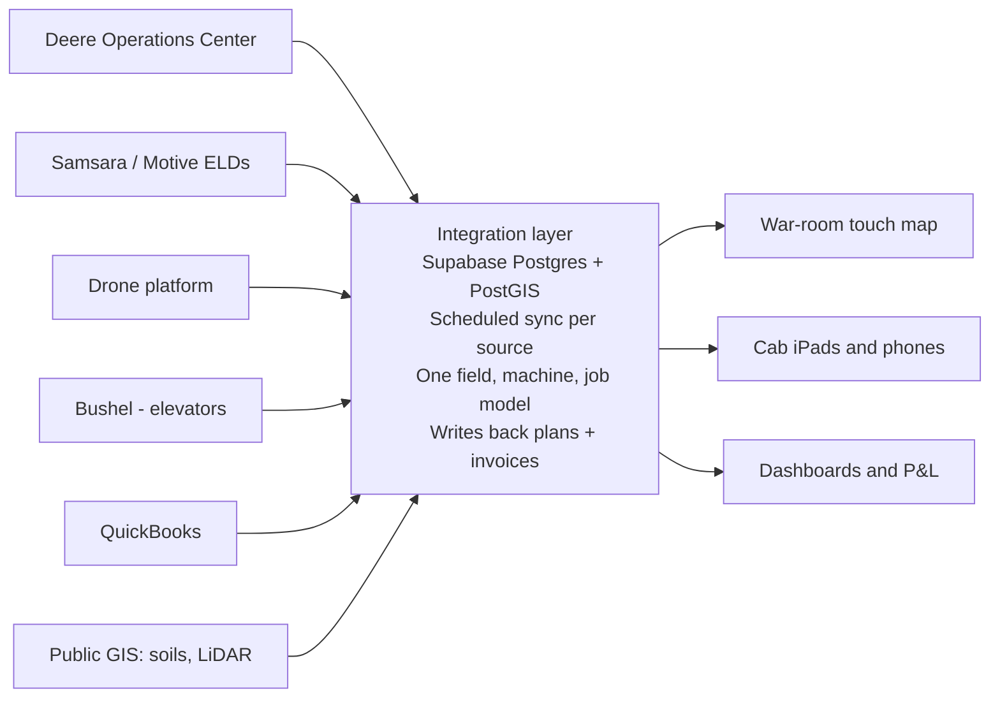

# Farm Ops Software Spec

Oct 28, 2026 · Derrick Hopson

## Build vs buy

Buy the systems of record and build one integration layer plus the war-room map on top. No single product today puts Deere machines, a truck fleet, spray drones, soils, LiDAR, custom-work billing and a team planning board on one screen.

| Piece | Buy or build | Why |
| --- | --- | --- |
| Machine data, field operations, work plans | Buy: John Deere Operations Center | Free with Deere equipment, holds the as-applied and yield record, has an API |
| Truck GPS, ELD logs, fuel | Buy: Samsara or Motive | ELDs are legally required for for-hire trucking; both expose APIs |
| Drone flight and spray logs | Buy: the drone maker's software (Hylio if US-made) | Comes with the aircraft; export spray logs to your system |
| Accounting | Buy: QuickBooks or Traction Ag | Taxes, payroll, 1099s; don't build this |
| Grain contracts and tickets | Buy: Bushel (through your elevators) | Elevators already push data there |
| Integration layer, war-room map, custom-work billing, decision dashboard | Build: Next.js + Supabase (PostGIS) | Nothing on the market joins all of the above; this is where your front-end skill pays off |

Deere's own Operations Center map is the closest thing to the war-room view and should be the fallback until yours is better. It shows Deere machines and fields, but not trucks, drones, LiDAR, landlords or billing.

## Architecture

Every outside system syncs into one Supabase database keyed on fields, machines and jobs, and every screen reads from that one place.

The stack is the one you already use: Next.js on Vercel, Supabase for Postgres with PostGIS, auth and realtime, and MapLibre GL with deck.gl for the map. Supabase Realtime pushes machine and truck positions to the board without page refreshes. Scheduled functions pull each source, and write-backs go out as Deere Work Plans and accounting invoices.

## War-room map

The centerpiece is a touch-first web app on a large display: every field, machine, truck and drone on one map, with today's jobs dragged onto fields and people. It runs in a browser in kiosk mode, so the same app works on phones in the field.

**Morning meeting mode** (one tap, 10-minute standup)

1. Weather strip: today and 3-day rain, wind gusts (spray go/no-go), soil temperature.
2. Job board: today's planned jobs by crew, each pinned to its field, color by status.
3. Fleet status: where every machine, truck and drone is, plus anything down for repair.
4. Grain snapshot: bushels in bins, bushels contracted, today's cash bid vs your breakeven.
5. Yesterday's actuals: acres planted, sprayed, harvested and loads hauled vs plan.

**Interactions**

- Tap a field: boundary, owner or landlord, soils, last 5 seasons of operations and yield, open jobs, notes.
- Drag a job card onto a field, then onto a person or machine to assign it; it pushes to Deere as a Work Plan where that applies.
- Layer toggles down one side: soils, elevation and drainage, imagery, tile maps, parcels, live fleet, custom-work customers.
- Time slider: replay a day's machine tracks, or flip through seasons on one field.
- Draw tools: mark wet holes, rock piles, tile blowouts and washouts as pins that persist and show on the operators' phones.
- Spray go/no-go per field: wind, inversion risk, rain-free hours, and buffer zones near sensitive neighbors such as organic farms, bees or houses.

## Map data layers

Most of the base layers are free public data, which is a big reason building pays off. Load them once into PostGIS and clip them per field.

| Layer | Source | Cost | What it answers |
| --- | --- | --- | --- |
| Soil types and productivity | USDA NRCS SSURGO via Soil Data Access (SQL/REST) | Free | Soil series, drainage class, productivity index per field zone |
| Elevation, slope, flow paths | USGS 3DEP lidar elevation | Free | Wet spots, where water runs, where tile would pay |
| Crop history on any field | USDA Cropland Data Layer (yearly crop type, back to 2008) | Free | What was grown on a field you want to rent or buy |
| Aerial photos | USDA NAIP (sub-meter, every 2 to 3 years) | Free | Base map, drainage scars, field edges |
| In-season crop health | Sentinel-2 satellite (10 m, every few days) | Free | NDVI to spot drown-outs, weeds and nitrogen problems |
| Parcels and owners | Lenawee and Monroe county GIS | Small fee or free | Who owns the ground: the landlord prospecting list |
| Rain and forecast | NOAA radar rainfall and the National Weather Service API | Free | Rain per field last night, and spray and field-work windows |
| Tile as-builts | Installer drawings and the Deere tile plow log | Your own | Where tile runs, for repairs and new laterals |
| Yield, as-applied, as-planted | Deere Operations Center | Free with equipment | Field and zone performance year over year |

The lidar and Cropland Data Layer combination is the land-scouting tool. It shows drainage problems and rotation history on a parcel before you ever talk to the owner.

## Fleet integrations

All three fleets can feed one map, but each needs its own connector and its own refresh cadence.

| Fleet | System | What you pull | Refresh |
| --- | --- | --- | --- |
| Deere machines | Operations Center API ([developer.deere.com](https://developer.deere.com)) | Fields and boundaries, field operations (planting, application, harvest), machine location and hours, work plans, flags, map layers | Every 1 to 5 minutes for location; event webhooks for completed operations |
| Trucks | Samsara or Motive API | GPS, hours-of-service, fuel, engine faults, geofence arrivals at elevators | Live (about 30 to 60 seconds) |
| Spray drones | Maker's platform (Hylio's software if US-made) | Flight paths, as-applied maps, gallons, acres | Upload after each flight |
| Grain loads | Bushel through the elevators | Scale tickets, moisture, dock, contract applied | On delivery |

**Deere API access.** Register an app on the developer portal and build against the sandbox, then apply for production access. Each organization, yours and every custom-work customer's, approves the connection once through Deere's sign-in.

**Drone caution.** DJI was put on the FCC Covered List, so new DJI models can't get US authorization. Already-authorized models are still legal, but parts and firmware support are uncertain ([DroneXL](https://dronexl.co/2026/03/10/state-us-ag-drones-trouble)). Hylio is the main US-made option at a much higher price. Commercial drone spraying also needs FAA Part 107 and a Part 137 agricultural aircraft operator certificate, a 44807 exemption for drones over 55 lb, and a Michigan commercial applicator license.

**Trucks.** Geofence each elevator and field entrance. The map can then count loads, time spent in line and haul cycle times on its own, with no driver input.

## Custom work: history and billing

Every acre you spray, plant or harvest for someone else is recorded by your own machines in your own Operations Center. That history builds automatically, field by field, from the first job.

**How the history accumulates**

- Set up each customer as a client and farm in Operations Center, with their field boundaries. Your machines then tag every job to the right field.
- Customers who run Operations Center can share their organization with you. You'd see their past yield and application maps, with their permission, through the same API.
- After a few seasons you hold multi-year operation and yield history on ground you don't own. That's the best lead list there is when a customer retires or sells.

**Job flow**

1. The customer requests a job by text, by phone, or through a simple web form.
2. The job card lands on the war-room board, pinned to the field, with product, rate and timing.
3. It's assigned to a machine and operator and pushed to the display as a Deere Work Plan.
4. The as-applied record comes back automatically: acres, product, time, and weather at application.
5. The invoice is generated from actual acres times rate, plus product if you supplied it, and sent to accounting.
6. The application record is stored for Michigan's commercial applicator record-keeping requirement.

**Data rights.** Put it in writing with each customer who owns the data from their fields and what you may use it for. It's their data; you keep a copy to run and bill the work.

## Other modules

These all share the same field and machine tables, so each one is a few screens rather than a new system.

| Module | What it does | Decision it drives |
| --- | --- | --- |
| Grain position | Bushels grown, in bins, contracted, priced vs breakeven, plus live bids | Sell, store or hold, and when |
| Bin monitoring | Temperature and moisture cables on a dashboard, with alerts | Run fans, sell before grain goes out of condition |
| Field P&L | Revenue minus inputs, machine cost and rent, per field per year | Keep, drop or renegotiate each rental; where to tile |
| Land and landlords | Parcels, owners, leases, rent due dates, renewal reminders | Who to call before a lease expires; the prospect list |
| Contact book | People by category, who introduced you, last and next touch | The relationship-building plan from the meetings and church |
| Maintenance | Hours from JDLink and the ELDs trigger service; repair cost per machine | Keep, trade or sell each machine |
| Crew and time | Who ran what, hours by job | Payroll, and labor cost per business line |
| Inventory | Seed, chemical and fertilizer on hand vs planned | Order early, avoid running out mid-season |
| Compliance | Applicator records, truck inspections, licenses and expirations | Stay audit-ready, no lapsed licenses |
| Business-line P&L | Grain, spraying, trucking and the farm store each as their own ledger | Which side business earns its keep |

The maintenance module is the equipment tracker idea you already have, pointed at JDLink and ELD engine hours instead of manual entry.

## Hardware

A commercial interactive display plus a small PC is the whole war room; budget roughly $5,000 to $10,000 (estimate, not quoted).

| Item | Spec | Note |
| --- | --- | --- |
| Main screen | 75 to 86 inch commercial interactive touch display, multi-touch, rated for all-day use | A consumer TV with a touch overlay works but feels laggy for map drag and pinch |
| Driver PC | Small form-factor PC running Chrome in kiosk mode | Easier to update than the display's built-in Android |
| Wall mount or rolling stand | Height-adjustable | Rolling lets it move between shop and office |
| Field devices | iPads in the cabs and trucks, phones for the crew | Same web app, with offline cache for spotty coverage |
| Network | Shop Wi-Fi plus a Starlink or cellular backup | The board is useless if the internet drops at 6 a.m. |

## Build plan and costs

Build it in four phases tied to the farm calendar, so each season gets a working tool rather than waiting on the whole system. Each phase is usable on its own before the next one starts.

1. **Phase 1: See it** (winter, before planting)
    - Fields, soils, lidar, crop history and parcels on the map
    - Live Deere machines and trucks, plus the weather strip
    - Read-only: Operations Center stays the system of record
    - *Gate: Deere production API access approved, truck ELDs installed*
2. **Phase 2: Plan it** (spring, planting and spraying)
    - Job board, drag-to-assign, Work Plans pushed to displays
    - Morning meeting mode and spray go/no-go per field
    - Pins for wet holes, rocks and tile problems
    - *Gate: the crew uses the board every day through planting*
3. **Phase 3: Bill it** (summer into harvest)
    - Custom-work invoices generated from as-applied acres
    - Grain position vs breakeven, bin monitoring, load counts
    - Maintenance driven by machine and truck hours
    - *Gate: one full season of clean job and cost data*
4. **Phase 4: Decide with it** (year 2)
    - Field P&L and P&L for each business line
    - Landlord and lease tracking, contact book
    - Drone logs, season replay, multi-year field history

**Running costs (estimates, verify before buying)**

- Deere Operations Center and API: free with Deere equipment for the core features.
- Truck telematics and ELDs: roughly $30 to $50 per truck per month.
- Supabase and Vercel: about $50 to $150 a month at this scale.
- Map tiles: MapLibre is free; Mapbox or satellite basemaps have a free tier, then usage-based pricing.
- Public data layers: free.
- Display hardware: about $5,000 to $10,000 once.

The real cost is your build time. Phase 1 is a winter project for one developer; Phases 2 and 3 run alongside the season.

**Sources**

- [John Deere developer portal](https://developer.deere.com)
- [DroneXL: the state of US ag drones (2026)](https://dronexl.co/2026/03/10/state-us-ag-drones-trouble)
